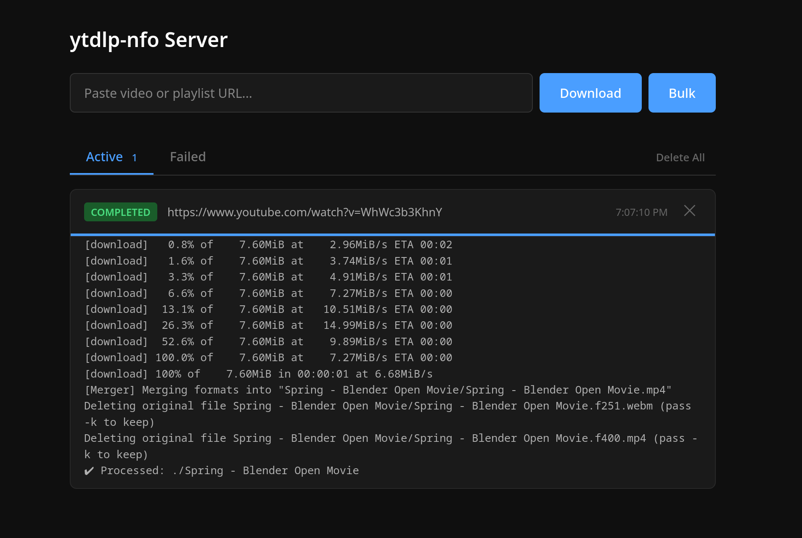

<!-- VERSION: LNA-DEV-README-TEMPLATE V1.3 -->

[![Contributors][contributors-shield]][contributors-url]
[![Forks][forks-shield]][forks-url]
[![Stargazers][stars-shield]][stars-url]
[![Issues][issues-shield]][issues-url]
[![MIT License][license-shield]][license-url]

<!-- PROJECT LOGO -->
<br />
<div align="center">
  <a href="https://github.com/lna-dev/ytdlp-nfo-server">
    
  </a>

### ytdlp-nfo-server

A self-hosted download server for [yt-dlp](https://github.com/yt-dlp/yt-dlp) that builds a Jellyfin/Kodi-ready library: one folder per video with the media, `movie.nfo`, `folder.jpg` and subtitles. It comes with a web UI, a browser add-on and an API.

<p align="center">

<br />

<a href="https://github.com/lna-dev/ytdlp-nfo-server"><strong>Explore the Project »</strong></a>
<br />
<br />
<a href="https://github.com/lna-dev/ytdlp-nfo-server/issues">Report Bug</a>
·
<a href="https://github.com/lna-dev/ytdlp-nfo-server/issues">Request Feature</a>

  </p>
</div>



## Features

- **Library-safe downloads**: an item only appears in the library after it was downloaded, verified with `ffprobe` and fsynced; it is moved in with a single atomic rename. Nothing in the library is overwritten by a different video.
- **Per-item tracking**: a playlist job has one item per video, each with its own state, retries and log. A failed video never affects the ones that already finished.
- **Subscriptions**: watch channels (with a choice of tabs) and playlists. New videos are downloaded automatically or land in an inbox to pick from; existing videos are only downloaded if asked. Checks are cheap and gentle on sites, and automatic downloads always give way to the ones you start by hand.
- **Reddit** (in testing): images, GIFs, galleries and videos from posts, subreddits and user profiles, without a Reddit account, plus the YouTube, Redgifs, Streamable and Imgur links in them. Pages are read like a logged-out browser does, with Arctic Shift as a fallback; crossposts and identical re-uploads are downloaded only once.
- **Smart retries**: errors are classified (permanent, blocked, rate-limited, extractor broken, crash, transient). Permanent errors are not retried, backoff is capped at 15 minutes, and every failed attempt is explained in the log.
- **yt-dlp version manager**: choose stable, nightly or master and a specific version in the UI, with SHA-256 verification, smoke test, auto-update and one-click rollback. Verified builds are bundled in the image, so it works offline on first start.
- **Impersonation** (`curl_cffi`) per job, per site rule, and as an automatic one-time escalation when a site blocks access.
- **Site rules** (impersonation, cookies, quality preset, concurrency, rate limit) and **cookie profiles**.
- **Web UI** with Active, Queued, Completed and Failed tabs, live progress over one event stream, item details, live logs, settings and diagnostics.
- **Extras**: thumbnails (detected by content, frame fallback), subtitles (live chat excluded), optional chapters, SponsorBlock chapters and embedded subtitles.
- **Integrations**: Jellyfin library refresh, notifications (webhook, ntfy, Gotify, Discord), several named libraries.
- **Security**: session cookies instead of passwords in URLs, revocable API tokens, login rate limiting, optional trusted proxy header.
- SQLite persistence (CGO-free), per-job log files, `PUID`/`PGID`, multi-arch image (`linux/amd64`, `linux/arm64`).

## Usage

### Docker Compose

```yaml
services:
  ytdlp-nfo-server:
    image: ghcr.io/lna-dev/ytdlp-nfo-server:latest
    ports:
      - "8080:8080"
    volumes:
      - ./downloads:/downloads   # work files and the shared .ytdlp-archive.txt
      - ./data:/data             # database, logs, cookies, installed yt-dlp versions
      - /path/to/media:/media    # the library
    environment:
      - OUTPUT_DIR=/media
      - PASSWORD=changeme
      - PUID=1000
      - PGID=1000
    restart: unless-stopped
```

```bash
docker compose up -d
```

Open `http://localhost:8080`. Put `/downloads` and the library on the same filesystem if you can: finalizing is then a rename instead of a copy.

### Environment variables

| Variable | Default | Description |
| --- | --- | --- |
| `PORT` | `8080` | HTTP port |
| `DATA_DIR` | `/data` | Database, job logs, cookie profiles, installed yt-dlp versions. Without it the server keeps everything in memory. |
| `DOWNLOAD_DIR` | `/downloads` | Work directories (`.work/`) and the shared `.ytdlp-archive.txt` |
| `OUTPUT_DIR` | *(empty)* | Library root. If empty, items are finalized into `DOWNLOAD_DIR`. |
| `PASSWORD` | *(empty)* | Protects the UI and API. If set, it cannot be changed in the UI. |
| `MAX_CONCURRENT` | `3` | Parallel jobs. Locks the setting in the UI when set. |
| `MAX_RETRIES` | `3` | Retries for transient errors. Locks the setting in the UI when set. |
| `YTDLP_CHANNEL` | *(empty)* | `stable`, `nightly` or `master`. Overrides and locks the channel. |
| `PUID`, `PGID`, `UMASK` | `0`, `0`, *(unchanged)* | Run as this user/group so library files get the right owner |
| `LIBRARIES` | *(empty)* | Additional libraries, e.g. `Kids=/media/kids;Courses=/media/courses` |
| `JELLYFIN_URL`, `JELLYFIN_API_KEY` | *(empty)* | Refresh Jellyfin after each finished item (can also be set in the UI) |
| `GITHUB_TOKEN` | *(empty)* | Optional, raises the GitHub API rate limit for listing yt-dlp releases |
| `TRUSTED_PROXY_AUTH_HEADER` | *(empty)* | Treat requests with this header (e.g. `Remote-User` from Authelia/Authentik) as authenticated. Only use it behind a proxy that sets and strips the header. |
| `YTDLP_PATH` | *(empty)* | Use this yt-dlp binary instead of the version manager |
| `FFMPEG_PATH`, `FFPROBE_PATH`, `DENO_PATH` | from `PATH` | External tools |

### Library layout

New installs use `Title [id]/Title [id].ext`, which never collides. Installs upgraded from v1 keep the v1 layout (`Title/Title.ext`, plus a playlist folder); a *different* video with the same title then gets `Title (2)`. You can switch the layout or define your own template in **Settings → Naming**; existing folders are never renamed.

```
Playlist title/                     (only for playlists)
  Title [id]/
    Title [id].mkv
    Title [id].en.vtt
    folder.jpg
    movie.nfo
```

### Upgrading from v1

On the first start the server imports `DATA_DIR/jobs.json` (finished jobs become history, unfinished ones are queued again) and `DOWNLOAD_DIR/.ytdlp-archive.txt`. Backups of both files are kept next to them (`jobs.json.v1-backup`, `DATA_DIR/ytdlp-archive.v1-backup.txt`). The archive file keeps being updated, so the `ytdlp-nfo` CLI and other tools can still share it.

v1 could record a video in the archive and then delete it together with a partly failed playlist. After upgrading, open **Archive → Check library**: it compares every archive entry with the library folders (`movie.nfo` and media file) and lists entries whose video is missing or incomplete. Selected entries can be removed from the archive and, where the URL is known, downloaded again. Library files are never changed.

The image no longer installs anything at start: drop the `pip-cache` volume and the old `entrypoint.sh` customisations. Python and `ytdlp-nfo` are not needed anymore.

### yt-dlp versions

**Settings → yt-dlp** lists the releases of each channel. Installing downloads the official standalone build, verifies its SHA-256 against the release's `SHA2-256SUMS`, and runs a smoke test (`--version`, `--list-impersonate-targets` and optionally a simulated download). A version that fails the smoke test cannot be activated. Switching versions never affects running downloads.

Auto-update can be set per channel (`off`, `notify`, `auto`); `auto` installs and activates a new version of the active channel only if its smoke test passes. New installs use **nightly** (recommended by yt-dlp), upgraded installs keep their channel. The image bundles verified stable and nightly builds from build time.

When a site's support breaks in the active version, the server retries once with the latest nightly. Failed jobs also offer **Retry with latest nightly**.

### Errors and retries

| Class | Examples | Behaviour |
| --- | --- | --- |
| `permanent` | private, removed, DRM, geo-blocked, unsupported URL, rejected file extension | failed at once |
| `auth_required` | login, age check, members-only, "confirm you're not a bot" | failed; retry with a cookie profile |
| `blocked` | HTTP 403, anti-bot challenge | one retry with impersonation |
| `rate_limited` | HTTP 429 | site cooldown (default 30 min), then retry |
| `extractor_broken` | "Unable to extract …" | one retry with the latest nightly |
| `crash` | Python traceback, killed | at most one retry |
| `transient` | network errors, 5xx, failed verification | backoff `30 s × 2ⁿ`, max 15 min, up to `MAX_RETRIES` |

A thumbnail or subtitle problem never fails a video; the item completes with a warning and can be repaired with **Re-run extras**.

### Subscriptions

**Subscriptions → + Add subscription** previews a channel, playlist or video page (a video subscribes to its channel) and lets you choose the tabs (Videos, Shorts, Live), the library and folder, the mode and what happens with the videos that already exist:

- **Manual** (default): new videos land in the inbox (the **Feed** tab and the badge in the navigation); download or ignore them one by one or in bulk.
- **All new videos**: every check queues the new videos as one job, oldest first. More than 25 new videos at once (a changed URL, a broken listing) are listed for review instead.
- Existing videos (the **backlog**) are not downloaded unless you choose *latest N* or *all*, now or later with **Download backlog…**.

Subscriptions are checked every 6 hours by default (15 minutes to 7 days per subscription); for exact times, call `POST /api/v1/subscriptions/check` from a cron job. Checks list only the newest 50 videos of a channel tab, run one at a time per site and respect rate limits. Each subscription has its own folder in the library (its name by default); filters by duration, title and date keep the inbox clean. Downloads of new videos and backlogs run in the background and give way to downloads you start by hand. Subscriptions can be imported from a URL list, OPML or the CSV of a YouTube subscriptions export, and exported as a URL list or OPML. See [`docs/subscriptions-concept.md`](docs/subscriptions-concept.md) for the details.

### Reddit

Paste a post, share link, subreddit or user URL as a download, or subscribe to a subreddit or user like to a channel. Posts are listed and fetched by two providers, tried in order (**Settings → Reddit**):

- **native** reads the pages Reddit shows a logged-out browser, with a browser's TLS and HTTP/2 fingerprint and headers; NSFW posts are read through the blur.
- **Arctic Shift** is a third-party archive (no guarantees; it sees which subreddits and posts the server asks for). It answers when native is blocked and fills gaps when more posts appeared between two checks than native can list.

Reddit shows logged-out visitors a JavaScript check instead of the page. **Answer Reddit's JavaScript check** (on by default) runs the check's script in a sandbox: an embedded JavaScript engine in a child process, without network or file access, with time and memory limits. It still runs code from Reddit on your server, and Reddit's terms don't allow automated access. Turned off, native pauses for 30 minutes whenever it meets the check, and Arctic Shift answers. **Reset Reddit session** forgets Reddit's cookies and ends such a pause.

Besides new posts, a subscription can follow a **top list** (paste e.g. `https://www.reddit.com/r/<name>/top/?t=week`): every check takes the top N of that period (default 10, **Settings → Reddit**), and only native can rank, so it doesn't fall back to Arctic Shift. **Load older posts…** in a subscription's menu adds older posts to its backlog once: the top N of a period, everything in a time range, or the top N of a time range, counted per year first. A range loads at most *Posts per gap fill or older-posts run* at a time; *Continue* loads more. A pasted top, hot, rising or controversial URL downloads that list in its order.

Link posts to YouTube, Redgifs, Streamable and Imgur (more sites in **Settings → Reddit**) are downloaded from the site they link to, in a job of their own with that site's rule, and a video already in the library is not downloaded again; other link posts are left out.

Images keep their type (`.jpg`, `.png`, `.gif`, …) and are checked by their content; galleries become `Title [id] - 01.jpg`, `- 02.jpg`, … in one folder; videos get `movie.nfo` and `folder.jpg` like any video. Every file gets the post time as its date. A hidden `.ytdlp-nfo.json` in each folder lists the files, so a re-download replaces the folder and **Archive → Check library** finds image folders. Crossposts, posts already in the library under another subscription and identical re-uploads are skipped; a gallery that partly exists stores only its new images. Resized or recompressed reposts get a warning ("Looks like …") or, if you choose, are skipped as well. Use a Jellyfin library of the type *Home videos and photos*: movie libraries don't show images.

`ytdlp-nfo-server reddit-probe <subreddit or post URL>` shows what each provider gets from your network (statuses, JavaScript checks, block pages, parsed posts, media reachability); `--solve` answers the JavaScript check like the setting, and `--fixtures DIR` saves the pages anonymized for bug reports. See [`docs/reddit-concept.md`](docs/reddit-concept.md).

### Browser add-on

The add-on in [`browser-addon/`](browser-addon/) sends the current tab, or any link via the context menu, to the server, and **Subscribe** subscribes to the channel or playlist of the page (manual mode, no backlog). Create an API token in **Settings → Security** and enter it in the add-on settings (the server password still works but is deprecated). The add-on also works with v1 servers.

### API

The UI uses `/api/v1` (jobs, events, settings, versions, sites, cookies, tokens, archive, system, subscriptions, feed); see [`docs/overhaul-concept.md`](docs/overhaul-concept.md#9-api) and [`docs/subscriptions-concept.md`](docs/subscriptions-concept.md#8-api). Authenticate with `Authorization: Bearer <api token>`. The v1 routes (`POST /api/download`, `GET /api/jobs`, …) remain available. `GET /healthz` needs no authentication.

```bash
curl -X POST http://localhost:8080/api/v1/jobs \
  -H "Authorization: Bearer ytn_…" -H "Content-Type: application/json" \
  -d '{"url": "https://example.com/watch?v=…", "options": {"preset": "compatible"}}'

# Check all subscriptions now (e.g. from cron)
curl -X POST http://localhost:8080/api/v1/subscriptions/check -H "Authorization: Bearer ytn_…"
```

## Development

```bash
cd server
go build
go vet ./...
go test -race ./...
docker build -t ytdlp-nfo-server .
```

The tests use a fake yt-dlp (`internal/testutil/fakeytdlp`) driven by scenario files, so they run without network access. `integrity_test.go` builds the server, kills it with `SIGKILL` at every pipeline step and checks that the library and archive stay consistent.

## License

MIT

<!-- MARKDOWN LINKS & IMAGES -->

[contributors-shield]: https://img.shields.io/github/contributors/lna-dev/ytdlp-nfo-server.svg?style=for-the-badge
[contributors-url]: https://github.com/lna-dev/ytdlp-nfo-server/graphs/contributors
[forks-shield]: https://img.shields.io/github/forks/lna-dev/ytdlp-nfo-server.svg?style=for-the-badge
[forks-url]: https://github.com/lna-dev/ytdlp-nfo-server/network/members
[stars-shield]: https://img.shields.io/github/stars/lna-dev/ytdlp-nfo-server.svg?style=for-the-badge
[stars-url]: https://github.com/lna-dev/ytdlp-nfo-server/stargazers
[issues-shield]: https://img.shields.io/github/issues/lna-dev/ytdlp-nfo-server.svg?style=for-the-badge
[issues-url]: https://github.com/lna-dev/ytdlp-nfo-server/issues
[license-shield]: https://img.shields.io/github/license/lna-dev/ytdlp-nfo-server.svg?style=for-the-badge
[license-url]: https://github.com/lna-dev/ytdlp-nfo-server/blob/master/LICENSE
