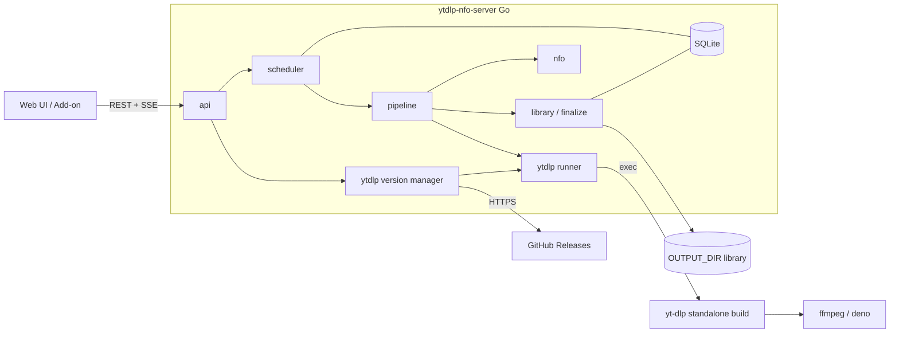
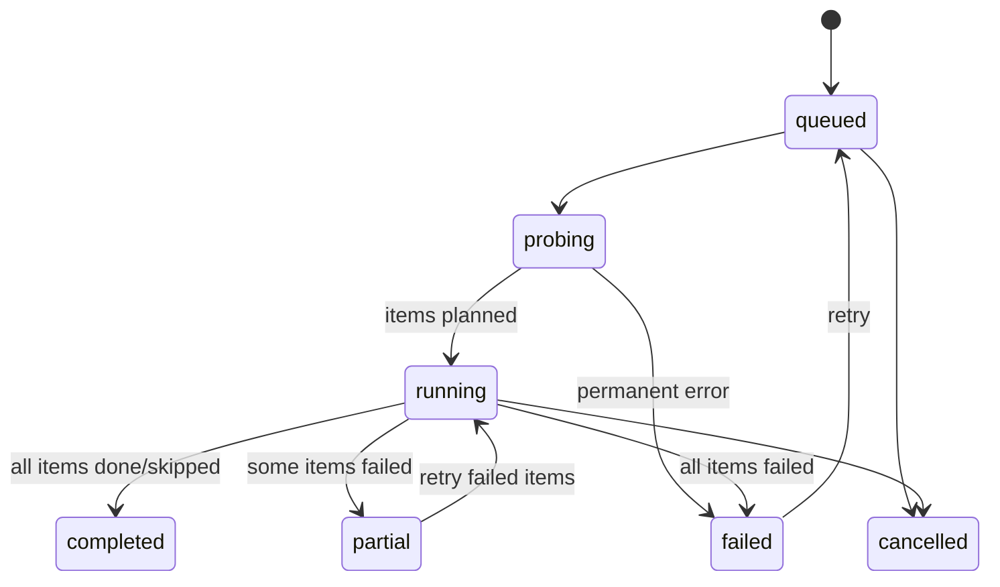

# ytdlp-nfo-server Overhaul Concept

> Status: **Draft, decisions recorded** ([§16](#16-decisions)) · 2026-10-14
> Scope: server, web UI, Docker image, browser add-on

## 1. Summary

The server currently shells out to the external Python tool [`ytdlp-nfo`](https://github.com/LNA-DEV/ytdlp-nfo), which is installed from Git on every container start. All download logic (format selection, NFO writing, thumbnails, archive) lives there and is invisible to the server. The server only sees an exit code and a directory full of files. That split causes most of the current bugs (see [§3](#3-current-state-and-findings)) and blocks the requested features.

**Core decisions**

| # | Decision |
|---|----------|
| D1 | **Port the `ytdlp-nfo` logic to Go** in this repo. The server calls the `yt-dlp` CLI directly and handles probing, format selection, NFO, thumbnails, archive and the final move itself. `ytdlp-nfo` is no longer a runtime dependency. |
| D2 | **Use the official standalone yt-dlp builds** (`yt-dlp_linux[_aarch64]`, preferably the unpacked `.zip` variant). They bundle Python, `curl_cffi` (impersonation) and `yt-dlp-ejs` (YouTube). The image no longer needs Python, pip or Git. |
| D3 | **Built-in yt-dlp version manager**: pick a channel (stable / nightly / master) and a specific version in the UI, with SHA-256 verification, a smoke test, instant switching and rollback. |
| D4 | **Impersonation as a first-class option**: per job, per site rule, and as an automatic escalation when yt-dlp reports an anti-bot block. |
| D5 | **Track work per item, not per job.** A playlist job has N items, and each item has its own status, retries, log and final path. |
| D6 | **Write the archive only after finalization.** The archive means "this file is in the library", not "yt-dlp finished it". |
| D7 | **Use SQLite (`modernc.org/sqlite`, CGO-free)** instead of `jobs.json`, with per-job log files. |
| D8 | **New UI**: tabs **Active · Queued · Completed · Failed**, one global event stream, a settings page and a diagnostics page. |
| D9 | **Fail fast on deterministic errors; extras are best-effort.** Errors are classified, permanent ones are never retried automatically, backoff is capped, and every failure reason goes into the log. A broken thumbnail or subtitle produces a warning; the video still completes. |

**Is the port feasible?** Yes. `ytdlp-nfo` is about 320 lines of Python, and the server already contains the harder parts (queue, retries, persistence, atomic moves). The port is mostly yt-dlp command-line plumbing plus about 150 lines of NFO and format-selection code.

## 2. Goals and non-goals

**Goals**

1. Keep file integrity as the top priority: nothing incomplete or unverified ever appears in the output directory, and nothing in the library is overwritten or lost unintentionally.
2. Choose the yt-dlp version in the UI (stable / nightly / master, specific tags) and roll back.
3. Make impersonation work.
4. Show completed downloads in their own tab, and keep their history and logs.
5. Ship one self-contained, reproducible Docker image with no network installs at startup.
6. Keep the existing API, the browser add-on and existing libraries/archives working.

**Non-goals for this overhaul** (see [§13](#13-additional-improvements)): channel subscriptions, an audio-only/music library mode, a multi-user system, and a SPA build toolchain.

## 3. Current state and findings

```
Browser ──HTTP/SSE──▶ Go server ──exec──▶ ytdlp-nfo (Python) ──import──▶ yt_dlp ──▶ ffmpeg
                         │                       │
                         │                       └─ writes into downloadDir/{jobID}/ ,
                         │                          appends .ytdlp-archive.txt (symlink)
                         └─ waits for exit code, scans dir, copies to OUTPUT_DIR
```

A review of both repositories found these problems. Severity is rated against the project's integrity-first priority.

| # | Sev. | Finding | Where |
|---|------|---------|-------|
| F1 | **High** | **A partly failed playlist loses data.** `ytdlp-nfo` exits 1 when any item fails. The server retries the whole job, then on the last attempt runs `os.RemoveAll(jobDir)`. That deletes all successfully downloaded items, which are already recorded in the archive, so they are never downloaded again. | `server/download.go:517`, `ytdlp-nfo/main.py:313-315` |
| F2 | **High** | **Already-archived videos end up as failed jobs.** `ytdlp-nfo` prints *"All items already in archive"* and exits 0. The server finds no new files, treats that as the error *"produced no files"* and retries. That reason only goes into the job's error field, so the log shows a success message followed by a retry banner. With `MAX_RETRIES=10` this loop takes about 27 h (F15) before the job is marked failed. | `server/download.go:461-467`, `main.py:310-312` |
| F3 | **High** | **The library can be silently overwritten.** `mergeMove` runs `os.RemoveAll(dst)` before `os.Rename`, so two different videos with the same title replace each other. A failure between the two calls leaves neither file. | `server/download.go:779-780` |
| F4 | Med | **No fsync before rename.** Staged copies are renamed into the library without `fsync` on the file or directory, so a power loss can leave empty or truncated files that look complete. | `server/download.go:678`, `copyFile` |
| F5 | Med | **Impersonation cannot work.** (a) The image installs `yt-dlp` without the `curl-cffi` extra, so no targets are available. (b) The server can only pass URL + 3 env vars to `ytdlp-nfo`, so there is no way to request impersonation. (c) Some extractors request impersonation on their own. Without `curl_cffi`, yt-dlp only logs *"The extractor is attempting impersonation, but no impersonate target is available"* and continues with a plain HTTP client, which nobody notices. | `server/Dockerfile:18`, `server/download.go:612-619` |
| F6 | Med | **`/etc/yt-dlp.conf` is never read.** The network-retry settings from commit `0f78bed` have no effect: the yt-dlp *Python API* (`YoutubeDL(...)`) never loads config files, so the conf is dead code. | `server/Dockerfile:10-16` |
| F7 | Med | **YouTube support is degraded.** Current yt-dlp needs `yt-dlp-ejs` and a JS runtime (deno) for full YouTube support. The image has neither. | `server/Dockerfile` |
| F8 | Med | **The concurrency counter goes negative.** `DeleteAllJobs` sets `running = 0` while download goroutines are still alive. Each of them later calls `running--`, so the concurrency limit stops working. | `server/download.go:399`, `:408` |
| F9 | Med | **Killing a job leaves orphan processes.** `exec.CommandContext` SIGKILLs only the Python process, so ffmpeg children can keep writing. `DeleteJob` removes the directory right after cancelling, without waiting. There is no init process in the container, so zombies are not reaped. | `server/download.go:367-374`, `:612` |
| F10 | Med | **The UI gets stuck on "queued".** Jobs that are queued when submitted never get an event stream, so they show "queued" until the page is reloaded. After a reload, the UI opens one `EventSource` per queued job, which exceeds the browser's 6-connections-per-host limit on HTTP/1.1 after a bulk import and stalls the page. | `static/app.js:209`, `:576`, `:686` |
| F11 | Low | **Completed jobs share the Active tab.** | `static/app.js:314-331` |
| F12 | Low | **Logs of finished and failed jobs are lost on restart** because they are not persisted. That makes failed jobs hard to debug. | `server/persist.go:36` |
| F13 | Low | **The password is the bearer token.** It is stored in `sessionStorage` and sent as `?token=` for SSE, so it ends up in reverse-proxy access logs. There is no login rate limit. | `static/app.js:42`, `:343`, `main.go:41` |
| F14 | Low | **Container start is slow and non-reproducible.** It runs unpinned network installs (`pip install -U …`, `git+https://…ytdlp-nfo.git` from `main`), and `\|\| true` hides failures. | `server/entrypoint.sh` |
| F15 | Med | **Deterministic errors are retried for more than a day.** Every failed run is retried with an uncapped backoff of `10 s × 3^(n-1)`. With `MAX_RETRIES=10` the waits are 10 s, 30 s, 1.5 min, 4.5 min, 13.5 min, 40.5 min, 2 h, 6 h and 18 h, about 27 h in total, before a job that can never succeed is marked failed. The same loop applies to private, removed, DRM-protected and geo-blocked videos, rejected file extensions (F21) and archive skips (F2), and each attempt repeats the whole playlist. | `server/download.go:503-570` |
| F16 | Low | **Each video is extracted 2–3 times** in all-audio mode (playlist pass, per-entry pass, download pass), which is slow and invites rate limits. | `main.py:234-287` |
| F17 | Low | **Folder naming is inconsistent.** It depends on the "All Audio" flag: `make_safe_name` strips characters, while yt-dlp's sanitizer substitutes full-width characters. Raw titles are also injected into `outtmpl`, so a title containing `%(` would be interpreted as template syntax. | `main.py:12`, `:211`, `:285` |
| F18 | Low | **Subtitle selection includes live chat.** `subtitleslangs: ["all"]` also downloads YouTube `live_chat` (large JSON) for livestream recordings. | `main.py:225` |
| F19 | Low | **NFO edge cases.** Runtime is `0` for videos under 30 s. Control characters in descriptions are written unescaped, which produces invalid XML that Jellyfin fails to parse. | `main.py:105`, `create_nfo_from_json` |
| F20 | Low | **Files are owned by root** in the output directory (no `PUID`/`PGID`). Duplicate detection compares exact URL strings only (`youtu.be/x` ≠ `youtube.com/watch?v=x`). | `server/download.go:185-192` |
| F21 | Med | **A bad thumbnail fails the whole video.** `ytdlp-nfo` always enables `writethumbnail`, and yt-dlp writes thumbnails *before* it downloads the media. yt-dlp derives the thumbnail's file extension from its URL. Some CDNs append a version suffix (`….v<timestamp>`), so the "extension" becomes `v<timestamp>`. yt-dlp's extension allowlist (the CVE-2024-38519 hardening) rejects it with *"The extracted extension (…) is unusual and will be skipped for safety reasons"*, which aborts the item. In the observed failures the error appears after the subtitle step and before any media download, which is exactly the thumbnail stage. The error is deterministic, so every retry fails the same way. | `main.py:214-215` |
| F22 | Low | **Failure reasons are missing from the log.** Errors raised by the server itself, such as *"produced no files"* or the exit status, only go to the job's error field. The retry banner does not say why the attempt failed. | `server/download.go:465`, `:540` |
| F23 | Med | **The deployed `ytdlp-nfo` is not the code in the repo, and nobody can tell.** When metadata extraction fails (for example with HTTP 403), `extract_info(..., ignoreerrors=True)` returns `None`. The published code then crashes with `TypeError: argument of type 'NoneType' is not iterable`, which hides the real error, and the crash is retried like a transient failure. A guard for this exists, but only as an uncommitted change in the local `ytdlp-nfo` working tree. Containers install `main` from GitHub at start. Every commit carries the same package version (`1.0.0`), so neither pip nor `--version` shows which code is actually running. | `ytdlp-nfo/main.py:242` (published), `setup.py:8`, `server/entrypoint.sh:14` |

`main.py` line numbers refer to the local `ytdlp-nfo` working tree, including its uncommitted 5-line change (F23).

Most High and Medium findings disappear structurally with D1, D5, D6 and D9, rather than being patched one by one.

## 4. Target architecture

### 4.1 Overview



### 4.2 Package layout

```
server/
  main.go                    wiring, config, signal handling
  internal/config/           env vars + runtime settings
  internal/store/            SQLite schema, migrations, import of jobs.json / archive.txt
  internal/scheduler/        queue, global + per-site slots, retries/backoff, cancellation
  internal/pipeline/         probe → plan → fetch meta → download → verify → extras → NFO → finalize
  internal/ytdlp/            command builder, output/progress parser, error classifier
  internal/artwork/          thumbnail fetch, content sniffing, JPEG conversion, frame fallback
  internal/ytdlp/versions/   channel listing, install, verify, activate, GC
  internal/formats/          format selection (port of discover_audio_formats)
  internal/nfo/              NFO writer (port of create_nfo_from_json)
  internal/library/          naming, sanitizing, staging, atomic finalize, archive
  internal/api/              handlers, auth/sessions, SSE hub, legacy routes
  internal/procutil/         process groups, graceful kill
  web/                       embedded static UI (ES modules, no build step)
```

### 4.3 Job and item model

A **job** is one user submission (a URL plus options). Probing a job produces one or more **items**, one per video.



Item states: `pending → fetching_meta → downloading → verifying → extras → finalizing → done`. Terminal alternatives are `skipped` (already in archive) and `failed`, which carries an error class (see [§4.7](#47-failure-handling-and-retries)).

- Retries are **per item** (F1, F15). A failed item never affects completed siblings.
- **`skipped` is a success outcome, not an error.** It is logged as *"Already in library"*, counts toward `completed`, and is never retried. A job whose items are all skipped is `completed` and shown as *"All 12 items already in library"* (F2).
- **`done` can carry warnings**, for example a missing thumbnail or a missing subtitle language (see [§4.8](#48-extras-thumbnails-and-subtitles)). Warnings never turn an item into `failed`.
- **The log explains every transition.** Each failed attempt, each retry decision and each warning is written to the job log with its reason and error class, not only to an error field (F22).
- **Every job log starts with a version header**: server version and commit, yt-dlp version and channel, ffmpeg and deno versions, impersonation availability, and the effective options. It is always clear which code produced a result (F23).

### 4.4 Pipeline

| Step | What happens | yt-dlp call |
|------|--------------|-------------|
| **Probe** | Detect single video vs playlist, enumerate entries (nested playlists flattened in Go), take `extractor_key` + `id` per entry. For a single video, the probe result *is* the full metadata, so the video is extracted only once. | `yt-dlp --flat-playlist -J -- <url>` |
| **Plan** | Create items. Look up the archive by `"<extractor_key> <id>"` and mark matches `skipped` (unless *force re-download*). Detect duplicates across active jobs by the same key (F20). | – |
| **Fetch meta** | Just-in-time per item, so signed format URLs don't expire while queued. Write `info.json` into the item's work directory. | `yt-dlp --no-playlist -J -- <entry_url>` |
| **Select formats** | Go port of `discover_audio_formats` plus quality presets (see [§5.2](#52-format-selection)). | – |
| **Download** | **Media only.** Thumbnails and subtitles are not requested in this call, so a problem with them cannot abort the media download (F21). Uses the stored `info.json`, so there is no re-extraction (F16). Writes `media.<ext>` into an **isolated per-item work dir** and reports structured progress via a progress template. If a media URL returns 403, re-extract once and retry. | `yt-dlp --load-info-json …` (see [Appendix A](#appendix-a-yt-dlp-invocation-sketch)) |
| **Verify** | Run `ffprobe` on the media file: it must be parseable, have duration > 0, contain a video stream (unless audio-only), and have the expected number of audio streams. A failure makes the item `failed` (class `transient`). It is never finalized. | `ffprobe` |
| **Extras** | **Best-effort**: thumbnail → `folder.jpg` (fetched by the server) and subtitles (separate yt-dlp call). A failure becomes an item warning, never an item failure (see [§4.8](#48-extras-thumbnails-and-subtitles)). | `yt-dlp --skip-download --write-subs …` |
| **NFO** | Write the NFO from `info.json`. This step is **required**, because it is local and deterministic. A failure here is a bug or a disk problem and fails the item. | – |
| **Finalize** | Atomic move into the library, then the archive record (see [§4.5](#45-file-integrity-design)). | – |

Items within a job run **sequentially**. Jobs run in parallel up to `MAX_CONCURRENT`, plus optional **per-site limits** (for example max 1 concurrent YouTube job), so behaviour stays predictable and gentle on rate limits.

### 4.5 File integrity design

**Invariants**

1. Nothing appears in `OUTPUT_DIR` before its item has passed **verify**.
2. Every library item appears through **one atomic `rename(2)` of a fully written, fsynced directory**.
3. Existing library content is never deleted before its replacement is in place.
4. An archive entry exists **if and only if** the item was finalized (D6).
5. Every step is **idempotent and resumable** after a crash or `kill -9`.

**Finalize algorithm**

1. Render the final relative path from the naming template (Go-side, see [§5.4](#54-naming)).
2. Build the item folder in `OUTPUT_DIR/.staging/<item-uid>/`. Use `rename` if the work dir is on the same filesystem, otherwise copy, then `fsync` each file and the directory. Write a `.staged` marker last.
3. If the target folder does **not** exist: `rename(staging → target)`, then `fsync(parent)`.
   If it **does** exist (only possible for the same video, because the id is in the name, or on *force re-download*): `rename(target → .trash/<uid>)`, then `rename(staging → target)`, then delete the trash. There is never a moment with neither version present.
4. In one DB transaction: record the archive entry, set the item to `done`, and store the final path. Also append to the legacy `.ytdlp-archive.txt` for compatibility.
5. Remove the work dir.

**Crash recovery at startup**

- `downloading`: back to `pending`. Keep the work dir; yt-dlp resumes `.part` files.
- `finalizing`: re-run finalize from the first incomplete step. A `.staged` marker shows that the copy is complete; without it the staging dir is rebuilt.
- Leftover `.staging/` or `.trash/` entries without a DB reference: log them and remove them.

**Process handling (F9)**

Start yt-dlp in its own process group (`Setpgid`). Cancel with `SIGINT` to the group, `cmd.WaitDelay` 15 s, then `SIGKILL` to the group. Delete the work dir only after `Wait()` returns. In the container, run `tini` as PID 1.

**Disk space**

Before starting an item, require `free > estimated size × 2.2` (download + merge) in the work dir and the estimated size in the output dir when they are on different filesystems. Otherwise pause the queue and show a banner.

### 4.6 Archive

- The archive is a SQLite table `archive(key, extractor, video_id, path, job_id, finalized_at)`. The key format equals yt-dlp's (`"youtube dQw4w9WgXcQ"`).
- On first start, the existing `DOWNLOAD_DIR/.ytdlp-archive.txt` is **imported**. The file keeps being appended to, so the `ytdlp-nfo` CLI and other tools can still share it.
- yt-dlp's own `--download-archive` is **no longer used**. The server checks before downloading and records after finalizing.
- UI: search the archive and remove an entry (to allow re-downloading). The API supports import and export.

### 4.7 Failure handling and retries

There are two levels of retries:

1. **Inside yt-dlp**, for short network hiccups. Every call passes explicit flags: `--retries 10 --fragment-retries 10 --extractor-retries 5 --socket-timeout 30 --retry-sleep http:exp=1:30 --retry-sleep fragment:exp=1:30 --abort-on-unavailable-fragments`. This replaces the dead `/etc/yt-dlp.conf` (F6). The last flag keeps today's "never accept missing fragments" behaviour.
2. **In the scheduler**, per item. The server only retries when a classified error says retrying can help.

**Error classification**

`internal/ytdlp` classifies every failed attempt from its `ERROR:` lines, warnings, exit status and HTTP status codes. Specific patterns are matched before generic ones. For example, the extension-allowlist message also contains yt-dlp's generic "please report this issue" text, but it must not be classified as `extractor_broken`.

| Class | Typical signals | Automatic behaviour | Hint shown in the UI |
|---|---|---|---|
| `permanent` | Video private, removed or unavailable; DRM; unsupported URL; geo-restricted; no downloadable formats; **file extension rejected by yt-dlp's safety allowlist** | Fail immediately, no retries | The concrete reason. For a rejected media extension: "try a newer yt-dlp version" |
| `extractor_broken` | "Unable to extract …", parser errors, yt-dlp asking to update or report a bug | No retry with the same yt-dlp version. **One** automatic retry with the newest nightly (installed on demand). On by default, can be disabled in settings | "Site support may be broken in this yt-dlp version". Action: *Retry with latest nightly* |
| `auth_required` | Login or age verification required, members-only, "confirm you're not a bot" | Fail, no retries | "Needs cookies". Action: *Retry with cookie profile…* |
| `blocked` | HTTP 403 on page or API requests, bot challenge pages | **One** retry with impersonation (`--impersonate=""`) if a target is available and impersonation wasn't already used; otherwise fail | "Access denied by the site: try impersonation, cookies or a different network". Shows a separate warning if impersonation is unavailable |
| `rate_limited` | HTTP 429, "rate-limited" messages | Per-site cooldown (default 30 min) that also pauses other queued jobs for that site, then retry | "Rate-limited by the site, resuming at 14:35" |
| `crash` | Python traceback, killed by a signal, unexpected exit without an `ERROR:` line | At most one retry, then fail | "yt-dlp crashed". Action: *Retry with another yt-dlp version* |
| `transient` | Network errors, timeouts, HTTP 5xx, fragment errors that survived yt-dlp's own retries, failed verify | Backoff retry | The last error line |
| `unknown` | Anything not matched | Retried like `transient`, but with a budget of 2 | The raw last `ERROR:` line, so new patterns can be added to the classifier |

**Retry policy**

- `MAX_RETRIES` (default 3) applies to `transient` and `unknown` only.
- Backoff is `30 s × 2^(n-1)` with ±20 % jitter, **capped at 15 min**. In addition, an item stops retrying after 2 h total. A job can never spin for a day again (F15).
- **Deterministic-error guard**: if two consecutive attempts fail with the same error class and the same normalized message, the item stops retrying and is marked failed. This catches deterministic errors that the classifier doesn't know yet.
- Each failed attempt writes one log line with its outcome, for example `--- Attempt 2 failed (transient: connection reset). Retry 2/3 at 14:05 ---` or `--- Failed (permanent: video is private). Not retrying ---` (F22).
- Manual retry is always possible, optionally with changed options (impersonation, cookies, another yt-dlp version).
- **`--compat-options allow-unsafe-ext` is never set automatically and is not offered as an option**, because it disables a security fix.

### 4.8 Extras: thumbnails and subtitles

Extras improve the library, but they must never cost a video (F21).

**Thumbnail → `folder.jpg`** (in `internal/artwork`)

1. Collect candidates from `info.json`: `thumbnails[]` ordered by `preference` and resolution, plus the top-level `thumbnail`.
2. Download up to 3 candidates with the `http_headers` from `info.json`, with a 30 s timeout and a 20 MB size limit.
3. **Detect the image type from the content** (magic bytes: JPEG, PNG, WebP, AVIF, GIF), never from the URL. Suffixes like `.v<timestamp>` therefore don't matter, and yt-dlp's extension allowlist is never involved.
4. Convert to JPEG with ffmpeg when needed, then decode it once to confirm the image is valid.
5. **Fallback**: extract a frame from the verified media file (at 10 % of the duration).
6. If that also fails, the item gets the warning "No thumbnail" and still completes.

**Subtitles**

- Fetched in a **separate yt-dlp call** after the media download, using the same `info.json`: `--skip-download --write-subs --sub-langs "all,-live_chat"`. This excludes live chat (F18).
- Conversion to SRT and embedding into MKV are available in settings and **off by default**, so the output stays unchanged.
- If the call fails, or some languages are missing, the item gets a warning.

**Re-running extras**

Completed items with warnings get the action *Re-run extras*. It fetches the thumbnail and subtitles again for an item that is already in the library. Each file is written to a temporary name in the item folder, fsynced, then renamed into place, so the integrity invariants still hold.

## 5. Porting `ytdlp-nfo`

### 5.1 Mapping

| `ytdlp-nfo` (Python) | New (Go) | Notes |
|---|---|---|
| `get_video_info`, discovery passes | Probe + fetch-meta steps | 1 extraction per video instead of 2–3 |
| `_flatten_entries` | `pipeline.flatten` | Same semantics |
| `discover_audio_formats` | `formats.SelectAudioTracks` | Same rule: best `abr` per (language, channels) |
| `create_nfo_from_json` | `nfo.WriteMovie` | Same fields, plus the fixes below |
| Thumbnail → `folder.jpg` | Extras step, `internal/artwork` | Type detected from content, never fatal, frame fallback (F21) |
| Subtitles in the download pass | Separate best-effort yt-dlp call | `all,-live_chat`; failures become warnings |
| `extract_info(..., ignoreerrors=True)` returning `None` | Classified error from the probe | No crash path; the real error reaches the UI (F23) |
| `outtmpl` / `make_safe_name` | `library.Name` | Go renders names; yt-dlp never sees titles in templates (F17) |
| `os.walk(".")` scan | Explicit per-item work dir | No guessing which files belong to which video |
| `.ytdlp-archive.txt` via yt-dlp | Server archive ([§4.6](#46-archive)) | Written after finalize only |
| `YTDLP_NFO_FORMAT` / `_ALL_AUDIO` / `_SUBTITLES` | Job options | Same defaults: `mkv`, all audio, all subs |
| Exit codes 0/1 | Per-item status | Exit codes no longer collapse partial success into failure |

### 5.2 Format selection

- **All audio** (default on): pick the best audio-only format per `(language, channels)`. If there is more than one, use `-f "bv+<a1>+<a2>…/bv*+ba/best" --audio-multistreams`, otherwise `-f "bv*+ba/best"`. This is the same rule as today.
- **Quality presets**, applied as `-S` sort strings and editable in settings:
  - *Best* (default): no sort override.
  - *Compatible*: `-S "res:1080,vcodec:h264,acodec:aac"`, so Jellyfin clients without AV1/VP9 can direct-play.
  - *Max 1080p* / *Max 720p*: `-S "res:1080"` / `-S "res:720"`.
- Container: `mkv` (default) or `mp4`.

### 5.3 NFO

- **Movie mode** (current behaviour, default) produces the same elements: `title`, `originaltitle`, `plot`, `outline`, `premiered`, `year`, `actor` (uploader), `runtime`, `tag`, `genre` (categories), `uniqueid` (type = `webpage_url_domain`), `mpaa`, `url`.
- Fixes: strip characters that are invalid in XML 1.0 (F19). `runtime` becomes at least `1` for videos with a duration. Add `<dateadded>`.
- The age rule (`porn`/`fetish` in the extractor name → `XXX`) becomes a configurable rule list.
- **Golden-file tests**: fixture `info.json` files are converted by the old Python function and by the Go port, and the outputs must be equivalent (modulo the documented fixes).

### 5.4 Naming

- Default template for new installs: `{playlist_title?}/{title} [{id}]/{title} [{id}].{ext}`.
  The `[id]` suffix makes names collision-free (F3). It does not change what Jellyfin displays, because the NFO `<title>` wins.
- A **"Legacy"** preset (`{title}/{title}.{ext}`) keeps today's layout, with collision handling that appends ` (2)` for a *different* video. Installs migrated from v1 start with this preset, so their layout doesn't change, and can switch in settings. Existing library folders are never renamed.
- Sanitizing is a Go port of yt-dlp's `sanitize_filename` (full-width substitution: `?`→`？`, `|`→`｜`, …), so new names match files yt-dlp produced before. Each path component is trimmed to 255 **bytes**, with room reserved for suffixes like `.en.vtt`.
- Allowed template fields: `title`, `id`, `uploader`, `channel`, `upload_date`, `upload_year`, `playlist_title`, `extractor`. Rendering happens entirely in Go.

### 5.5 What happens to the `ytdlp-nfo` repo

The server stops depending on it. The repo stays an independent CLI in **maintenance mode**, and the Homebrew formula (`LNA-DEV/homebrew-tap`) keeps installing it. Only the Phase 0 fixes from [§14.1](#141-phase-0-hotfixes) and critical bugfixes go in. Later, a `ytdlp-nfo-server get <url>` CLI mode reuses the Go pipeline and replaces it ([§16](#16-decisions)).

## 6. yt-dlp version management

### 6.1 Channels

yt-dlp has no "beta" channel. These are the official channels:

| Channel | Source repo | Cadence | UI label |
|---|---|---|---|
| `stable` | `yt-dlp/yt-dlp` | ~monthly | Stable |
| `nightly` | `yt-dlp/yt-dlp-nightly-builds` | daily, if master changed | Nightly *(recommended by yt-dlp for regular users)* |
| `master` | `yt-dlp/yt-dlp-master-builds` | every push | Master *(bleeding edge, may regress)* |

### 6.2 How it works

- **Listing**: GitHub Releases API per channel, cached for 1 h. An optional `GITHUB_TOKEN` raises the rate limit.
- **Install**: download the asset matching `runtime.GOARCH` (`yt-dlp_linux.zip` / `yt-dlp_linux_aarch64.zip`, unpacked onedir for fast start; onefile `yt-dlp_linux` as fallback) plus `SHA2-256SUMS` from the same release, and **verify SHA-256**. Optionally also verify `SHA2-256SUMS.sig` against yt-dlp's public key. Installed under `DATA_DIR/ytdlp/<channel>/<tag>/`.
- **Smoke test** after install:
  - `--version`
  - `--list-impersonate-targets` (records which targets are *available*)
  - optionally `--simulate` against a configurable test URL
  A failed smoke test blocks activation.
- **Activate**: a pointer in settings. Each job resolves its binary path **when it starts**, so switching versions never affects running downloads. Old versions stay on disk.
- **Per-job override**: an advanced option "yt-dlp version". Failed jobs get a **"Retry with latest nightly"** action, which is the typical fix when a site extractor breaks.
- **Auto-update policy** per channel: `off` / `notify` / `auto`. `auto` checks daily, installs, smoke-tests and activates only if the test passes.
- **Defaults**:
  - New installs use **`nightly` with policy `auto`**, as yt-dlp itself recommends nightly for regular users. The smoke test and one-click rollback keep this safe.
  - Upgraded installs keep their current channel (`YTDLP_CHANNEL`, `stable` if unset) with policy `auto`, and can switch in the UI.
- **Retention**: keep the active version, pinned versions, and the last 3 per channel. Versions used by running jobs are never deleted.
- **Bundled fallback**: the Docker image contains verified builds of the latest `nightly` and `stable` from build time, so the container works offline on first boot, whatever the default channel is.
- **Compatibility**: `YTDLP_CHANNEL` keeps working. If it is set, it overrides the default channel.

### 6.3 UI

Settings → yt-dlp shows:

- the active version and its channel
- a channel selector and a version list (tag, date, "installed" marker)
- Install / Activate / Delete / Pin buttons
- the smoke-test result and impersonation targets

The header shows the active version, with an "update available" badge.

## 7. Impersonation, site rules and cookies

### 7.1 Impersonation

- The standalone builds include `curl_cffi`, which fixes F5a. Option plumbing through the job options fixes F5b.
- Job option **Impersonate**:
  - `Off` (default)
  - `Any` (`--impersonate=""`)
  - a specific target (`chrome`, `chrome-131:windows-10`, `safari`, …), populated from `--list-impersonate-targets` of the active version
  Targets that are unavailable are shown but disabled.
- **Automatic escalation**: if an item fails with class `blocked` (HTTP 403 on page requests, a bot challenge, or yt-dlp's hint to use impersonation), **one** retry adds `--impersonate=""` and logs that it did. If that also fails, the item fails with a hint. There are no further automatic retries (see [§4.7](#47-failure-handling-and-retries)). Escalation can be disabled in settings.
- **Visibility**: some extractors request impersonation on their own. If yt-dlp logs that an extractor *attempted* impersonation but no target was available, the item gets a warning, and the diagnostics page and header show "Impersonation unavailable" (F5c).
- The default stays `Off` because yt-dlp warns that forcing impersonation for all requests can hurt download speed and stability.

### 7.2 Site rules

Settings → Sites: an ordered list of rules matched on the URL host (glob, for example `*.example.com`). A rule can set:

- impersonate target
- cookie profile
- format preset
- max concurrent jobs for that site
- rate limit (`--limit-rate`) and sleep (`--sleep-requests`, `--sleep-interval`)

Precedence: **explicit job option > site rule > global default**. The effective options are stored on the job.

### 7.3 Cookies

- Named cookie profiles: upload a Netscape `cookies.txt` in the UI. The file is stored with `0600` permissions in `DATA_DIR/cookies/` and never returned by the API.
- Each job gets **its own copy**, because yt-dlp writes the cookie jar back to the file and concurrent jobs would corrupt a shared one.
- This is needed for age-restricted, members-only and "Sign in to confirm you're not a bot" cases.

## 8. Web UI

### 8.1 Layout

```
┌───────────────────────────────────────────────────────────────────┐
│ ytdlp-nfo Server            yt-dlp 2026.10.09 (nightly) ⬆  ⚙  ⓘ │
├───────────────────────────────────────────────────────────────────┤
│ [ Paste video or playlist URL…                 ] [Download] [Bulk]│
│ Preset: Best ▾  Container: MKV ▾  ☑ All audio  ☑ Subtitles  ▸ More│
├───────────────────────────────────────────────────────────────────┤
│  Active (2) │ Queued (14) │ Completed (230) │ Failed (3)   🔍 filter│
├───────────────────────────────────────────────────────────────────┤
│ ▣ [running] Some Video Title — Channel        3/12 · 41% · 8.2MB/s│
│   ███████████░░░░░░░░░░░░░  item: "Episode 3"            ETA 1:12 │
└───────────────────────────────────────────────────────────────────┘
```

- **Tabs**:
  - **Active**: probing, running, retrying.
  - **Queued**: reorderable; *start now* and *cancel*.
  - **Completed**: its own tab (F11).
  - **Failed**: includes partial jobs.
  All tabs are paginated with a text filter.
- Cards show **title, channel and thumbnail** after probing instead of the raw URL. Playlist jobs expand into per-item rows with their own status.
- **Completed** cards show final path(s), size, duration, completion time and the yt-dlp version used.
  - Items skipped because they were already in the library are labelled *"Already in library"*. They are never shown as failed.
  - Items with warnings (no thumbnail, missing subtitles, impersonation unavailable) get a warning badge and the action *Re-run extras*.
  - Actions: *Show log*, *Re-download (force)*, *Remove from list*. Bulk action: *Clear completed*.
  - History is kept indefinitely. An optional auto-prune setting (off by default) removes completed records after N days; files are never touched.
- **Retrying** cards (Active tab) show the error class, the reason and the time of the next attempt, for example *"Retry 2/3 at 14:05: connection reset"*.
- **Failed** cards show the error class and its hint from [§4.7](#47-failure-handling-and-retries) ("Video is private", "Access denied by the site", "Rate-limited by site"). Permanent failures say *"Not retried automatically: this error does not go away by waiting"*.
  - Actions: *Retry*, *Retry with options…* (for example impersonation, a cookie profile or another yt-dlp version), *Retry with latest nightly*.
  - Bulk action: *Retry all*.
- **"More" (advanced options)**:
  - impersonate
  - cookie profile
  - yt-dlp version override
  - force re-download
  - target library (if several output libraries are configured)
- **Settings page**:
  - defaults
  - yt-dlp versions
  - sites
  - cookies
  - naming
  - libraries
  - notifications
  - security (password, API tokens)
- **Diagnostics page**:
  - server, yt-dlp, ffmpeg and deno versions
  - impersonation availability
  - disk space per directory
  - queue statistics
  - a *"Test URL"* button that runs a probe and shows the raw yt-dlp output

### 8.2 Real-time updates (F10)

- **One global SSE stream** `GET /api/v1/events` carries job/item state changes and throttled progress (≤ 2 updates/s per job), using event IDs so reconnects lose nothing (`Last-Event-ID`).
- **Per-job log streaming** happens only while a log panel is open (`GET /api/v1/jobs/{id}/log/stream`). At most a few connections are open at a time, regardless of queue size.

### 8.3 Technology

Stay with **plain JS without a build step**, split into ES modules (`api.js`, `events.js`, `views/*.js`) and embedded into the binary as today. This keeps the single-binary deployment and avoids a Node toolchain. The UI should be responsive, so it works on a phone opened from a share sheet.

## 9. API

New endpoints live under `/api/v1`. The **legacy routes stay as aliases** for at least one major version, so the current add-on keeps working: `POST /api/download {url}` must keep returning `201` / `409`.

| Method | Path | Purpose |
|---|---|---|
| `POST` | `/api/v1/jobs` | Create a job `{url, options}` |
| `POST` | `/api/v1/jobs/bulk` | Create up to 500 jobs |
| `GET` | `/api/v1/jobs?state=&q=&cursor=` | Paginated list |
| `GET` | `/api/v1/jobs/{id}` | Job with items |
| `GET` | `/api/v1/jobs/{id}/log` · `/log/stream` | Persisted log · live log |
| `POST` | `/api/v1/jobs/{id}/retry` | Optional `{options}` override, `{failedOnly}` |
| `POST` | `/api/v1/jobs/{id}/items/{item}/extras` | Re-run extras (thumbnail, subtitles) for a finished item |
| `POST` | `/api/v1/jobs/{id}/cancel` | Cancel (keeps record) |
| `DELETE` | `/api/v1/jobs/{id}` | Remove record (cancel first if running) |
| `POST` | `/api/v1/jobs/clear?state=completed` | Bulk clear |
| `PATCH` | `/api/v1/queue` | Reorder queued jobs |
| `GET` | `/api/v1/events` | Global SSE |
| `GET/PUT` | `/api/v1/settings` | Runtime settings |
| `GET` | `/api/v1/ytdlp/channels/{ch}/releases` | Available versions |
| `GET` | `/api/v1/ytdlp/versions` | Installed versions |
| `POST` | `/api/v1/ytdlp/versions` | Install `{channel, tag}` |
| `POST` | `/api/v1/ytdlp/versions/{id}/activate` | Activate |
| `DELETE` | `/api/v1/ytdlp/versions/{id}` | Remove |
| `GET/POST/DELETE` | `/api/v1/sites`, `/api/v1/cookies`, `/api/v1/tokens` | Rules, cookie profiles, API tokens |
| `GET` | `/api/v1/archive?q=` · `DELETE /api/v1/archive/{key}` | Archive search / remove |
| `GET` | `/api/v1/system` | Versions, impersonation targets, disk, health detail |
| `GET` | `/healthz` | Liveness for Docker (no auth) |

## 10. Persistence and migration

- **SQLite** in `DATA_DIR/ytdlp-nfo-server.db`, with WAL mode and versioned schema migrations. Tables: `jobs`, `items`, `archive`, `settings`, `ytdlp_versions`, `site_rules`, `cookie_profiles`, `api_tokens`, `sessions`.
- **Logs** go to `DATA_DIR/logs/<job-id>.log`, capped at 2 MB per job (head and tail kept), and are deleted with the job record. This fixes F12.
- **First-start migration** (idempotent, with a backup copy of the old files):
  1. `jobs.json`: completed and failed jobs become history; others are re-queued.
  2. `DOWNLOAD_DIR/.ytdlp-archive.txt` is imported into `archive`.
  3. Env-based settings (`MAX_CONCURRENT`, `MAX_RETRIES`, `YTDLP_CHANNEL`) seed the runtime settings. Env values stay authoritative when set explicitly.
  4. Installs migrated from v1 get the **Legacy** naming preset and keep their yt-dlp channel ([§16](#16-decisions)). Fresh installs get the new defaults.
- Without `DATA_DIR`, the server uses an in-memory DB, so it behaves like today's "no persistence".

## 11. Security

- **Argument injection**: accept only `http(s)` URLs, reject anything starting with `-`, and always pass the URL after `--`. yt-dlp has options like `--exec`, so a crafted "URL" would otherwise be code execution.
- **No free-form "extra yt-dlp args" field** in the normal UI. If one is added later, it must use an allowlist and be admin-only, because options like `--exec`, `--netrc-cmd`, `--plugin-dirs`, `-o`/`-P` and `--config-locations` allow code execution or path escapes.
- **Always pass `--ignore-config`**, so behaviour comes only from the server's settings and a stray config file has no effect.
- **Auth (F13)**:
  - The login exchanges the password for a random session ID in an `HttpOnly; SameSite=Strict` cookie (`Secure` behind TLS). SSE uses the cookie, so the password never appears in a URL.
  - Revocable API tokens for the browser add-on and scripts. The legacy `Authorization: Bearer <password>` keeps working for compatibility, with a deprecation note.
  - Login rate limiting.
  - Optional `TRUSTED_PROXY_AUTH_HEADER` for Authelia/Authentik forward-auth setups.
- **Secrets**: cookie files and tokens are stored `0600` and redacted from logs (`--cookies <path>` is fine; cookie values never appear).
- **Supply chain**: no unpinned installs at runtime. yt-dlp binaries are SHA-256 verified. The base image and deno are pinned by version/digest.

## 12. Deployment

### 12.1 Docker image

```dockerfile
FROM golang:1.24-alpine AS build          # CGO_ENABLED=0, modernc sqlite
...
FROM debian:trixie-slim                    # glibc for yt-dlp_linux builds
RUN apt-get install -y --no-install-recommends ffmpeg ca-certificates tini
COPY --from=denoland/deno:bin-<pinned> /deno /usr/local/bin/deno
COPY --from=build /out/ytdlp-nfo-server /usr/local/bin/
COPY --from=ytdlp-fetch /opt/ytdlp/bundled /opt/ytdlp/bundled   # verified stable
ENTRYPOINT ["tini", "--", "ytdlp-nfo-server"]
HEALTHCHECK CMD ["ytdlp-nfo-server", "healthcheck"]
```

- No Python, pip or Git, and no `entrypoint.sh` installs. Startup is instant and reproducible (F14).
- **`PUID` / `PGID` / `UMASK`**: the server drops privileges at start, so library files get the right owner for Jellyfin (F20).
- **Multi-arch** builds (`linux/amd64`, `linux/arm64`) via Buildx in CI.
- Optionally ship yt-dlp's patched FFmpeg builds instead of Debian's `ffmpeg`, after testing in Phase 2.

### 12.2 Volumes and environment

| Variable | Default | Notes |
|---|---|---|
| `PORT` | `8080` | unchanged |
| `DATA_DIR` | `/data` | DB, logs, cookies, yt-dlp versions |
| `DOWNLOAD_DIR` | `/downloads` | Work dirs move to `DOWNLOAD_DIR/.work/<job>/<item>/`. Same filesystem as `OUTPUT_DIR` recommended, so finalize is a rename instead of a copy |
| `OUTPUT_DIR` | *(empty)* | Library root. If empty, finished items are finalized into `DOWNLOAD_DIR` itself, as today |
| `MAX_CONCURRENT`, `MAX_RETRIES`, `PASSWORD`, `YTDLP_CHANNEL` | as today | seed / override runtime settings |
| `PUID`, `PGID`, `UMASK` | `0`, `0`, `022` | new |
| `GITHUB_TOKEN` | *(empty)* | optional, release listing rate limit |
| `JELLYFIN_URL`, `JELLYFIN_API_KEY` | *(empty)* | optional, see [§13](#13-additional-improvements) |

## 13. Additional improvements

**In scope for the overhaul**

Error classification, retries and network flags are covered in [§4.7](#47-failure-handling-and-retries); thumbnails and subtitles in [§4.8](#48-extras-thumbnails-and-subtitles).

- **Version transparency**: the server embeds its version and Git commit at build time (`-ldflags`, `debug.ReadBuildInfo`). It shows them in the UI header, in `/api/v1/system` and in every job log header (F23).
- **Chapters**: `--embed-chapters` (cheap, useful in Jellyfin). Optional SponsorBlock chapter marking (`--sponsorblock-mark all`). Both are settings, off by default to keep output unchanged.
- **Jellyfin integration**: after finalizing, call `POST /Library/Media/Updated` with the new path, so new items show up in seconds without a full library scan.
- **Notifications**: a generic webhook plus an ntfy/Gotify/Discord URL, sent on job completed/failed. Playlists send one summary message.
- **Multiple libraries**: named output targets (for example "YouTube", "Kids", "Courses") selectable per job and per site rule.
- **Browser add-on**: preset/library selection in the popup, a context menu "Send link to ytdlp-nfo-server", token-based auth, and a link to the job in the web UI.

**Later / optional**

- **Subscriptions**: periodically check channels/playlists and download new items. The archive and job model already support this, because a subscription just creates jobs. See [subscriptions-concept.md](subscriptions-concept.md).
- **TV-show NFO mode**: channel as `tvshow.nfo`, upload year as season, episodes with `episodedetails`. This suits channels better than "movie" in Jellyfin.
- **YouTube PO-token provider plugin** support (plugin dir in `DATA_DIR/ytdlp/plugins`, passed via `--plugin-dirs`), if bot checks become common.
- **Audio-only / music mode** with matching tags and library layout.
- **CLI mode** `ytdlp-nfo-server get <url>`, which reuses the Go pipeline and could replace the Python CLI and Homebrew formula.

## 14. Rollout plan

Each phase ends in a releasable state. CI builds and pushes images per phase, tagged `v2.0.0-alpha.N`.

| Phase | Content | Exit criteria |
|---|---|---|
| **0 — Safety net** | Hotfixes on the current architecture (`v1.x`), see [§14.1](#141-phase-0-hotfixes). Fixture `info.json` files and golden NFO outputs from the Python implementation. | Bugs reproducible by test, then fixed. An archived URL completes immediately. A deterministic error fails after its first attempt. A video whose thumbnail is rejected still downloads. A 403 during extraction shows the 403, not a `TypeError`. Golden files committed. |
| **1 — Foundation** | `internal/` package layout, SQLite store and migration, a scheduler owning slots via a single goroutine, process groups and graceful kill, per-job log files, `tini`, `/healthz`. Still calls `ytdlp-nfo`. | Restart/kill tests pass. Old `jobs.json` and archive migrated. |
| **2 — Engine port** | yt-dlp runner, probe/plan/fetch/download, format selection, NFO, naming, verify, finalize, archive-after-finalize, error classification. Docker image without Python, with the bundled standalone yt-dlp, deno and ffmpeg. **`ytdlp-nfo` dependency removed.** | Golden NFO tests green. Integrity tests ([§15](#15-testing-strategy)) green. A real-world smoke list (YouTube video, YouTube playlist, multi-language video, generic site) downloads correctly. |
| **3 — Versions and access** | yt-dlp version manager and UI, impersonation options and escalation, site rules, cookie profiles. | Switching stable/nightly/master works without affecting running jobs. Impersonation targets show as available. A Cloudflare-protected test site downloads with escalation. |
| **4 — UI and API** | `/api/v1`, global SSE, new tabs including **Completed**, item rows, settings and diagnostics pages, sessions and API tokens, legacy route aliases, add-on update. | The old add-on still works. Bulk import of 500 URLs keeps the UI responsive. |
| **5 — Integrations and polish** | PUID/PGID, multi-arch, Jellyfin refresh, notifications, multiple libraries, README and docs, `CLAUDE.md` update. | `v2.0.0` released. |

### 14.1 Phase 0 hotfixes

These are small, targeted changes to the current code. They stop data loss and endless retries until the overhaul ships.

| Finding | Fix | Repo |
|---|---|---|
| F1 | Never delete a job dir that still contains files. Keep it, and mark the job failed with a pointer to the directory. | server |
| F2 | Exit 0 together with *"All items already in archive"* means `completed` ("Already in library"), with no retry. Exit 0 with no files and without that line means `failed` with a clear reason, also without retry. | server |
| F15, F22 | Stop retrying known-permanent errors (matched against the yt-dlp `ERROR:` patterns from [§4.7](#47-failure-handling-and-retries)), including the extension-allowlist rejection and Python tracebacks. Cap the backoff at 15 min, default `MAX_RETRIES` to 3, and write the reason of each failed attempt into the log before the retry banner. | server |
| F21 | Download the media without `writethumbnail`. Fetch the thumbnail afterwards in a second, best-effort pass (`skip_download`, no download archive) whose errors are only printed as warnings. | `ytdlp-nfo` |
| F23 | Commit and push the existing `if not info:` guard. Bump the package version in `setup.py` with every release, and use it as the single source for `--version`. In the image, pin the installed `ytdlp-nfo` to a release tag at build time instead of installing `main` at container start. | `ytdlp-nfo`, server |
| F8 | Track slots per goroutine instead of resetting the counter in `DeleteAllJobs`. | server |
| F10 | Open an event stream for jobs that are queued when submitted, or poll queued jobs until they start. | server |

## 15. Testing strategy

- **Unit tests**:
  - format selection
  - NFO (golden files against the Python output)
  - sanitizing and naming, including 255-byte limits and full-width substitutions
  - error classification, driven by a corpus of real yt-dlp `ERROR:` and `WARNING:` lines (anonymized: no URLs, titles or IDs), including:
    - the extension-allowlist rejection, which also contains the generic "please report" text
    - HTTP 403 and 429
    - Python tracebacks
    - the "attempting impersonation, but no impersonate target is available" warning
  - retry policy (backoff cap, total window, deterministic-error guard)
  - thumbnail content sniffing, with URLs carrying non-image suffixes
  - progress parser
- **Fake yt-dlp**: a small Go test binary that behaves like yt-dlp according to a scenario file (emits progress, writes files, fails, hangs, exits with a given code, writes `.part` files). It drives scheduler and pipeline tests without network access. Required regression scenarios:

  | Scenario | Expected result |
  |---|---|
  | All items already in the library | Job `completed` at once, no retry (F2) |
  | Deterministic error repeated | Item `failed` after the first attempt (`permanent`) or after the second (guard) (F15) |
  | Thumbnail unavailable or invalid | Item `done` with warning, media in the library (F21) |
  | 403 on extraction | Exactly one impersonation retry, then `failed` with the `blocked` hint |
  | Crash with traceback | At most one retry, then `failed` with class `crash` (F23) |
  | Transient error, then success | Item `done` after backoff |
- **Integrity tests**:
  - Kill the server (`SIGKILL`) at every pipeline step, restart, and assert invariants 1–5 from [§4.5](#45-file-integrity-design).
  - Filesystem fault injection (disk full, EXDEV, permission denied) during finalize.
  - Assert that existing library files are never removed when the replacement fails.
- **Concurrency tests**: run with `-race`; cover delete/cancel during download, delete-all, retry storms, and the same video submitted twice in parallel.
- **Manual smoke list** before each release, run against the active nightly and stable.

## 16. Decisions

These were decided on 2026-10-14 and are reflected in the sections referenced.

| # | Topic | Decision | Where |
|---|---|---|---|
| 1 | `ytdlp-nfo` repo | It stays an independent CLI in **maintenance mode**, and the Homebrew formula stays. The server no longer depends on it. Later, a `ytdlp-nfo-server get <url>` CLI mode replaces it. | [§5.5](#55-what-happens-to-the-ytdlp-nfo-repo) |
| 2 | Naming | New installs default to **`Title [id]`** (collision-free). Installs migrated from v1 start with the **Legacy** preset (`Title`), so their layout doesn't change, and can switch in settings. Existing libraries are never renamed. | [§5.4](#54-naming), [§10](#10-persistence-and-migration) |
| 3 | Default yt-dlp channel | New installs use **`nightly` with auto-update `auto`**. The smoke test and one-click rollback make this safe. Upgraded installs keep their current channel. | [§6.2](#62-how-it-works) |
| 4 | Chapters, SponsorBlock, embedded subtitles | **Off by default**, so output stays unchanged. Each one can be enabled in settings. | [§4.8](#48-extras-thumbnails-and-subtitles), [§13](#13-additional-improvements) |
| 5 | Job history retention | History is **kept indefinitely** by default. An optional auto-prune setting (off by default) removes completed records after N days. Files are never touched. | [§8.1](#81-layout), [§10](#10-persistence-and-migration) |
| 6 | Phase 0 hotfixes | **Yes**: ship them on the current architecture as `v1.x` before the overhaul starts. F1–F3 can lose or overwrite data today, and F2, F15, F21 and F23 make jobs fail wrongly or spin for more than a day. | [§14.1](#141-phase-0-hotfixes) |
| 7 | Automatic retry with nightly for `extractor_broken` | **On by default**, limited to one attempt per item. It can be disabled in settings. | [§4.7](#47-failure-handling-and-retries) |

## Appendix A: yt-dlp invocation sketch

This is illustrative. The exact flags get validated against the pinned version in Phase 2.

```bash
# Probe
yt-dlp --ignore-config --flat-playlist -J [--impersonate T] [--cookies job.cookies] -- "$URL"

# Fetch metadata (per item, just in time)
yt-dlp --ignore-config --no-playlist -J [...] -- "$ENTRY_URL" > "$WORK/info.json"

# Download (per item, media only: no thumbnail, no subtitles)
yt-dlp --ignore-config --no-playlist \
  --load-info-json "$WORK/info.json" \
  -f "bv+251-0+251-1/bv*+ba/best" --audio-multistreams \
  --merge-output-format mkv \
  -P "home:$WORK" -P "temp:$WORK/.tmp" -o "media.%(ext)s" \
  --retries 10 --fragment-retries 10 --extractor-retries 5 --socket-timeout 30 \
  --retry-sleep http:exp=1:30 --retry-sleep fragment:exp=1:30 \
  --abort-on-unavailable-fragments \
  --newline --progress-template "download:@@P %(progress)j" \
  --print-to-file after_move:filepath "$WORK/.result" \
  [--impersonate chrome] [--cookies "$WORK/.cookies.txt"] [--limit-rate 5M]

# Subtitles (per item, best-effort, after the media is verified)
yt-dlp --ignore-config --no-playlist \
  --load-info-json "$WORK/info.json" --skip-download \
  --write-subs --sub-langs "all,-live_chat" \
  -P "home:$WORK" -o "media.%(ext)s" [--impersonate …] [--cookies …]

# Thumbnail: fetched by the server itself (§4.8), not by yt-dlp
```

## Appendix B: yt-dlp facts this concept relies on

These were checked against the yt-dlp README on 2026-10-14:

- Release channels are `stable`, `nightly` (`yt-dlp/yt-dlp-nightly-builds`) and `master` (`yt-dlp/yt-dlp-master-builds`). Nightly is recommended for regular users.
- `curl_cffi` (impersonation) is included in most official builds except the Unix zipimport `yt-dlp` and `yt-dlp_x86`.
- Full YouTube support requires `yt-dlp-ejs` (bundled in official executables) plus a JS runtime. `deno` is the only runtime enabled by default.
- Linux glibc builds: `yt-dlp_linux`, `yt-dlp_linux_aarch64` (onefile), and `yt-dlp_linux.zip`, `yt-dlp_linux_aarch64.zip`, `yt-dlp_linux_armv7l.zip` (unpacked, no self-update, glibc ≥ 2.31).
- Releases ship `SHA2-256SUMS` and `SHA2-256SUMS.sig` (GPG).
- `--impersonate=""` impersonates any available client, and `--list-impersonate-targets` lists the targets.
- Since 2024.07.01, yt-dlp refuses to write files whose extension is not on an allowlist (CVE-2024-38519). `--compat-options allow-unsafe-ext` disables the check. The project's own documentation warns that this can enable remote code execution, so this concept never uses it.
- Python ≥ 3.10 is required for pip installs. This doesn't matter with the standalone builds.
