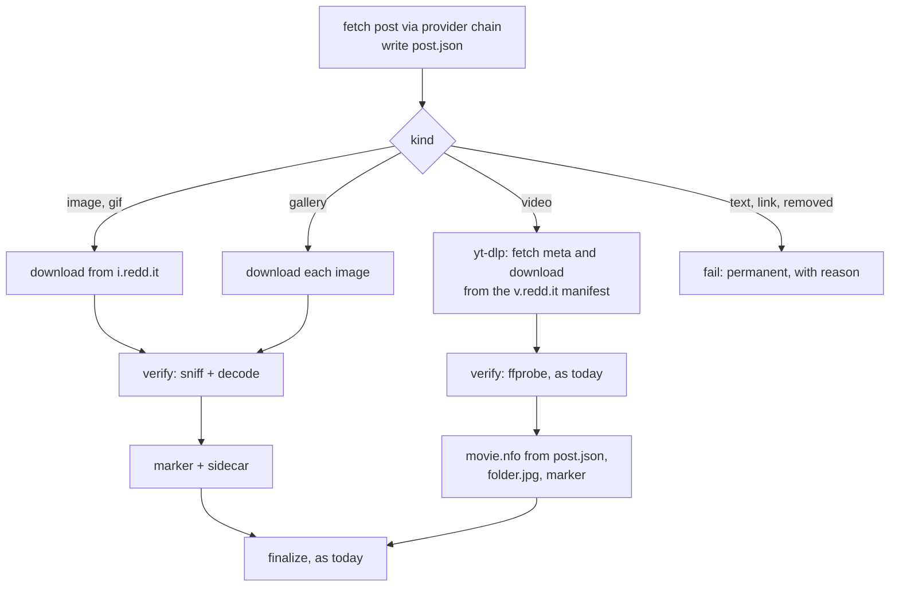

# Reddit Concept

> Status: **Draft** · 2026-10-28
> Scope: server, web UI, browser add-on
> Builds on [overhaul-concept.md](overhaul-concept.md) (pipeline, integrity invariants) and [subscriptions-concept.md](subscriptions-concept.md) (checks, entries, jobs). Open points are listed in [§14](#14-open-questions).

## 1. Summary

Download images, galleries and videos from subreddits and user profiles, and subscribe to them like to a channel. Reddit gets two ways to read its data, called **providers**:

- **native**: reads the HTML pages a logged-out browser gets from `www.reddit.com`. No account, no cookies, no API key.
- **arcticshift**: reads the [Arctic Shift](https://github.com/ArthurHeitmann/arctic_shift) API, a free third-party archive of Reddit. The server then never talks to `www.reddit.com`.

Both providers produce the same normalized **post**. Everything after that is provider-independent: subscription entries, jobs, items, archive keys and the library layout. Media files are always downloaded from Reddit's media hosts (`i.redd.it`, `v.redd.it`, `preview.redd.it`).

yt-dlp cannot list subreddits, and its Reddit extractor needs the JSON endpoints that Reddit closed for logged-out clients ([§2](#2-access-situation)). So this concept adds a listing step in Go and a download path for images and galleries. Reddit videos still go through yt-dlp, but from their `v.redd.it` stream manifest, never through yt-dlp's Reddit extractor.

**Core decisions**

| # | Decision |
|---|----------|
| R1 | **No login, no API key.** Reddit's JSON endpoints, RSS feeds and OAuth API are closed, closing or need approval ([§2](#2-access-situation)). The providers use only what a logged-out browser gets, or a third-party archive. Cookie profiles are not used for Reddit in this concept. |
| R2 | **One post, one key, any provider.** A post's archive key is `redditpost <post id>`, the base-36 ID from its URL. It depends only on the post, never on the provider or on the media, so providers can be mixed and switched without duplicate downloads. Crossposts keep their own ID. |
| R3 | **Providers are a chain.** An ordered list per subscription (default: the global order). A request falls through to the next provider on `blocked`, `rate_limited`, `auth_required` or a page layout the parser doesn't recognize. A `permanent` error (subreddit banned or not found) does not fall through. |
| R4 | **No evasion.** Native is a plain HTTP client: no JavaScript, no headless browser, no TLS fingerprint spoofing, no CAPTCHA solving, no proxy rotation. If Reddit blocks it, the request is `blocked` and the next provider is tried. The subscription loop's impersonation escalation is a no-op for Reddit providers. |
| R5 | **Arctic Shift is opt-in.** It is a volunteer-run third-party service that learns which subreddits and posts the server asks for. It is enabled in *Settings → Reddit*, which says so. |
| R6 | **A post is one item and one folder**, including galleries. A gallery reaches the library through one atomic rename like any other item, so invariant 2 holds unchanged. |
| R7 | **Images get their own verify and no NFO.** Images are checked by content (magic bytes plus a full decode), never by URL. Image items carry a hidden marker file instead of `movie.nfo`, so the library check and target selection still recognize them ([§8](#8-library-layout)). |
| R8 | **Reddit listings are never complete.** Reddit lists at most about 1000 posts, and Arctic Shift has the full history, which is far too much to list. Reddit sources therefore never report a complete listing, and the subscription loop never marks their entries *gone*. |
| R9 | **Reddit-hosted media first.** Images, galleries, GIFs and `v.redd.it` videos are in scope. Links to other sites (YouTube, Redgifs, Imgur, …) are ignored with a reason in this concept and can follow later ([§15](#15-rollout)). |
| R10 | **Measure before building.** Phase R-0 ships a probe subcommand. It shows from the user's own network whether each provider works and records the HTML and JSON this concept assumes ([§13](#13-testing)). The parser details in [§5](#5-native-provider) are expectations until R-0 confirms them. |

## 2. Access situation

Status as of 2026-10-28. Most sources are secondary; dates are reported, not confirmed by Reddit.

| Access | Status | Used here |
|---|---|---|
| `www.reddit.com/…/.json` without login | Returns 403 since the end of May 2026 (r/modnews "Protecting communities from scrapers and platform abuse"). A browser User-Agent doesn't help. | no |
| RSS (`/r/<sub>/new/.rss`) | Still answers, about one request per minute per IP without login. Reddit ends RSS on 2026-11-13. | no ([§11](#11-integrations) imports RSS subscriptions) |
| `old.reddit.com` | Login required, being rolled out | no |
| Official OAuth API | New tokens need approval since 2025-11. Reportedly no new applications after 2026-10-31, and the public Data API closes by 2027-03. | no |
| **Logged-out HTML** (`www.reddit.com/r/<sub>/…`) | Reddit says logged-out browsing of `reddit.com` stays available. A "blocked by network security" page hits clients by IP reputation (VPN, datacenter), rate and missing browser signals. | **native** |
| **Arctic Shift API** | Keyless and free, with no uptime guarantee. Posts are archived about when they are posted, and scores settle after about 36 h. | **arcticshift** |
| `i.redd.it`, `v.redd.it`, `preview.redd.it` | No reported restrictions. To be confirmed by R-0. | media |

**Why native needs no login.** The pages a logged-out browser shows are server-rendered: the HTML of a subreddit page already contains one `<shreddit-post>` element per post, with the post's data in its attributes. Further posts come from an HTML endpoint the page calls while scrolling. Native requests the same documents and reads them without running JavaScript. Three things limit it:

1. **Reddit decides per client.** Whether a plain HTTP client gets the page or the block page depends on the IP address and on how the client looks. A home connection is more likely to work than a VPS. R-0 measures this.
2. **The logged-out view is limited.** In the default card view, logged-out pages render only the first few posts; the compact view (`feedViewType=compactView`) renders more (measured by a third party on 2026-10-16). NSFW and quarantined communities and, depending on the country, mature content need a login. For those, native fails with `auth_required` and the chain falls through to Arctic Shift.
3. **HTML changes more often than an API.** The parser keeps all element and attribute names in one place, and a page it can't read is a classified error, never an empty result ([§5.4](#54-errors)).

## 3. Terms

| Term | Meaning |
|---|---|
| **Provider** | A way to read Reddit data: `native` or `arcticshift`. |
| **Post** | The normalized record of one Reddit post ([§4](#4-post-model)), produced by any provider. |
| **Reddit source** | A subscription source whose canonical URL is a subreddit (`https://www.reddit.com/r/<name>/new`) or a user's posts (`https://www.reddit.com/user/<name>/submitted`). |
| **Media kind** | What a post contains: `image`, `gallery`, `video`, `gif`, `link` (another site) or `text`. |

## 4. Post model

Both providers fill the same struct (`internal/reddit/post.go`). Fields a provider can't report stay empty.

| Field | Notes |
|---|---|
| `ID` | Base-36 post ID without the `t3_` prefix. The archive key is `redditpost <ID>` (R2). |
| `Subreddit`, `Author` | Without `r/` and `u/` |
| `Title`, `Selftext`, `Flair` | `Selftext` becomes the plot of a video's NFO |
| `Created` | Post time (UTC) |
| `Permalink` | `https://www.reddit.com/r/<sub>/comments/<id>/` |
| `Kind` | Media kind (see above) |
| `NSFW`, `Spoiler` | |
| `Media` | Ordered list of media: `{URL, MediaID, Mime, Width, Height, Caption}`. One entry for an image or video, N for a gallery. |
| `VideoID`, `Duration` | `v.redd.it` ID and duration, if known |
| `Thumbnail` | Preview image for the feed and `folder.jpg` |
| `CrosspostParent` | For display only. The key stays the post's own ID (R2). |
| `Removed` | The provider reports the post as deleted or removed |

**Media URLs.** Images and GIFs use the original `https://i.redd.it/<media id>.<ext>`. A gallery's media IDs come from Arctic Shift's `media_metadata`/`gallery_data`, or from the preview URLs in the native post page (`https://preview.redd.it/<media id>.<ext>?…`, original at `i.redd.it` with the same name). A video needs only its `v.redd.it` ID: the manifest is `https://v.redd.it/<id>/DASHPlaylist.mpd`, with `HLSPlaylist.m3u8` as the fallback. yt-dlp's Reddit extractor uses the same URLs.

## 5. Native provider

### 5.1 Requests

| Purpose | URL |
|---|---|
| Subreddit, first page | `https://www.reddit.com/r/<sub>/new/?feedViewType=compactView` |
| Next page | `https://www.reddit.com/svc/shreddit/community-more-posts/new/?after=<cursor>&name=<sub>&feedViewType=compactView` |
| User posts | `https://www.reddit.com/user/<name>/submitted/?feedViewType=compactView`, then its own more-posts endpoint (R-0 records it) |
| One post (item metadata) | `https://www.reddit.com/r/<sub>/comments/<id>/`; without a subreddit, `https://www.reddit.com/comments/<id>/` (redirects to the full URL) |

- **Client**:
  - A fixed, current desktop browser `User-Agent`, as yt-dlp sends by default, plus `Accept-Language: en`. [§14](#14-open-questions) asks whether a descriptive project User-Agent works as well; R-0 measures both.
  - A cookie jar per check or per item, discarded afterwards. It only holds what Reddit sets itself.
- **Pacing**: pages of one listing are at least 2 s apart (±20 % jitter). The subscription loop already allows one check per site at a time and waits `siteDelaySeconds` between checks of a site ([subscriptions §5.4](subscriptions-concept.md#54-politeness-errors-and-rate-limits)).
- **Limits**: 5 MB per HTML document, 30 s per request, redirects only to allowlisted hosts ([§10](#10-security)).

### 5.2 Parsing

The parser uses the tokenizer from `golang.org/x/net/html` (new dependency, Go project). It reads tags and attributes only, never scripts. Every name below lives in one table in `internal/reddit/native/layout.go`. The names are what third-party scrapers report; R-0 confirms them and saves real pages as test fixtures.

| Post field | Expected source |
|---|---|
| `ID` | `shreddit-post[id]` (`t3_<id>`) |
| `Title`, `Author`, `Subreddit` | `post-title`, `author`, `subreddit-prefixed-name` |
| `Created` | `created-timestamp` (ISO 8601) |
| `Permalink` | `permalink` (relative) |
| `Kind` | `post-type` (`image`, `gallery`, `video`, `link`, `text`, …), checked against `content-href` |
| Media | `content-href` (`i.redd.it/…`, `v.redd.it/<id>`, `reddit.com/gallery/<id>` or an external URL). The post page adds gallery images (`gallery-carousel` images) and the player's `v.redd.it` URL. |
| `NSFW`, `Spoiler` | The corresponding boolean attributes |
| Cursor | `more-posts-cursor` on the last post (observed: base64 of `t3_<id>`) |

### 5.3 Listing

- The first page usually holds fewer posts than a page of the more-posts endpoint (about 25). Native pages until the requested number of posts is reached, or until a page has no cursor (end of the listing).
- **Short pages**: a page that ends early but has a cursor is followed. A first page without a single post and without the community's empty-state marker is a layout error ([§5.4](#54-errors)), not an empty subreddit.
- **Duplicates** across pages (posts inserted while paging) are dropped by ID.
- **Stop**: at the requested count, at the end of the listing, or after 1000 posts (Reddit's own limit).

### 5.4 Errors

| Response | Class | Effect |
|---|---|---|
| 429, or a 200 with Reddit's rate-limit page | `rate_limited` | Site cooldown for `reddit.com` (`Retry-After` if sent, else `rateLimitCooldownMinutes`). Falls through to the next provider. |
| 403, or a 200 with the "blocked by network security" page | `blocked` | Falls through. Hint: "Reddit blocks this server's network (VPN or datacenter addresses are often blocked). Enable Arctic Shift or run the server from another network." |
| Redirect to the login page, or an NSFW, quarantine or age gate | `auth_required` | Falls through. Hint: "Reddit shows this community only to logged-in users. Enable Arctic Shift." |
| 404, "community not found", banned or private community | `permanent` | No fall-through. Hint as for a removed channel |
| A 200 page without readable posts | `extractor_broken` | Falls through. Hint: "Reddit's page layout changed; the server needs an update." Logged with the first 2 KB of the page. |
| Network errors, 5xx, timeouts | `transient` | Falls through, backoff as usual |

## 6. Arctic Shift provider

| Purpose | Request |
|---|---|
| Subreddit, newest first | `/api/posts/search?subreddit=<sub>&sort=desc&limit=100[&before=<created_utc of the oldest post so far>]` |
| User posts | the same with `author=<name>` |
| One post (item metadata) | `/api/posts/ids?ids=<id>`. Up to 500 IDs per request, so a check can refresh many entries at once if needed. |
| Preview | `/api/subreddits/search?subreddit=<sub>` for the title, NSFW flag and subscriber count |
| Share links (`/r/<sub>/s/<code>`) | `/api/short_links?paths=<path>` |

- `fields` is not set: posts come back as the full objects Arctic Shift stored, including `media_metadata`, `gallery_data`, `secure_media`, `is_video` and `preview`. The documented list of selectable fields doesn't mention these, so R-0 confirms that they are present.
- **Freshness**: posts are archived about when they are posted. A video can be archived before Reddit has processed it, without `secure_media`. Item metadata is therefore fetched again at download time ([§7.2](#72-pipeline)), and the manifest can be derived from the `v.redd.it` ID in `url` either way. `score` and `num_comments` are 0 or 1 for about 36 h, so there are no score filters in this concept.
- **Politeness**, as the operator asks ("a free service, be considerate"):
  - one request at a time per server;
  - at least 1 s between requests;
  - pages of 100;
  - never a crawl of a subreddit's whole history: the deepest listing is `firstListing` posts ([§9](#9-settings)).
- **Errors**:
  - 429 sets a site cooldown for `arctic-shift.photon-reddit.com` until `X-RateLimit-Reset` and falls through;
  - "Query timed out" is retried once with half the page size, then `transient`;
  - an unknown subreddit is an empty result. Combined with a native `permanent` error, it is `permanent`.
- **Removed posts**: Arctic Shift keeps posts that were deleted on Reddit. If their media is gone from `i.redd.it`, the item fails as `permanent` ("removed from Reddit") and is not queued again (subscriptions S3).

## 7. Integration

### 7.1 Subscriptions

Today the subscription loop always lists with yt-dlp (`listSource` in `internal/subscriptions/loop.go`, `PreviewSubscription` in `internal/manager/subops.go`). R-1 moves that call behind an interface:

```go
// Lister lists one source. window 0 = the deepest listing the lister allows.
type Lister interface {
	List(ctx context.Context, src *store.Source, window int, call ytdlp.CallOptions) (l *ytdlp.Listing, complete bool, err *ytdlp.Classification)
}
```

`ytdlpLister` is today's code. `redditLister` runs the provider chain and maps posts to `ytdlp.ListEntry`. The lister is chosen by the host of the canonical URL. The window doubling, the merge, `Apply` and `commitCheck` stay as they are, because they only see `ytdlp.Listing`.

| Subscription concept | For Reddit sources |
|---|---|
| Canonical URL | `https://www.reddit.com/r/<name lowercase>/new` and `https://www.reddit.com/user/<name>/submitted`. `old.`, `new.`, `np.` and `m.` hosts, `redd.it` and share links resolve to these. The uniqueness constraint prevents duplicate subscriptions. |
| Order | Newest first, known up front: a new Reddit source is stored with `newest_first = 1, order_known = 1`, so checks use the window from the start. (`tab` is not used, because `ListArgs` derives YouTube arguments from it.) |
| Window and gaps | Window `window` (default 50), doubled while it holds no known entry, up to 1000 |
| First listing | The newest `firstListing` posts (default 100) become the backlog. The backlog choice *all* means these posts. |
| Full rescan | Lists `firstListing` posts and never reports `complete` (R8), so nothing is marked *gone* |
| Entry | `ListEntry{ExtractorKey: "RedditPost", ID, URL: permalink, Title, Timestamp, Thumbnail, Duration}` plus two new optional fields, `MediaKind` and `NSFW` |
| Not media | `text` posts and, for now, `link` posts are stored as ignored with the reason `no media` or `link to <host>`, like `not a video` |
| Preview | A subreddit or user URL previews its newest 10 posts. A post URL switches to its subreddit, as a video URL switches to its channel (subscriptions decision 20). The preview names the provider that answered. |
| Errors | The classes from [§5.4](#54-errors). Each provider sets the cooldown of its own site, and a provider whose site is in a cooldown is skipped. After the whole chain fails, the error of the first provider is recorded, with a hint that names all providers that were tried. |

**Filters.** `store.Filters` gets `mediaKinds` (a subset of `image`, `gallery`, `video`, `gif`; empty = all) and `nsfw` (`include`, `exclude` or `only`; default `include`). Both only use listing data and leave non-Reddit entries alone. As with all filters, entries that don't match are ignored with a reason such as `filter: video`.

**Defaults when subscribing.**
- The name is `r/<name>` or `u/<name>`.
- The folder is preset to `<name>` (`u_<name>` for users), because the slash in the name would be sanitized to `⧸`.
- The library is preselected if one is marked as the Reddit default ([§9](#9-settings)).

### 7.2 Pipeline

Subscription jobs already create items with their key. A Reddit item is an item whose `Extractor` is `RedditPost`. `attempt` (`internal/pipeline/item.go`) hands it to `attemptReddit` (`internal/pipeline/reddit.go`):



1. **Fetch post.** The post is fetched again through the provider chain and written to `post.json` in the work dir. This replaces `info.json` for images; signed preview URLs and video processing state are thereby fresh. The same freshness rule as for `info.json` applies (`MetaMaxAge`).
2. **Images and GIFs.** Download from `i.redd.it` to `media.part`, then rename to `media.<ext>`. The extension comes from the content ([§7.3](#73-verify)). A `.gif` stays a GIF; there is no conversion in this concept.
3. **Galleries.** Download each image in gallery order to `media-NN.part`, verify it, and rename it to `media-NN.<ext>`. Already verified files are kept and reused after a retry or crash (invariant 5).
   - An image that returns 404 or 410 is a warning ("2 of 14 images were removed").
   - If all images are gone, the item fails as `permanent`.
   - Other errors fail the attempt as `transient`.
4. **Videos.** yt-dlp gets `https://v.redd.it/<id>/DASHPlaylist.mpd`: fetch meta, then download with `--load-info-json`, exactly the existing calls. yt-dlp's generic extractor reads the manifest and merges video and audio. `ffprobe` verify and subtitles work as for any video. The thumbnail candidates for `folder.jpg` come from `post.json`, with the frame fallback as today.
5. **No re-keying.** Today `attempt` replaces the item's key with the one from yt-dlp's metadata. For Reddit items that step is skipped. The generic extractor names every manifest `DASHPlaylist`, so all Reddit videos would get the same key `generic DASHPlaylist`, and every video after the first would be skipped as *already in library*.
6. **NFO.** For videos, `movie.nfo` is written from a yt-dlp-shaped map built from `post.json`, so `nfo.Movie` stays unchanged:

   | NFO input | From the post |
   |---|---|
   | `title` | `Title` |
   | `description` | `Selftext` |
   | `uploader` | `Author` |
   | `channel` | `r/<sub>` |
   | `upload_date` | `Created` |
   | `tags` | `Flair` |
   | `webpage_url` | `Permalink` |
   | `extractor_key` | `RedditPost` |
   | `id` | `ID` |
   | `age_limit` | 18 if `NSFW` |

   With 18, the existing age rules can map it to an MPAA rating.

   Images get no NFO (R7).
7. **Finalize** as today: plan in the DB, staging, one rename, archive entry. Reddit keys are not appended to `.ytdlp-archive.txt`: that file is for yt-dlp-compatible tools, which don't know them. The SQLite archive is unaffected, so invariant 4 holds.

**Single posts outside subscriptions.**
- A pasted or add-on-sent post URL (`/r/<sub>/comments/<id>/…`, `redd.it/<id>`, `reddit.com/gallery/<id>`, share links) skips the yt-dlp probe and becomes a job with one Reddit item.
- A pasted subreddit or user URL becomes a one-off job with the newest `jobListLimit` posts (default 25), listed through the same chain.
- `POST /api/download` keeps returning 201/409.

### 7.3 Verify

| Media | Check |
|---|---|
| JPEG, PNG, GIF | `artwork.Sniff` (magic bytes) and a full decode with the standard library; width and height > 0 |
| WebP, AVIF | Sniff plus `ffprobe` (one video stream with width and height), because the standard library can't decode them |
| Anything else | `permanent` "not an image" (for example an HTML error page with status 200) |
| Videos | `ffprobe`, as today |

Size limits: 50 MB per image and 2 GB per gallery. A file over the limit fails the item as `permanent` with the reason.

### 7.4 What stays unchanged

- The integrity invariants, finalize, crash recovery, the scheduler bands and yielding, the archive semantics (`archive` table), the retry policy and the error classes.
- Subscription checks, entries, auto mode, backlog, cap, notifications and the feed.
- yt-dlp calls for all other sites, and `POST /api/download` → 201/409.

## 8. Library layout

- **Folder per subscription (S9)**: `<library>/<folder>/<item folder>/`. The item folder comes from the naming template like any item: `title` = post title, `id` = post ID, `uploader` = author, `channel` = `r/<sub>`, `upload_date` = post date.
- **Files**:
  - an image: `<base>.<ext>`, the template's file name;
  - a gallery: `<base> - 01.<ext>`, `<base> - 02.<ext>`, … in gallery order;
  - a video: as today (`<base>.mkv`, `folder.jpg`, `movie.nfo`, subtitles).

  `<base>` is the rendered file name without extension. Galleries don't need a new template syntax.
- **Marker**: every Reddit item folder holds a hidden `.ytdlp-nfo.json`:

  ```json
  {"key": "redditpost 1abc23", "id": "1abc23", "kind": "gallery", "subreddit": "EarthPorn", "author": "…", "title": "…",
   "permalink": "https://www.reddit.com/r/EarthPorn/comments/1abc23/", "created": "2026-10-27T18:03:11Z",
   "provider": "native", "files": ["… - 01.jpg", "… - 02.png"]}
  ```

  `library.FolderVideoID` and `library.ScanFolders` fall back to this file when there is no `movie.nfo`. Then `ChooseTarget` still replaces the same post instead of adding ` (2)`, and *Archive → Check library* finds image folders. `ScanFolders` also learns the image extensions.
- **Jellyfin**: a movie library ignores images. A Reddit subscription should therefore use a library of the Jellyfin type *Home videos and photos*; the subscription's library can be chosen per subscription (S9). Whether Jellyfin reads `movie.nfo` in that library type is not verified; the videos play either way. Jellyfin ignores the hidden marker.

## 9. Settings

`config.Settings` gains `reddit`:

| Setting | Default | Range | Notes |
|---|---|---|---|
| `providers` | `["native"]` | ordered subset of `native`, `arcticshift` | Global chain. `arcticshift` can only be added after `arcticShiftAccepted` |
| `arcticShiftAccepted` | `false` | – | The user confirmed the note: third-party service, no guarantees, it sees the subreddits and posts the server asks for (R5) |
| `firstListing` | `100` | 25–1000 | Depth of the first listing and of a full rescan |
| `jobListLimit` | `25` | 1–1000 | Posts of a pasted subreddit URL |
| `pageDelaySeconds` | `2` | 1–60 | Between two native pages, ±20 % jitter |
| `defaultLibrary` | `""` | a library name | Preselected for new Reddit subscriptions |

A subscription can override the chain (`provider`: `""` = global, `native`, `arcticshift`, `native,arcticshift`, `arcticshift,native`). The resolved chain is stored on its jobs with the other effective options, so a retry uses the same chain.

**Schema**: one migration adds `subscriptions.provider TEXT NOT NULL DEFAULT ''`, `subscription_entries.media_kind TEXT NOT NULL DEFAULT ''` and `subscription_entries.nsfw INTEGER NOT NULL DEFAULT 0`. The two entry columns stay empty for other sources. Sources and items need no new columns.

## 10. Security

- **Host allowlist** for every request the Reddit code makes:
  - `www.reddit.com`;
  - `i.redd.it`, `preview.redd.it`, `external-preview.redd.it`, `v.redd.it`;
  - `arctic-shift.photon-reddit.com`.

  Only HTTPS. Redirects are followed only within the allowlist. Post data is written by strangers, so a URL that points elsewhere (for example a LAN address) is never fetched.
- **Address check**: the dialer refuses loopback, private, link-local and unique-local addresses after DNS resolution, which also covers DNS rebinding.
- **yt-dlp** only gets manifest URLs on `v.redd.it` that the code built itself from a validated ID. `--ignore-config` and the URL after `--` stay as they are.
- **Size and time limits** on every response ([§5.1](#51-requests), [§7.3](#73-verify)).
- **No secrets**: no cookie profile or token is ever sent to Reddit or Arctic Shift.

## 11. Integrations

- **Browser add-on**:
  - *Send to server* on a Reddit post page sends the post URL, which becomes a single-post job ([§7.2](#72-pipeline)).
  - *Subscribe* on a subreddit or post page subscribes to the subreddit.

  Neither needs add-on changes beyond the URL patterns the add-on already sends.
- **OPML import of Reddit RSS feeds**: Reddit ends RSS on 2026-11-13, and feed reader users have OPML files with `https://www.reddit.com/r/<sub>/.rss` (or `/new/.rss`, `/user/<name>/submitted/.rss`). The existing import (`POST /subscriptions/import`, `format: opml`) maps such an `xmlUrl` to the Reddit source `r/<sub>/new`.
- **Notifications** and **Jellyfin refresh**: unchanged. Every finalized item triggers the refresh.

## 12. Packages

| Package | Content |
|---|---|
| `internal/reddit` | URL parsing and canonical URLs, `Post`, the provider chain, the media downloader with the host allowlist |
| `internal/reddit/native` | HTTP client, HTML parser, layout table |
| `internal/reddit/arcticshift` | API client |
| `internal/subscriptions` | `Lister` interface, `ytdlpLister` (moved code), `redditLister` |
| `internal/pipeline/reddit.go` | `attemptReddit`, gallery handling, verify of images |
| `internal/library` | Marker fallback in `FolderVideoID` and `ScanFolders`, image extensions |
| `main.go` | `reddit-probe` subcommand ([§13](#13-testing)) |

## 13. Testing

**R-0 probe.**

```bash
ytdlp-nfo-server reddit-probe [--provider native|arcticshift|all] [--user-agent browser|project] [--fixtures DIR] <subreddit or post URL>
```

It runs both providers from the container's network and prints:
- the HTTP status per request;
- whether a block page, rate-limit page or login gate was detected;
- the number of posts parsed and which attributes were found;
- for the first image and video, whether `i.redd.it` and the `v.redd.it` manifest answer.

With `--fixtures`, it stores the pages and JSON responses with usernames and titles replaced, as fixtures for the parser tests. It writes nothing else and needs no database. Run hourly for a few days with `--quiet` (one line per run), it shows how stable each provider is from that network.

**Automated tests** never touch the network:
- a fake Reddit and a fake Arctic Shift (`httptest`) serve the R-0 fixtures, block pages, 429 responses and gates;
- a fake media host serves images, broken images and HTML instead of images.

| Scenario | Expected result |
|---|---|
| Parser on the R-0 fixtures | Golden posts, including gallery, video, crosspost and NSFW post |
| A 200 page without posts and without the empty-state marker | `extractor_broken`, chain falls through |
| Native block page, Arctic Shift enabled | The check succeeds through Arctic Shift. The check log names both providers |
| Native and Arctic Shift list the same posts in different checks | The same keys, no new entries, no job |
| First check of a subreddit, `firstListing` 100 | 100 backlog entries, no job |
| Windowed check, 70 new posts, window 50 | Paging by cursor (native) or `before` (Arctic Shift), all 70 found |
| Full rescan | Never marks entries *gone* |
| Text and link posts | Ignored with a reason, never queued |
| Filter `mediaKinds = [image, gallery]` | Videos ignored as `filter: video` |
| Two Reddit videos in one job | Two archive entries, two folders (no re-keying to `generic DASHPlaylist`) |
| An image URL returns an HTML page with status 200 | Item failed, `permanent`, not an image |
| A gallery with 1 of 5 images removed | Item done with a warning, 4 files |
| A gallery whose images are all removed | Item failed, `permanent` |
| SIGKILL after each gallery image and at every finalize step | Restart resumes. Invariants 1–5 hold, and verified images are not downloaded again |
| Force re-download of a gallery in the library | The folder is replaced through the marker, not duplicated as ` (2)` |
| *Check library* with image folders | Image folders count as present |
| A post URL pasted as a job | One Reddit item, 201 |
| OPML with Reddit RSS feeds | One Reddit subscription per feed |
| A post links to a private address or another host | Never fetched |
| Arctic Shift 429 with `X-RateLimit-Reset` | Cooldown for the Arctic Shift site key, chain falls through |

## 14. Open questions

| # | Question | Recommendation |
|---|---|---|
| 1 | Is Arctic Shift opt-in, or on by default as the second provider? | **Opt-in** (R5): it is a third-party service that sees what the server asks for. |
| 2 | Native User-Agent: a browser string (like yt-dlp) or a descriptive project string? | Decide after R-0, which measures both. A browser string is the yt-dlp default and not evasion in the sense of R4; if the project string works as well, prefer it. |
| 3 | Where do images go if the user has only a movie library? | Warn in the add dialog that Jellyfin's movie libraries don't show images, and suggest a *Home videos and photos* library. Don't block. |
| 4 | Default of the NSFW filter | `include`. NSFW communities only work through Arctic Shift anyway ([§2](#2-access-situation)). |
| 5 | Links to other sites (YouTube, Redgifs, Imgur, …) | Later (R9). With an allowlist they can go through the existing yt-dlp path and its re-keying. |

## 15. Rollout

| Phase | Content | Exit criteria |
|---|---|---|
| **R-0 Probe** | `reddit-probe` subcommand, fixtures | Run on the user's server for a few days. For each provider: works / works with limits / blocked. The parser table in [§5.2](#52-parsing) is confirmed or corrected. **Go/no-go per provider.** |
| **R-1 Lister** | `Lister` interface, `ytdlpLister` | No behavior change. All tests pass, including the integrity tests |
| **R-2 Listing** | Providers (the ones that passed R-0), Reddit sources, canonical URLs, preview, errors, chain, filters, settings, OPML import of Reddit RSS | A subreddit can be subscribed, checked and previewed. Entries appear in the feed with thumbnails |
| **R-3 Media** | `attemptReddit`: images, GIFs, galleries, `v.redd.it` videos, verify, marker, library scan and check, single-post jobs and one-off subreddit jobs | All tests from [§13](#13-testing) pass. A real subreddit with images, galleries and videos lands complete in a *Home videos and photos* library |
| Later | Links to other sites, crosspost deduplication by media, score filters (once scores settle), a logged-in provider if one becomes necessary | – |
