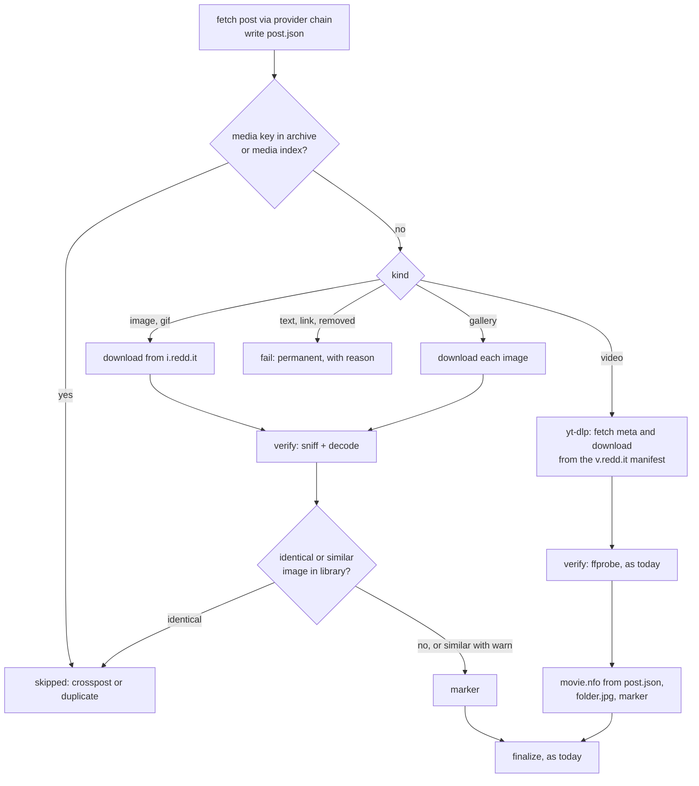

# Reddit Concept

> Status: **Draft**, decisions of 2026-10-28 recorded ([§14](#14-decisions-and-open-questions)) · 2026-10-28
> Scope: server, web UI, browser add-on
> Builds on [overhaul-concept.md](overhaul-concept.md) (pipeline, integrity invariants) and [subscriptions-concept.md](subscriptions-concept.md) (checks, entries, jobs).

## 1. Summary

Download images, galleries and videos from subreddits and user profiles, and subscribe to them like to a channel. Reddit gets two ways to read its data, called **providers**:

- **native**: reads the HTML pages a logged-out browser gets from `www.reddit.com`. No account, no login, no API key: it looks like a logged-out Chrome visitor.
- **arcticshift**: reads the [Arctic Shift](https://github.com/ArthurHeitmann/arctic_shift) API, a free third-party archive of Reddit. The server then never talks to `www.reddit.com`.

Both providers produce the same normalized **post**. Everything after that is provider-independent: subscription entries, jobs, items, archive keys and the library layout. Media files are always downloaded from Reddit's media hosts (`i.redd.it`, `v.redd.it`, `preview.redd.it`). Crossposts and re-uploads are recognized, so the same picture or video is not downloaded twice.

yt-dlp cannot list subreddits, and its Reddit extractor needs the JSON endpoints that Reddit closed for logged-out clients ([§2](#2-access-situation)). So this concept adds a listing step in Go and a download path for images and galleries. Reddit videos still go through yt-dlp, but from their `v.redd.it` stream manifest, never through yt-dlp's Reddit extractor.

**Core decisions**

| # | Decision |
|---|----------|
| R1 | **No login, no API key.** Reddit's JSON endpoints, RSS feeds and OAuth API are closed, closing or need approval ([§2](#2-access-situation)). The providers use only what a logged-out browser gets, or a third-party archive. Cookie profiles are not used for Reddit in this concept. |
| R2 | **One media, one key, any provider.** The archive key identifies the media, not the post: `redditmedia <media id>` for an image or GIF, `reddit <v.redd.it id>` for a video and `redditgallery <hash>` for a gallery. The video key is the one yt-dlp's Reddit extractor writes, so videos downloaded earlier through yt-dlp count. A crosspost shows the media of its original and therefore gets the same key. Keys come only from Reddit's own IDs, never from the provider, so providers can be mixed and switched ([§7.5](#75-duplicates-and-crossposts)). |
| R3 | **Providers are a chain.** An ordered list per subscription (default: the global order). A request falls through to the next provider on `blocked`, `rate_limited`, `auth_required` or a page layout the parser doesn't recognize. A `permanent` error (subreddit banned or not found) does not fall through. |
| R4 | **Native looks like a browser as far as possible.** It presents itself consistently as one current desktop Chrome: the TLS and HTTP/2 fingerprint, headers in Chrome's order, client hints, a persistent cookie jar like a returning logged-out visitor, a browser-like order of requests, and human pacing ([§5.1](#51-requests)). It does not run JavaScript and can't change the IP address. If Reddit still blocks it, the request is `blocked` and the next provider is tried. Because native always impersonates, the subscription loop's impersonation escalation is a no-op for it. |
| R5 | **Arctic Shift is on by default, as the fallback.** The default chain is `native, arcticshift`. Arctic Shift is a volunteer-run third-party service that learns which subreddits and posts the server asks for; *Settings → Reddit* says so and can switch it off. |
| R6 | **A post is one item and one folder**, including galleries. A gallery reaches the library through one atomic rename like any other item, so invariant 2 holds unchanged. |
| R7 | **Images get their own verify and no NFO.** Images are checked by content (magic bytes plus a full decode), never by URL. Image items carry a hidden marker file instead of `movie.nfo`, so the library check and target selection still recognize them ([§8](#8-library-layout)). |
| R8 | **Reddit listings are never complete.** Reddit lists at most about 1000 posts, and Arctic Shift has the full history, which is far too much to list. Reddit sources therefore never report a complete listing, and the subscription loop never marks their entries *gone*. If more posts appear between two checks than native can list, the gap is filled from Arctic Shift or reported ([§7.7](#77-history-top-lists-and-gaps)). |
| R9 | **Reddit-hosted media first, links to other sites after.** Images, galleries, GIFs and `v.redd.it` videos come first. Link posts to an allowlist of sites (YouTube, Redgifs, Imgur, Streamable, …) become ordinary downloads of their target in a later phase ([§7.6](#76-links-to-other-sites), [§15](#15-rollout)). |
| R10 | **Build first, then check against the real Reddit.** The parser is built on the names third parties observed ([§5.2](#52-parsing)), with all of them in one table so they are quick to correct. R-2 ships the diagnostics subcommand `reddit-probe`. Run on the user's server, it shows what each provider really gets and saves real pages as test fixtures ([§13](#13-testing)). |
| R11 | **Duplicates are caught as early as possible.** There are three levels. The media key catches crossposts before any media is downloaded. A SHA-256 of each image catches identical re-uploads before finalize. An optional perceptual hash flags reposts that were resized or recompressed, as a warning by default. A duplicate is *skipped*, never failed, and nothing in the library is changed for it ([§7.5](#75-duplicates-and-crossposts)). |
| R12 | **History and top lists are extras the user asks for.** Subscriptions follow `/new`. Top lists come only from native (Arctic Shift can't rank by score); they can be a subscription source, a one-time backfill or a one-off job. Older posts by time range come from Arctic Shift as a backfill. Everything a backfill lists is backlog and is downloaded only when asked ([§7.7](#77-history-top-lists-and-gaps)). |

## 2. Access situation

Status as of 2026-10-28. Most sources are secondary; dates are reported, not confirmed by Reddit.

| Access | Status | Used here |
|---|---|---|
| `www.reddit.com/…/.json` without login | Returns 403 since the end of May 2026 (r/modnews "Protecting communities from scrapers and platform abuse"). A browser User-Agent doesn't help. | no |
| RSS (`/r/<sub>/new/.rss`) | Still answers, about one request per minute per IP without login. Reddit ends RSS on 2026-11-13. | no ([§11](#11-integrations) imports RSS subscriptions) |
| `old.reddit.com` | Login required, being rolled out | no |
| Official OAuth API | New tokens need approval since 2025-11. Reportedly no new applications after 2026-10-31, and the public Data API closes by 2027-03. | no |
| **Logged-out HTML** (`www.reddit.com/r/<sub>/…`) | Reddit says logged-out browsing of `reddit.com` stays available. A "blocked by network security" page hits clients by IP reputation (VPN, datacenter), rate and missing browser signals. | **native** |
| **Arctic Shift API** | Keyless and free, with no uptime guarantee. Posts are archived about when they are posted, and scores settle after about 36 h. | **arcticshift** |
| `i.redd.it`, `v.redd.it`, `preview.redd.it` | No reported restrictions. The reality check after R-3 confirms it. | media |

**Why native needs no login.** The pages a logged-out browser shows are server-rendered: the HTML of a subreddit page already contains one `<shreddit-post>` element per post, with the post's data in its attributes. Further posts come from an HTML endpoint the page calls while scrolling. Native requests the same documents and reads them without running JavaScript. Three things limit it:

1. **Reddit decides per client.** Whether a client gets the page or the block page depends on the IP address and on how the client looks. Native looks like a current Chrome as far as that is possible without running JavaScript (R4), but it can't change the IP address. A home connection is more likely to work than a VPS; the optional `proxy` setting can route Reddit requests through one ([§9](#9-settings)). `reddit-probe` shows it on the user's network.
2. **The logged-out view is limited.**
   - In the default card view, logged-out pages render only the first few posts; the compact view (`feedViewType=compactView`) renders more (measured by a third party on 2026-10-16).
   - **NSFW:** Reddit blurs NSFW posts or shows an 18+ dialog to logged-out visitors. Browser extensions remove both, which indicates that the posts are in the page anyway. Native sets Reddit's `over18` cookie, as yt-dlp does, and reads posts regardless of blur and dialog elements. The reality check covers an NSFW community.
   - **Real gates:** where Reddit withholds content on the server (quarantined communities, or a legally required age verification in some countries), native reports `auth_required` and does not try to get around it. The chain falls through to Arctic Shift.
3. **HTML changes more often than an API.** The parser keeps all element and attribute names in one place, and a page it can't read is a classified error, never an empty result ([§5.4](#54-errors)).

## 3. Terms

| Term | Meaning |
|---|---|
| **Provider** | A way to read Reddit data: `native` or `arcticshift`. |
| **Post** | The normalized record of one Reddit post ([§4](#4-post-model)), produced by any provider. |
| **Reddit source** | A subscription source whose canonical URL is a subreddit (`https://www.reddit.com/r/<name>/new`), a subreddit's top list (`https://www.reddit.com/r/<name>/top?t=<period>`) or a user's posts (`https://www.reddit.com/user/<name>/submitted`). |
| **Gap** | Posts between two checks that native couldn't reach, because more appeared than its listing limit of about 1000 ([§7.7](#77-history-top-lists-and-gaps)). |
| **Backfill** | A one-time listing of older posts or of a top list for a subscription, recorded as backlog ([§7.7](#77-history-top-lists-and-gaps)). |
| **Media kind** | What a post contains: `image`, `gallery`, `video`, `gif`, `link` (another site) or `text`. |

## 4. Post model

Both providers fill the same struct (`internal/reddit/post.go`). Fields a provider can't report stay empty.

| Field | Notes |
|---|---|
| `ID` | Base-36 post ID without the `t3_` prefix. Listings report a post as `redditpost <ID>` while its media key is unknown ([§7.5](#75-duplicates-and-crossposts)). |
| `Subreddit`, `Author` | Without `r/` and `u/` |
| `Title`, `Selftext`, `Flair` | `Selftext` becomes the plot of a video's NFO |
| `Created` | Post time (UTC) |
| `Permalink` | `https://www.reddit.com/r/<sub>/comments/<id>/` |
| `Kind` | Media kind (see above) |
| `NSFW`, `Spoiler` | |
| `Media` | Ordered list of media: `{URL, MediaID, Mime, Width, Height, Caption}`. One entry for an image or video, N for a gallery. |
| `VideoID`, `Duration` | `v.redd.it` ID and duration, if known |
| `MediaKey` | The archive key derived from the media (R2). Empty if the provider didn't report the media. |
| `Thumbnail` | Preview image for the feed and `folder.jpg` |
| `CrosspostParent` | For display. A crosspost reports the media of its original, so it gets the same media key. |
| `Removed` | The provider reports the post as deleted or removed |

**Media URLs.** Images and GIFs use the original `https://i.redd.it/<media id>.<ext>`. A gallery's media IDs come from Arctic Shift's `media_metadata`/`gallery_data`, or from the preview URLs in the native post page (`https://preview.redd.it/<media id>.<ext>?…`, original at `i.redd.it` with the same name). A video needs only its `v.redd.it` ID: the manifest is `https://v.redd.it/<id>/DASHPlaylist.mpd`, with `HLSPlaylist.m3u8` as the fallback. yt-dlp's Reddit extractor uses the same URLs.

## 5. Native provider

### 5.1 Requests

| Purpose | URL |
|---|---|
| Subreddit, first page | `https://www.reddit.com/r/<sub>/new/?feedViewType=compactView` |
| Next page | `https://www.reddit.com/svc/shreddit/community-more-posts/new/?after=<cursor>&name=<sub>&feedViewType=compactView` |
| Top of a period | `https://www.reddit.com/r/<sub>/top/?t=<period>&feedViewType=compactView`, then `…/community-more-posts/top/?t=<period>&after=<cursor>&name=<sub>&feedViewType=compactView`. `<period>` is `hour`, `day`, `week`, `month`, `year` or `all`. |
| Hot, rising, controversial (one-off jobs only) | The same with the sort order's name (`controversial` with `t=`) |
| User posts | `https://www.reddit.com/user/<name>/submitted/?feedViewType=compactView`, then its own more-posts endpoint |
| One post (item metadata) | `https://www.reddit.com/r/<sub>/comments/<id>/`; without a subreddit, `https://www.reddit.com/comments/<id>/` (redirects to the full URL) |

The next-page requests are what third parties observed for `/new`. `reddit-probe` shows their real form for every sort order and for user pages.

**Browser identity** (R4). Native presents itself as one current desktop Chrome, and every layer tells the same story:

| Layer | What native sends |
|---|---|
| TLS | Chrome's ClientHello: cipher suites, extensions and their order, GREASE, ALPN `h2`. JA3/JA4 match Chrome. |
| HTTP/2 | Chrome's SETTINGS, window update, stream priorities and pseudo-header order |
| Headers | In Chrome's order: `User-Agent`, `sec-ch-ua`, `sec-ch-ua-mobile`, `sec-ch-ua-platform`, `Accept`, `Accept-Encoding`, `Accept-Language`, `Sec-Fetch-Site`, `Sec-Fetch-Mode`, `Sec-Fetch-Dest`, `Sec-Fetch-User`, `Upgrade-Insecure-Requests`, `Priority`. All of them belong to the same Chrome version as the TLS profile. |
| Navigation | The listing page as a top-level navigation (`Sec-Fetch-Mode: navigate`). Further pages as the page's script requests them (`Sec-Fetch-Mode: cors`, `Referer` = the listing page). Post pages as navigations from the listing. |
| Cookies | One persistent cookie jar, like a returning logged-out visitor: what Reddit sets itself (`loid`, `csv`, `edgebucket`, `session_tracker`, …) plus `over18=1`. Stored in `DATA_DIR/reddit/cookies.json` (0600). It is reset after a block, and by hand in the settings. |
| Timing | Pages of one listing 2–5 s apart (random), about as fast as a person scrolls |

- **Library**: [`Noooste/azuretls-client`](https://github.com/Noooste/azuretls-client) (MIT). It brings Chrome's TLS and HTTP/2 fingerprints and controls the header order, and it works with the Go version the image builds with today (1.26). [`bogdanfinn/tls-client`](https://github.com/bogdanfinn/tls-client) (BSD-3) has more profiles (Chrome up to 152, Firefox, Safari) but needs Go 1.27, so the implementation uses `azuretls-client`. `reddit-probe` compares it with a plain `net/http` client.
- **Profile updates**: the browser profile comes with the library and is updated with it. User-Agent, client hints and TLS profile always come from the same profile: a Chrome 150 User-Agent on a Chrome 131 fingerprint is more conspicuous than either alone.
- **Limits of the disguise**:
  - The IP address can't be faked. The optional `proxy` setting routes Reddit requests through a connection of the user's choice, for example the home connection when the server runs on a VPS. There are no proxy pools and no CAPTCHA services.
  - If Reddit starts to require JavaScript challenges, native is blocked. The next step would be a real browser in a sidecar container ([§15](#15-rollout)).
- **Media**:
  - Images from `i.redd.it` use the same client and identity, with `Sec-Fetch-Dest: image` and `Referer: https://www.reddit.com/`.
  - Videos go through yt-dlp, which gets `--impersonate chrome` for `v.redd.it` when a target is available.
- **Pacing beyond one listing**: the subscription loop already allows one check per site at a time and waits `siteDelaySeconds` between checks of a site ([subscriptions §5.4](subscriptions-concept.md#54-politeness-errors-and-rate-limits)).
- **Limits**: 5 MB per HTML document, 30 s per request, redirects only to allowlisted hosts ([§10](#10-security)).

### 5.2 Parsing

The parser uses the tokenizer from `golang.org/x/net/html` (new dependency, Go project). It reads tags and attributes only, never scripts. Every name below lives in one table in `internal/reddit/native/layout.go`. The names are what third-party scrapers report; `reddit-probe` checks them against real pages and saves those as test fixtures.

| Post field | Expected source |
|---|---|
| `ID` | `shreddit-post[id]` (`t3_<id>`) |
| `Title`, `Author`, `Subreddit` | `post-title`, `author`, `subreddit-prefixed-name` |
| `Created` | `created-timestamp` (ISO 8601) |
| `Permalink` | `permalink` (relative) |
| `Kind` | `post-type` (`image`, `gallery`, `video`, `link`, `text`, …), checked against `content-href` |
| Media | `content-href` (`i.redd.it/…`, `v.redd.it/<id>`, `reddit.com/gallery/<id>` or an external URL). The post page adds gallery images (`gallery-carousel` images) and the player's `v.redd.it` URL. |
| `NSFW`, `Spoiler` | The corresponding boolean attributes |
| Cursor | `more-posts-cursor` on the last post (observed: base64 of `t3_<id>`) |

### 5.3 Listing

- The first page usually holds fewer posts than a page of the more-posts endpoint (about 25). Native pages until the requested number of posts is reached, or until a page has no cursor (end of the listing).
- **Short pages**: a page that ends early but has a cursor is followed. A first page without a single post and without the community's empty-state marker is a layout error ([§5.4](#54-errors)), not an empty subreddit.
- **Duplicates** across pages (posts inserted while paging) are dropped by ID.
- **Stop**: at the requested count, at the end of the listing, or after 1000 posts (Reddit's own limit).

### 5.4 Errors

| Response | Class | Effect |
|---|---|---|
| 429, or a 200 with Reddit's rate-limit page | `rate_limited` | Site cooldown for `reddit.com` (`Retry-After` if sent, else `rateLimitCooldownMinutes`). Falls through to the next provider. |
| 403, or a 200 with the "blocked by network security" page | `blocked` | Falls through. Resets the cookie jar. Hint: "Reddit blocks this server's network (VPN or datacenter addresses are often blocked). Use Arctic Shift, or route Reddit through another connection (setting `proxy`)." |
| Redirect to the login page, a quarantine gate, or a page whose posts are withheld (age verification) | `auth_required` | Falls through. Hint: "Reddit shows this community only to logged-in or verified users. Arctic Shift has it if it is enabled." An NSFW blur or 18+ dialog is not a gate: the posts are read through it. |
| 404, "community not found", banned or private community | `permanent` | No fall-through. Hint as for a removed channel |
| A 200 page without readable posts | `extractor_broken` | Falls through. Hint: "Reddit's page layout changed; the server needs an update." Logged with the first 2 KB of the page. |
| Network errors, 5xx, timeouts | `transient` | Falls through, backoff as usual |

## 6. Arctic Shift provider

| Purpose | Request |
|---|---|
| Subreddit, newest first | `/api/posts/search?subreddit=<sub>&sort=desc&limit=100[&before=<created_utc of the oldest post so far>]` |
| User posts | the same with `author=<name>` |
| A time range (gap fill, backfill) | `/api/posts/search?subreddit=<sub>&after=<time>&before=<time>&sort=desc&limit=100`, optionally with `url=<prefix>` and `over_18=<bool>` ([§7.7](#77-history-top-lists-and-gaps)) |
| Posts per year or month (backfill preview) | `/api/posts/search/aggregate?aggregate=created_utc&frequency=year&subreddit=<sub>[&after=…&before=…]` |
| One post (item metadata) | `/api/posts/ids?ids=<id>`. Up to 500 IDs per request, so a check can refresh many entries at once if needed. |
| Preview | `/api/subreddits/search?subreddit=<sub>` for the title, NSFW flag and subscriber count |
| Share links (`/r/<sub>/s/<code>`) | `/api/short_links?paths=<path>` |

- `fields` is not set: posts come back as the full objects Arctic Shift stored, including `media_metadata`, `gallery_data`, `secure_media`, `is_video` and `preview`. The documented list of selectable fields doesn't mention these; the parser treats them as optional, and `reddit-probe` shows whether they are present.
- **Freshness**: posts are archived about when they are posted. A video can be archived before Reddit has processed it, without `secure_media`. Item metadata is therefore fetched again at download time ([§7.2](#72-pipeline)), and the manifest can be derived from the `v.redd.it` ID in `url` either way. `score` and `num_comments` are 0 or 1 for about 36 h, so there are no score filters in this concept, and Arctic Shift never serves top lists of recent posts. Scores of older posts are final, which makes a local top list of a past time range possible ([§7.7](#77-history-top-lists-and-gaps)).
- **Politeness**, as the operator asks ("a free service, be considerate"):
  - one request at a time per server;
  - at least 1 s between requests;
  - pages of 100;
  - a normal check lists at most `firstListing` posts ([§9](#9-settings)). Only gap fills and backfills go deeper, at most `backfillMax` posts per run, and never through a subreddit's whole history in one go ([§7.7](#77-history-top-lists-and-gaps)).
- **Errors**:
  - 429 sets a site cooldown for `arctic-shift.photon-reddit.com` until `X-RateLimit-Reset` and falls through;
  - "Query timed out" is retried once with half the page size, then `transient`;
  - an unknown subreddit is an empty result. Combined with a native `permanent` error, it is `permanent`.
- **Removed posts**: Arctic Shift keeps posts that were deleted on Reddit. If their media is gone from `i.redd.it`, the item fails as `permanent` ("removed from Reddit") and is not queued again (subscriptions S3).

## 7. Integration

### 7.1 Subscriptions

Today the subscription loop always lists with yt-dlp (`listSource` in `internal/subscriptions/loop.go`, `PreviewSubscription` in `internal/manager/subops.go`). R-1 moves that call behind an interface:

```go
// Lister lists one source. window 0 = the deepest listing the lister allows.
type Lister interface {
	List(ctx context.Context, src *store.Source, window int, call ytdlp.CallOptions) (*ListResult, *ytdlp.Classification)
}

type ListResult struct {
	Listing   *ytdlp.Listing
	Complete  bool // every entry of the source is in the listing
	Exhausted bool // the lister can't list deeper (Reddit's limit of about 1000 posts)
}
```

`ytdlpLister` is today's code. `redditLister` runs the provider chain and maps posts to `ytdlp.ListEntry`. The lister is chosen by the host of the canonical URL. `listSource` stops doubling the window when the lister is exhausted; for yt-dlp that is a full listing, as today. The merge, `Apply` and `commitCheck` stay as they are, because they only see `ytdlp.Listing`.

| Subscription concept | For Reddit sources |
|---|---|
| Canonical URL | `https://www.reddit.com/r/<name lowercase>/new`, `https://www.reddit.com/r/<name lowercase>/top?t=<period>` and `https://www.reddit.com/user/<name>/submitted`. `old.`, `new.`, `np.` and `m.` hosts, `redd.it` and share links resolve to these. The uniqueness constraint prevents duplicate subscriptions. |
| Order | Newest first, known up front: a new Reddit source is stored with `newest_first = 1, order_known = 1`, so checks use the window from the start. (`tab` is not used, because `ListArgs` derives YouTube arguments from it.) Top sources have a fixed order of their own ([§7.7](#77-history-top-lists-and-gaps)). |
| Window and gaps | Window `window` (default 50), doubled while it holds no known entry, until the lister is exhausted (native: about 1000 posts). An exhausted listing without a known entry is a gap ([§7.7](#77-history-top-lists-and-gaps)). |
| Top sources | Always the top N (`list_limit`), whatever the window. Native only ([§7.7](#77-history-top-lists-and-gaps)). |
| First listing | The newest `firstListing` posts (default 100) become the backlog. The backlog choice *all* means these posts. Older posts and top lists come in through a backfill ([§7.7](#77-history-top-lists-and-gaps)). |
| Full rescan | Lists `firstListing` posts and never reports `complete` (R8), so nothing is marked *gone* |
| Entry | `ListEntry{ExtractorKey, ID, URL: permalink, Title, Timestamp, Thumbnail, Duration}` plus two new optional fields, `MediaKind` and `NSFW`. The key is the media key if the listing shows the media, else `redditpost <post id>`. Both providers show it for images, GIFs and videos; only Arctic Shift shows it for galleries ([§7.5](#75-duplicates-and-crossposts)). |
| Not media | `text` posts are stored as ignored with the reason `no media`, like `not a video`. Link posts to a host on `externalHosts` become entries for their target ([§7.6](#76-links-to-other-sites)); other link posts are ignored with the reason `link to <host>`. |
| Preview | A subreddit or user URL previews its newest 10 posts; a top URL (`/top/?t=week`) previews that top list and preselects a top source. A post URL switches to its subreddit, as a video URL switches to its channel (subscriptions decision 20). The preview names the provider that answered. |
| Errors | The classes from [§5.4](#54-errors). Each provider sets the cooldown of its own site, and a provider whose site is in a cooldown is skipped. After the whole chain fails, the error of the first provider is recorded, with a hint that names all providers that were tried. |

**Filters.** `store.Filters` gets `mediaKinds` (a subset of `image`, `gallery`, `video`, `gif`, `linked`; empty = all) and `nsfw` (`include`, `exclude` or `only`; default `include`). Both only use listing data and leave non-Reddit entries alone. As with all filters, entries that don't match are ignored with a reason such as `filter: video`.

**Defaults when subscribing.**
- The name is `r/<name>` or `u/<name>`.
- The folder is preset to `<name>` (`u_<name>` for users), because the slash in the name would be sanitized to `⧸`.
- The library is preselected if one is marked as the Reddit default ([§9](#9-settings)).

### 7.2 Pipeline

Subscription jobs already create items with their key. A Reddit item is an item whose URL is a Reddit post URL. Its key can change once (from the post key to the media key), so the dispatch uses the URL, not the key. `attempt` (`internal/pipeline/item.go`) hands it to `attemptReddit` (`internal/pipeline/reddit.go`):



1. **Fetch post.** The post is fetched again through the provider chain and written to `post.json` in the work dir. This replaces `info.json` for images; signed preview URLs and video processing state are thereby fresh. The same freshness rule as for `info.json` applies (`MetaMaxAge`).
2. **Media key.** The item is re-keyed to the post's media key through the existing path in `attempt`: it takes the key lock for the new key, and an item whose key is already in the archive is skipped. A Reddit item also counts as already in the library if the media index knows the key ([§7.5](#75-duplicates-and-crossposts)). The key always comes from `post.json`, never from yt-dlp's metadata. yt-dlp's generic extractor names every manifest `DASHPlaylist`, so all Reddit videos would get the key `generic DASHPlaylist`, and every video after the first would be skipped as *already in library*.
3. **Images and GIFs.** Download from `i.redd.it` to `media.part`, then rename to `media.<ext>`. The extension comes from the content ([§7.3](#73-verify)). A `.gif` stays a GIF; there is no conversion in this concept.
4. **Galleries.** Download each image that isn't already in the library ([§7.5](#75-duplicates-and-crossposts)) in gallery order to `media-NN.part`, verify it, and rename it to `media-NN.<ext>`. `NN` is the image's position in the gallery. Already verified files are kept and reused after a retry or crash (invariant 5).
   - An image that returns 404 or 410 is a warning ("2 of 14 images were removed").
   - If all images are gone, the item fails as `permanent`.
   - Other errors fail the attempt as `transient`.
5. **Videos.** yt-dlp gets `https://v.redd.it/<id>/DASHPlaylist.mpd`: fetch meta, then download with `--load-info-json`, exactly the existing calls. yt-dlp's generic extractor reads the manifest and merges video and audio. `ffprobe` verify and subtitles work as for any video. The thumbnail candidates for `folder.jpg` come from `post.json`, with the frame fallback as today.
6. **NFO.** For videos, `movie.nfo` is written from a yt-dlp-shaped map built from `post.json`, so `nfo.Movie` stays unchanged:

   | NFO input | From the post |
   |---|---|
   | `title` | `Title` |
   | `description` | `Selftext` |
   | `uploader` | `Author` |
   | `channel` | `r/<sub>` |
   | `upload_date` | `Created` |
   | `tags` | `Flair` |
   | `webpage_url` | `Permalink` |
   | `extractor_key` | `RedditPost` |
   | `id` | `ID` |
   | `age_limit` | 18 if `NSFW` |

   With 18, the existing age rules can map it to an MPAA rating.

   Images get no NFO (R7).
7. **Finalize** as today: plan in the DB, staging, one rename, archive entry. Before the staging folder is fsynced, every media file gets the post time as its modification time ([§8](#8-library-layout)). The same transaction as the archive entry writes the item's rows in the media index ([§7.5](#75-duplicates-and-crossposts)). Video keys (`reddit <id>`) are appended to `.ytdlp-archive.txt` as today, because yt-dlp writes the same key. Image and gallery keys are not, because yt-dlp-compatible tools don't know them.

**Single posts outside subscriptions.**
- A pasted or add-on-sent post URL (`/r/<sub>/comments/<id>/…`, `redd.it/<id>`, `reddit.com/gallery/<id>`, share links) skips the yt-dlp probe and becomes a job with one Reddit item.
- A pasted subreddit or user URL becomes a one-off job with `jobListLimit` posts (default 25), in the sort order of the URL ([§7.7](#77-history-top-lists-and-gaps)).
- `POST /api/download` keeps returning 201/409.

### 7.3 Verify

| Media | Check |
|---|---|
| JPEG, PNG, GIF | `artwork.Sniff` (magic bytes) and a full decode with the standard library; width and height > 0 |
| WebP, AVIF | Sniff plus `ffprobe` (one video stream with width and height), because the standard library can't decode them |
| Anything else | `permanent` "not an image" (for example an HTML error page with status 200) |
| Videos | `ffprobe`, as today |

Size limits: 50 MB per image and 2 GB per gallery. A file over the limit fails the item as `permanent` with the reason.

### 7.4 What stays unchanged

- The integrity invariants, finalize, crash recovery, the scheduler bands and yielding, the archive semantics (`archive` table), the retry policy and the error classes.
- Subscription entries, auto mode, backlog, cap, notifications and the feed. Checks only gain what Reddit sources need: the lister interface, top sources, gap fills and backfills ([§7.7](#77-history-top-lists-and-gaps)). Checks of other sources behave as today.
- yt-dlp calls for all other sites, and `POST /api/download` → 201/409.

### 7.5 Duplicates and crossposts

A crosspost shows the media of its original: the same `i.redd.it` files or the same `v.redd.it` video. A repost is a new upload of the same picture, often resized or recompressed. Duplicates are caught at three levels, from cheap to expensive:

| Level | Catches | When | Cost of a duplicate |
|---|---|---|---|
| 1. Media key | Crossposts, the same post in two subscriptions, an image that is also part of a gallery in the library, a video downloaded earlier through yt-dlp | At listing time if the listing shows the media, else right after the post is fetched | Nothing, or one metadata request. No media download. |
| 2. File hash (SHA-256) | Identical re-uploads under a new media ID | After verify, before finalize | The download |
| 3. Perceptual hash (dHash) | Reposts that were resized, recompressed or converted | After verify, before finalize | The download and one ffmpeg call per image |

**Media keys** (R2):

| Media | Key | Notes |
|---|---|---|
| Image, GIF | `redditmedia <media id>` | The file name of the `i.redd.it` URL without the extension. Gallery images have the same IDs in `media_metadata` and in their preview URLs. |
| Video | `reddit <v.redd.it id>` | yt-dlp's key for Reddit videos, so earlier yt-dlp downloads and imported `.ytdlp-archive.txt` lines count |
| Gallery | `redditgallery <hash>` | The first 16 hex digits of the SHA-256 of its media IDs in gallery order, joined by commas. A crosspost of a gallery has the same media in the same order. |

**Media index.** A new table lists every file of a finalized Reddit item:

```sql
CREATE TABLE media_index (
	id INTEGER PRIMARY KEY AUTOINCREMENT,
	archive_key TEXT NOT NULL REFERENCES archive(key) ON DELETE CASCADE, -- the item whose file this is
	media_key TEXT NOT NULL,              -- redditmedia <id> or reddit <id>
	path TEXT NOT NULL,                   -- the file, relative to the library root
	sha256 TEXT NOT NULL DEFAULT '',      -- images only
	dhash INTEGER,                        -- images only; NULL if not computed
	alias INTEGER NOT NULL DEFAULT 0      -- 1 = the media key of a skipped duplicate of this file
);
CREATE INDEX media_index_media ON media_index(media_key);
CREATE INDEX media_index_sha ON media_index(sha256);
```

- **When rows are written:**
  - in the finalize transaction, together with the archive entry (`Store.FinalizeItem`). A row exists only for a file in the library;
  - for a duplicate skipped at level 2 or 3, its media key is recorded as an alias row pointing at the file it duplicates. A later crosspost of that duplicate is then caught at level 1, without a download. The skip writes the alias row and re-keys the item's subscription entries in one transaction, as `skipIfArchived` does.
- **Removal:** removing an archive entry (for example to download it again) removes its rows, aliases included, through the foreign key. Invariant 4 is unchanged, because the media index is not the archive.
- **Rebuilding:** the markers in the library ([§8](#8-library-layout)) list each file with its media key and SHA-256, so *Check library* can rebuild the index.

**Level 1 in detail**

- **At listing time:** if an entry's key is a media key and the archive or the media index contains it, the entry is *in library*, and auto mode doesn't queue it (rule 3 of [subscriptions §5.3](subscriptions-concept.md#53-auto-queue-rules)). For that, the status query of subscription entries also looks up the media index. A crosspost shows as *in library* with a link to the original's folder. Within one subscription, two posts with the same media key are one entry, because of the existing `UNIQUE (subscription_id, key)`.
- **After the post is fetched:** the item is re-keyed to the media key (step 2 in [§7.2](#72-pipeline)), and the existing key lock and archive check skip it as "Already in library (crosspost of r/<sub>: <title>)". The existing re-keying of subscription entries (`rekeyEntries`) moves the entries to the media key and merges the ones that now share a key.
- **Galleries:** besides the gallery key, each image's media key is looked up.
  - If all images are in the library (for example, posted one by one before), the item is skipped.
  - If only some are, the gallery is *partly known*. Its known images are neither downloaded nor stored again: the file somewhere in the library is enough (decision 6 in [§14](#14-decisions-and-open-questions)). The gallery's folder holds only the new images, and the marker lists the known ones with the path of the file that already has them. The item gets the warning "2 of 5 images were already in the library and were not stored again", with links to those files.

**Level 2.** After verify, the SHA-256 of each image is looked up in the media index.

- A single image that is identical to a library file: the item is *skipped* ("Identical to `<path>`") with an alias row, and its work dir is removed. Nothing is finalized.
- A gallery whose images are all identical to library files is skipped the same way. A partly identical gallery is *partly known*, as in level 1: the identical files are removed from the work dir before finalize, and their media keys get alias rows. This is the common case: a gallery is usually a fresh upload with new media IDs, so its overlap with the library only shows up here, after the download.
- Videos get no file hash: two downloads of the same stream give different merged files, so the hash would never match. The video key covers crossposts.

**Level 3.** A 64-bit dHash per image: ffmpeg scales the first frame to 9 × 8 gray pixels, and each bit says whether a pixel is brighter than its right neighbour. This works the same way for every image type ffmpeg reads.

- Two images are *similar* if their hashes differ in at most `similarDistance` bits (default 6).
- **Modes** (setting `similar`):
  - `warn` (default): the item is finalized as usual, with the warning "Looks like `<path>`" and a link in the UI;
  - `skip`: treated like level 2;
  - `off`: no hash.
- Images under 64 × 64 pixels and almost uniform images (low variance) get no hash, because such hashes match too easily.
- The hashes are kept in memory as a list of 64-bit values and compared linearly. A million images take 8 MB and a few milliseconds per lookup, so no special index is needed.
- Videos are not hashed in this concept. A later version can hash frames at 10, 50 and 90 % of the duration, together with the duration.

**Force re-download** skips levels 1 to 3 for that item, as it skips the archive check today: the user asked for the post again, with all its images.

**What a duplicate never does:** it never replaces, moves, links or deletes anything in the library; it only skips the new download or file. Duplicates across sites (the same picture from Reddit and from another site) are out of scope, except for linked videos, which share the target's key ([§7.6](#76-links-to-other-sites)).

### 7.6 Links to other sites

Many posts link to media elsewhere: YouTube videos, Redgifs clips, Imgur images and GIFs, Streamable videos. In such a **link post**, the media lives on the other site, and the Reddit post only adds a title and a subreddit.

**Principle: a link post becomes an ordinary download of its target.** The entry's URL is the target URL, not the permalink. Its item runs through the existing yt-dlp pipeline with the target's metadata, NFO, archive key and site rules. The same video is then the same library item, whether it came from Reddit, from a YouTube subscription or from a pasted URL.

**Allowlist.** Posts are written by strangers, so only hosts on `externalHosts` ([§9](#9-settings)) are followed. The default list:

| Site | URL forms | Key at listing time | Downloaded by |
|---|---|---|---|
| YouTube | `youtube.com/watch?v=<id>`, `youtu.be/<id>`, `youtube.com/shorts/<id>` | `youtube <id>` | yt-dlp |
| Redgifs | `redgifs.com/watch/<id>`, `redgifs.com/ifr/<id>` | `redgifs <id>` (lowercase) | yt-dlp |
| Streamable | `streamable.com/<id>`, `streamable.com/e/<id>` | `streamable <id>` | yt-dlp |
| Imgur video or GIF | `imgur.com/<id>`, `i.imgur.com/<id>.gifv`, `.mp4`, `.gif` | `imgur <id>` | yt-dlp |
| Imgur still image | `i.imgur.com/<id>.jpg`, `.jpeg`, `.png`, `.webp` | `imgur <id>` | The image path of [§7.2](#72-pipeline): yt-dlp's Imgur extractor rejects still images ("not a video or animated image") |

- **More hosts**: the user can add hosts (an exact host or `*.example.com`). A host without a known URL form gets the key `url <normalized URL>`, which the subscription system already uses for entries without an ID. After the metadata is fetched, the item is re-keyed to yt-dlp's key as usual.
- **Keys**: the known keys are the ones yt-dlp writes (`<extractor key, lowercase> <id>`), and tests pin them against yt-dlp's URL patterns. A wrong guess costs nothing: the re-keying after fetch meta corrects it, and the key lock prevents a double download.
- **Not followed**:
  - hosts not on the list;
  - Imgur albums and galleries (`imgur.com/a/…`, `imgur.com/gallery/…`), which need the Imgur API;
  - links to other Reddit posts (crossposts are handled in [§7.5](#75-duplicates-and-crossposts)).

**Jobs per target site.** The scheduler limits and cools down per site, and options are resolved per job URL. A YouTube video inside a Reddit job would ignore the YouTube site rule (cookies, impersonation, per-site limit), and a YouTube 429 would cool down `reddit.com` instead of `youtube.com`. So when a check or a user action queues entries, `subJobTx` groups them by site:
- Reddit-hosted media in one job;
- each target site in a job of its own (`"r/videos: 3 linked videos (youtube.com)"`), with the subscription's band and options resolved for the target URL (subscription option > site rule of the target > default).

The exception is a single post URL pasted by hand that turns out to be a link post: its item switches to the target URL inside its job, and the target's site limits don't apply to that one job.

**Duplicates.** Level 1 works through the target keys. A YouTube video that is already in the library, from anywhere, shows as *in library* at listing time, and a link to it in another subreddit is skipped without a download. Levels 2 and 3 apply to Imgur still images as to Reddit images.

**Library and metadata.**
- A linked item lands in the subscription's folder like any other (S9).
- Its NFO comes from the target's metadata (the YouTube title and channel), not from the Reddit post, so it matches a direct download of the same video.
- The feed shows the Reddit post's title and subreddit.

**Filters.** `mediaKinds` has `linked` for these posts. The NSFW filter uses the post's flag, so it applies to links as well; most Redgifs links are NSFW.

**Security.** Before a target URL reaches yt-dlp, it must pass all of these: `https` only, host on the allowlist, `config.ValidateURL`, and an address that isn't private (the check from [§10](#10-security)). yt-dlp can still follow redirects within the target site; the allowlist limits that to well-known sites.

### 7.7 History, top lists and gaps

Reddit has several sort orders, and no provider lists a subreddit's whole history from Reddit itself. What can be listed, and by whom:

| What | Provider | How far | Order |
|---|---|---|---|
| New posts (`/new`) | native, Arctic Shift | native: the newest ~1000; Arctic Shift: everything, by time | post time, newest first |
| Top of an hour, day, week, month, year or all time | native only | ~1000 per period | score |
| Hot, rising, controversial | native only | ~1000 | Reddit's ranking |
| Any time range | Arctic Shift only | everything in the range | post time |
| Top of a past time range | Arctic Shift, sorted locally | the whole range is listed | score (final after ~36 h) |

Arctic Shift can't sort by score, and its scores are 0 or 1 for the first 36 hours. Native reaches no further back than about 1000 posts per sort order. Several sort orders give different slices, but never a complete history.

**Subscriptions follow `/new`, or a top list.** Only `/new` has a stable order: new posts appear at the top, which the window and the gap detection of the subscription loop rely on. Hot, rising and controversial reorder all the time, so they are offered for one-off jobs only.

#### Gaps

A subscription only needs the posts since its last check. Native doubles the window while it holds no known post, up to its limit of about 1000 posts. If it reaches the limit without a known post, more posts appeared since the last check than native can see. The ones in between are a *gap*:

- **Fill from Arctic Shift.** With Arctic Shift in the chain (the default) and `gapFill` on, the check lists the gap from Arctic Shift by time:
  - `after` = the newest known post of the source, `before` = the oldest post native listed;
  - paged until done, at most `backfillMax` posts;
  - the posts become normal new entries, so the cap of auto mode applies (subscriptions S8).
- **Warning.** The subscription gets the warning "More than 1000 new posts since the last check", plus either "the gap was filled from Arctic Shift" or "N posts could not be listed". The warning suggests the interval at which about 500 posts appear, computed from the posting rate the listing showed. It is replaced by the next check that has no gap.
- **No gaps through Arctic Shift.** When Arctic Shift lists a source (native blocked), it pages by time without a limit, so there is no gap.

#### Top lists as a source

A Reddit subscription can follow a top list: "the top N of the day, week, month or year". It is a source with the canonical URL `https://www.reddit.com/r/<name>/top?t=<period>` and N in the new source column `list_limit` (1–1000, default `topDefault` = 10).

- **Checks:** every check lists the top N, whatever the window. A post that enters the top N and isn't known yet is a new entry, and auto mode downloads it. That keeps big subreddits manageable: only what makes it to the top.
- **Order:** the order of a top source is fixed (`order_known = 1`, `newest_first = 0`). `listingOrder` (`internal/subscriptions/order.go`) leaves sources with a `list_limit` alone, because the dates in a top list say nothing about its order. Entries still sort by post time.
- **Backlog:** the first listing is the backlog, as for any source (S4).
- **Native only.** If native fails, the check fails with the hint "Top lists need native: Arctic Shift can't rank by score". It doesn't fall through.
- **Never complete and never a gap:** a top list has no "since the last check".

A subscription can hold a `/new` source and a top source of the same subreddit; entries merge by key as for any two sources. Usually it is one or the other.

#### Loading older posts (backfill)

Reddit subscriptions get the action *Load older…*, which the add dialog offers as well. It lists posts once and records them as **backlog** entries; nothing is downloaded unless asked (S4). Then *Download backlog…* (latest N or all, with the filters) works as for any subscription. The dialog's option *Download them* queues them at once in the backlog band.

| Backfill | Provider | Example |
|---|---|---|
| `top`: top of a period | native | "Top 1000 of all time", "Top 100 of the year" |
| `range`: a time range | Arctic Shift | "Everything from 2024", "Everything since 2022-01-01" |
| `rangeTop`: top of a time range | Arctic Shift, sorted locally | "The 50 best posts of 2023" |

- **Count first.** For a time range, the dialog shows the number of posts per year before anything starts, from Arctic Shift's aggregation. The documentation warns that it can time out for very large subreddits; the dialog then shows no number.
- **Filter on the server.** The subscription's media kinds become `url` prefixes: `https://i.redd.it/` for images and GIFs, `https://v.redd.it/` for videos, `https://www.reddit.com/gallery/` for galleries, one query each. The NSFW filter becomes `over_18`. Text and link posts are then never transferred. Links to other sites (R-5) need a query without a prefix.
- **Cap.** At most `backfillMax` posts per run (default 5000: about 50 requests, a minute or two at 1 s apart). If a range holds more, the run stops at the cap, and the subscription shows "5 000 of about 12 300 posts loaded" with *Continue*, which resumes from the oldest post loaded. For more than that, the Arctic Shift operator points to the monthly dumps.
- **Top of a time range** lists the whole range and sorts it by score, so it is offered only if the count is at most `backfillMax`. Scores of posts older than 36 hours are final.
- **Running it.**
  - The request is stored on the subscription (new column `backfill`, like `full_requested`), so it survives a restart.
  - The next check runs it after its normal listing, under the same rules (one check per site, pacing), and commits its entries in the same transaction. That transaction also clears the request, or stores the position for *Continue*.
  - The entries belong to the subscription's subreddit source and have `backlog = 1`, so auto mode never queues them (S3).
- **API:**
  - `POST /api/v1/subscriptions/{id}/backfill` with `{kind: "top" | "range" | "rangeTop", period, n, from, to, download}`;
  - `POST /api/v1/subscriptions/{id}/backfill/preview` for the counts.

**What to expect from old posts.**
- `i.redd.it` exists since 2016, `v.redd.it` since 2017, galleries since 2020. Before that, almost all media are links to Imgur, which need phase R-5 ([§7.6](#76-links-to-other-sites)).
- Imgur deleted large amounts of anonymous and NSFW uploads in May 2023, so many old Imgur links are dead. They fail as removed (`permanent`) and are not queued again.
- Arctic Shift keeps posts that were deleted on Reddit, but their media are often gone ([§6](#6-arctic-shift-provider)).

#### One-off jobs

A pasted subreddit or user URL keeps its sort order:
- `/r/<sub>/` and `/r/<sub>/new` → the newest `jobListLimit` posts, through the provider chain;
- `/hot`, `/rising`, `/top/?t=…` and `/controversial/?t=…` → the first `jobListLimit` posts of that list, native only.

The items run in the order of the list (rank 1 first), not oldest first as in subscription jobs.

## 8. Library layout

- **Folder per subscription (S9)**: `<library>/<folder>/<item folder>/`. The item folder comes from the naming template like any item: `title` = post title, `id` = post ID, `uploader` = author, `channel` = `r/<sub>`, `upload_date` = post date.
- **Files**:
  - an image: `<base>.<ext>`, the template's file name;
  - a gallery: `<base> - 01.<ext>`, `<base> - 02.<ext>`, … by position in the gallery. Images that were already in the library leave a gap in the numbering ([§7.5](#75-duplicates-and-crossposts)), so the order stays visible;
  - a video: as today (`<base>.mkv`, `folder.jpg`, `movie.nfo`, subtitles).

  `<base>` is the rendered file name without extension. Galleries don't need a new template syntax.
- **Dates**: every media file of a Reddit item gets the post time as its modification time (`os.Chtimes`, before the staging folder is fsynced). File managers and Jellyfin then sort by when it was posted. Jellyfin uses the file date for photos without an EXIF date; R-3 confirms that. Videos also carry the date in `movie.nfo`. Nothing in the server reads the modification time of library files; only `info.json` and `post.json` in the work dir are checked for freshness, and they keep theirs.
- **Marker**: every Reddit item folder holds a hidden `.ytdlp-nfo.json`:

  ```json
  {"key": "redditgallery 5f2ab1c09d3e4a7b", "post": "1abc23", "kind": "gallery", "subreddit": "EarthPorn",
   "author": "…", "title": "…", "permalink": "https://www.reddit.com/r/EarthPorn/comments/1abc23/",
   "created": "2026-10-27T18:03:11Z", "provider": "native",
   "files": [{"name": "… - 01.jpg", "media": "redditmedia q8x2v0f3k1", "sha256": "…"},
             {"name": "… - 03.png", "media": "redditmedia 7h1kz9pa2m", "sha256": "…"}],
   "known": [{"position": 2, "media": "redditmedia c4n0p2w7xe",
              "path": "EarthPorn/Other post [1x9y8z]/Other post [1x9y8z].jpg"}]}
  ```

  `known` lists the gallery's images that were already in the library and were not stored again, with the file that has them (relative to the library root).

  `library.FolderVideoID` and `library.ScanFolders` fall back to this file when there is no `movie.nfo`, and return the ID part of its `key`. Then `ChooseTarget` still replaces the same post instead of adding ` (2)`, and *Archive → Check library* finds image folders. `ScanFolders` also learns the image extensions.
- **Jellyfin**: a movie library ignores images. A Reddit subscription should therefore use a library of the Jellyfin type *Home videos and photos*; the subscription's library can be chosen per subscription (S9). If only one library exists, or the chosen one is not marked as a Reddit library, the add dialog warns that Jellyfin's movie libraries don't show images. It doesn't block. Whether Jellyfin reads `movie.nfo` in that library type is not verified; the videos play either way. Jellyfin ignores the hidden marker.

## 9. Settings

`config.Settings` gains `reddit`:

| Setting | Default | Range | Notes |
|---|---|---|---|
| `providers` | `["native", "arcticshift"]` | ordered subset of `native`, `arcticshift` | Global chain (R3, R5). The settings page says that Arctic Shift is a third-party service without guarantees that sees the subreddits and posts the server asks for. |
| `nativeProfile` | `chrome` | `chrome`, `firefox`, `safari` | Browser identity of native (R4). Always the newest profile of that browser in the library. |
| `proxy` | `""` | `http://`, `https://` or `socks5://` URL | Route all Reddit and Arctic Shift requests and media downloads through this proxy, for example the home connection. Credentials in it are never logged. |
| `externalHosts` | see [§7.6](#76-links-to-other-sites) | hosts or `*.domain` | Link posts to these hosts are downloaded |
| `firstListing` | `100` | 25–1000 | Depth of the first listing and of a full rescan |
| `jobListLimit` | `25` | 1–1000 | Posts of a pasted subreddit URL |
| `pageDelaySeconds` | `2` | 1–60 | Between two native pages, ±20 % jitter |
| `defaultLibrary` | `""` | a library name | Preselected for new Reddit subscriptions |
| `duplicates.contentHash` | `true` | – | Level 2 of the duplicate check ([§7.5](#75-duplicates-and-crossposts)) |
| `duplicates.similar` | `warn` | `off`, `warn`, `skip` | Level 3 |
| `duplicates.similarDistance` | `6` | 0–16 | Bits two dHashes may differ in to count as similar |
| `gapFill` | `true` | – | Fill gaps from Arctic Shift if it is in the chain ([§7.7](#77-history-top-lists-and-gaps)) |
| `backfillMax` | `5000` | 100–50000 | Posts per backfill or gap fill run |
| `topDefault` | `10` | 1–1000 | N of a new top source |

A subscription can override the chain (`provider`: `""` = global, `native`, `arcticshift`, `native,arcticshift`, `arcticshift,native`). The resolved chain is stored on its jobs with the other effective options, so a retry uses the same chain.

**Schema**: one migration adds:
- `subscriptions.provider TEXT NOT NULL DEFAULT ''`;
- `subscriptions.backfill TEXT NOT NULL DEFAULT ''`: the pending backfill request as JSON, with its position for *Continue* ([§7.7](#77-history-top-lists-and-gaps));
- `subscription_sources.list_limit INTEGER NOT NULL DEFAULT 0`: N of a top source, 0 for all other sources;
- `subscription_entries.media_kind TEXT NOT NULL DEFAULT ''` and `subscription_entries.nsfw INTEGER NOT NULL DEFAULT 0`, which stay empty for other sources;
- the table `media_index` ([§7.5](#75-duplicates-and-crossposts)).

Items need no new columns.

## 10. Security

- **Host allowlist** for every request the Reddit code makes:
  - `www.reddit.com`;
  - `i.redd.it`, `preview.redd.it`, `external-preview.redd.it`, `v.redd.it`;
  - `arctic-shift.photon-reddit.com`.

  Only HTTPS. Redirects are followed only within the allowlist. Post data is written by strangers, so a URL that points elsewhere (for example a LAN address) is never fetched.
- **Address check**: the dialer refuses loopback, private, link-local and unique-local addresses after DNS resolution, which also covers DNS rebinding.
- **yt-dlp** only gets manifest URLs on `v.redd.it` that the code built itself from a validated ID. `--ignore-config` and the URL after `--` stay as they are.
- **Size and time limits** on every response ([§5.1](#51-requests), [§7.3](#73-verify)).
- **No secrets**: no cookie profile or token is ever sent to Reddit or Arctic Shift. Native's cookie jar only holds what Reddit sets for a logged-out visitor; it is stored with 0600 permissions and used for Reddit only.
- **Link posts** reach yt-dlp only through the allowlist and the checks of [§7.6](#76-links-to-other-sites).

## 11. Integrations

- **Browser add-on**:
  - *Send to server* on a Reddit post page sends the post URL, which becomes a single-post job ([§7.2](#72-pipeline)).
  - *Subscribe* on a subreddit or post page subscribes to the subreddit.

  Neither needs add-on changes beyond the URL patterns the add-on already sends.
- **OPML import of Reddit RSS feeds**: Reddit ends RSS on 2026-11-13, and feed reader users have OPML files with `https://www.reddit.com/r/<sub>/.rss` (or `/new/.rss`, `/user/<name>/submitted/.rss`). The existing import (`POST /subscriptions/import`, `format: opml`) maps such an `xmlUrl` to the Reddit source `r/<sub>/new`.
- **Notifications** and **Jellyfin refresh**: unchanged. Every finalized item triggers the refresh.

## 12. Packages

| Package | Content |
|---|---|
| `internal/reddit` | URL parsing and canonical URLs, `Post`, the provider chain, the media downloader with the host allowlist |
| `internal/reddit/browser` | The browser identity of [§5.1](#51-requests) on top of `azuretls-client` (new dependency): profile, header order, navigation headers, persistent cookie jar, proxy |
| `internal/reddit/native` | Requests, HTML parser, layout table |
| `internal/reddit/links.go` | Allowlist, known URL forms and their keys ([§7.6](#76-links-to-other-sites)) |
| `internal/reddit/arcticshift` | API client: listings by time, aggregation, posts by ID |
| `internal/subscriptions` | `Lister` interface with `ListResult`, `ytdlpLister` (moved code), `redditLister`; top sources, gap fill and backfill runs in the check |
| `internal/pipeline/reddit.go` | `attemptReddit`, gallery handling, verify of images |
| `internal/library` | Marker fallback in `FolderVideoID` and `ScanFolders`, image extensions |
| `internal/store` | `media_index`: rows in `FinalizeItem`, alias rows on a duplicate skip, lookups by media key and SHA-256; the media index in the entry status query |
| `internal/reddit/dedup.go` | Media keys, gallery hash, dHash via ffmpeg, the in-memory dHash list |
| `main.go` | `reddit-probe` subcommand ([§13](#13-testing)) |

## 13. Testing

**Diagnostics: `reddit-probe`** (ships with R-2).

```bash
ytdlp-nfo-server reddit-probe [--provider native|arcticshift|all] [--client browser|plain] [--proxy URL] [--limit N] [--fixtures DIR] [--quiet] <subreddit, user or post URL>
```

It runs the providers from the container's network and prints:
- the HTTP status per request;
- whether a block page, rate-limit page, login gate or NSFW overlay was detected;
- the number of posts parsed and which attributes were found;
- for the first image and video, whether `i.redd.it` and the `v.redd.it` manifest answer.

`--client` compares the browser identity (`browser`, the default) with a plain `net/http` client (`plain`). This shows whether the disguise makes a difference from that network. The first real runs should include an NSFW community and an NSFW post page, to confirm that the posts are in the page behind the overlay ([§2](#2-access-situation)).

With `--fixtures`, it stores the pages and JSON responses with usernames and titles replaced, as fixtures for the parser tests. Until such real fixtures exist, the parser tests use hand-written pages built from the names in [§5.2](#52-parsing). It writes nothing else and needs no database. Run hourly for a few days with `--quiet` (one line per run), it shows how stable each provider is from that network. The exit code is 0 when every provider answered, 1 when one failed and 2 for wrong arguments. `--proxy` defaults to the environment variable `REDDIT_PROXY`.

**Automated tests** never touch the network:
- a fake Reddit and a fake Arctic Shift (`httptest`) serve the fixtures (hand-written until real ones from `reddit-probe` exist), block pages, 429 responses and gates;
- a fake media host serves images, broken images and HTML instead of images.

| Scenario | Expected result |
|---|---|
| Parser on the fixtures | Golden posts, including gallery, video, crosspost and NSFW post |
| An NSFW page with blur and 18+ dialog | Posts parsed as usual, `NSFW` set |
| A page whose posts are withheld (age verification or quarantine) | `auth_required`, chain falls through |
| Requests of the browser client (captured by the fake Reddit) | Header names and order, client hints, `Sec-Fetch-*` and `Referer` as in [§5.1](#51-requests); User-Agent and client hints of the same version |
| Cookies across checks | Set by the fake Reddit in one check, sent in the next. Reset after a block |
| A 200 page without posts and without the empty-state marker | `extractor_broken`, chain falls through |
| Native block page, Arctic Shift enabled | The check succeeds through Arctic Shift. The check log names both providers |
| Native and Arctic Shift list the same posts in different checks | Images and videos: the same keys, no new entries, no job. A gallery that native lists under its post key and Arctic Shift under its gallery key is downloaded once, and its two entries are merged at that point (`rekeyEntries`). |
| First check of a subreddit, `firstListing` 100 | 100 backlog entries, no job |
| Windowed check, 70 new posts, window 50 | Paging by cursor (native) or `before` (Arctic Shift), all 70 found |
| Full rescan | Never marks entries *gone* |
| Native reaches its limit without a known post, Arctic Shift in the chain | The gap is listed from Arctic Shift by time. Its posts are new entries, the auto-mode cap applies, and the warning says the gap was filled |
| The same without Arctic Shift | Warning with the number of posts that could not be listed and a suggested interval |
| Top source with N = 10, window 50 | Every check lists exactly the top 10. The order is not learned from the dates. A post entering the top 10 is queued in auto mode |
| Top source, native blocked | Check fails with the top-list hint, no fall-through |
| Backfill `top` (all time, 1000) | 1000 backlog entries, no job. With *Download them*: one backlog-band job |
| Backfill `range` over 12 000 posts, `backfillMax` 5000 | 5000 backlog entries and *Continue*. *Continue* resumes from the oldest post loaded, without duplicate entries |
| SIGKILL during a backfill run | After the restart the request is still stored, the run is repeated, and no entry exists twice |
| Backfill with media kinds `image` and `gallery` | Two Arctic Shift queries with the `url` prefixes, no text or link posts transferred |
| Backfill `rangeTop` over a range with more than `backfillMax` posts | Refused with a message to narrow the range |
| Aggregation times out | Backfill preview without counts, the backfill still works |
| Pasted `/r/x/top/?t=week` | One-off job with the top `jobListLimit` posts, items in rank order. `/hot` and `/rising` likewise, native only |
| Media file of a finalized Reddit item | Modification time = post time |
| Text posts, link posts to hosts not on the allowlist | Ignored with a reason, never queued |
| A link post to YouTube, the video already in the library from a YouTube subscription | Entry *in library* at listing time, no job |
| A check finds 2 Reddit images and 3 YouTube links | Two jobs: one for `reddit.com`, one for `youtube.com` with the YouTube site rule's options |
| A link post to `i.imgur.com/<id>.jpg` | Downloaded through the image path, key `imgur <id>` |
| A link post to a host added as `*.example.com` | Key `url <normalized URL>`, re-keyed to yt-dlp's key after fetch meta |
| Filter `mediaKinds = [image, gallery]` | Videos ignored as `filter: video` |
| Two Reddit videos in one job | Two archive entries, two folders (no re-keying to `generic DASHPlaylist`) |
| A crosspost of an image in the library, listed with its media | Entry *in library*, no job, no request |
| A crosspost whose listing doesn't show the media (a gallery, native) | One post request. Item skipped as a crosspost, entry re-keyed and *in library*, no media download |
| A Reddit video downloaded earlier through yt-dlp (`reddit <id>` in the archive) | Skipped as already in library |
| Two crossposts of the same image in one check | One entry, one download |
| An identical re-upload (new media ID, same bytes) | Downloaded, skipped before finalize, alias row written. A later crosspost of it is caught at listing time. |
| A resized repost | `similar = warn`: finalized with the warning. `skip`: skipped with an alias row |
| A gallery with 3 of 5 images in the library, known by media key | Only the 2 new images are downloaded and stored, with their gallery positions in the names. Warning with the 3 paths, `known` in the marker |
| A gallery with 2 of 5 images identical to library files, found after the download | The 2 files are removed before finalize, alias rows for their media keys, warning. The folder holds 3 images |
| Force re-download of a partly known gallery | All 5 images downloaded and stored |
| The original's archive entry is removed | Its media index rows and aliases are gone, and the duplicate can be downloaded |
| SIGKILL around a duplicate skip | After the restart, the skip and its alias row are both there or both missing |
| An image URL returns an HTML page with status 200 | Item failed, `permanent`, not an image |
| A gallery with 1 of 5 images removed | Item done with a warning, 4 files |
| A gallery whose images are all removed | Item failed, `permanent` |
| SIGKILL after each gallery image and at every finalize step | Restart resumes. Invariants 1–5 hold, and verified images are not downloaded again |
| Force re-download of a gallery in the library | The folder is replaced through the marker, not duplicated as ` (2)` |
| *Check library* with image folders | Image folders count as present |
| A post URL pasted as a job | One Reddit item, 201 |
| OPML with Reddit RSS feeds | One Reddit subscription per feed |
| A post links to a private address or another host | Never fetched |
| Arctic Shift 429 with `X-RateLimit-Reset` | Cooldown for the Arctic Shift site key, chain falls through |

## 14. Decisions and open questions

Decided on 2026-10-28:

| # | Topic | Decision | Where |
|---|---|---|---|
| 1 | Arctic Shift | **On by default**, as the fallback after native. The settings page says what Arctic Shift sees, and it can be switched off. | R5, [§9](#9-settings) |
| 2 | How native presents itself | **As much like a browser as possible**: one consistent Chrome identity across TLS, HTTP/2, headers, navigation, cookies and timing. Not possible without JavaScript or another IP address, and therefore not done: JavaScript challenges and a different IP. The `proxy` setting covers the second. | R4, [§5.1](#51-requests) |
| 3 | Images and a movie-only library | **Warn, don't block.** The add dialog says that Jellyfin's movie libraries don't show images. | [§8](#8-library-layout) |
| 4 | NSFW | **Included by default.** Native reads NSFW posts through the blur and the 18+ dialog, like the browser extensions that remove them. Only content that Reddit withholds on the server goes through Arctic Shift. | [§2](#2-access-situation), [§5.4](#54-errors) |
| 5 | Links to other sites | **Designed in [§7.6](#76-links-to-other-sites)** and built in phase R-5: an allowlist, the target's own key, metadata and site rules, and one job per target site. | R9 |
| 6 | A gallery whose images are partly in the library | **Store only the new images.** A file that is somewhere in the library is enough. The gallery's folder holds the new images, numbered by their position in the gallery; the marker lists the known ones with their paths. Rejected: keeping every image (duplicates on disk) and hardlinks (no extra space, but duplicates in Jellyfin and in backups that don't understand hardlinks). | [§7.5](#75-duplicates-and-crossposts), [§8](#8-library-layout) |
| 7 | Default of level 3 (similar images) | **`warn`**: a perceptual match can be wrong (screenshots, memes on the same template), and a skipped image is easy to miss. | [§7.5](#75-duplicates-and-crossposts) |
| 8 | Gaps between two checks | **Warn, and fill from Arctic Shift by time** when it is in the chain. | R8, [§7.7](#77-history-top-lists-and-gaps) |
| 9 | Top lists | **Native only**, as a subscription source (top N per period), as a backfill and in one-off jobs. Subscriptions otherwise follow `/new`; hot, rising and controversial only in one-off jobs. | R12, [§7.7](#77-history-top-lists-and-gaps) |
| 10 | Older posts | **Backfill by time range from Arctic Shift**, with a count first, filters on the server, `backfillMax` per run and *Continue*. Everything becomes backlog and is downloaded only when asked. | R12, [§7.7](#77-history-top-lists-and-gaps) |
| 11 | Sort order of a pasted URL | **Kept** for one-off jobs; items run in the order of the list. | [§7.7](#77-history-top-lists-and-gaps) |
| 12 | File dates | **Post time** as the modification time of every media file. | [§8](#8-library-layout) |
| 13 | Probe before building | **No.** R-1 to R-3 are built first, against hand-written fixtures. The probe ships as the diagnostics command `reddit-probe`, and the reality check on the user's server follows R-3. | R10, [§15](#15-rollout) |

No questions are open.

## 15. Rollout

| Phase | Content | Exit criteria |
|---|---|---|
| **R-1 Lister** | `Lister` interface, `ytdlpLister` | No behavior change. All tests pass, including the integrity tests |
| **R-2 Listing** | Both providers with the browser identity, Reddit sources, canonical URLs, preview, errors, chain, filters, settings, OPML import of Reddit RSS, gap warning and gap fill from Arctic Shift, the `reddit-probe` diagnostics | Against the fake Reddit and fake Arctic Shift: a subreddit can be subscribed, checked and previewed, and a gap is filled or reported |
| **R-3 Media** | `attemptReddit`: images, GIFs, galleries, `v.redd.it` videos, verify, marker, post time as file date, library scan and check, single-post jobs and one-off subreddit jobs (`/new`). Media keys, media index, duplicate levels 1 and 2 | All tests from [§13](#13-testing) pass except level 3. Then the **reality check** on the user's server: `reddit-probe` on a normal and an NSFW subreddit, the parser table corrected where needed, and a real subreddit with images, galleries, videos and crossposts lands complete and without duplicates in a *Home videos and photos* library. R-4 to R-6 start after that. |
| **R-4 Similar images** | Level 3 (dHash), settings, warning and link in the UI | Level 3 tests pass. On a real subreddit with known reposts, the warnings were checked by hand for false positives |
| **R-5 Links** | [§7.6](#76-links-to-other-sites): allowlist and known URL forms, `linked` entries, one job per target site, Imgur still images, settings and filter | The link tests from [§13](#13-testing) pass. A subreddit with YouTube and Redgifs links downloads them as ordinary items of those sites, and videos already in the library are not downloaded again |
| **R-6 History and top lists** | [§7.7](#77-history-top-lists-and-gaps): top sources, backfills (`top`, `range`, `rangeTop`) with counts, *Continue* and server-side filters, sort orders of one-off jobs, UI for *Load older…* | The history and top-list tests from [§13](#13-testing) pass. A real subreddit's top 100 of the year and its posts of one month land in the backlog and download through *Download backlog…*. Posts from before 2016 need R-5 |
| Later | A real browser in a sidecar container if Reddit starts to require JavaScript challenges, perceptual hashes for videos, Imgur albums, score filters (once scores settle), a logged-in provider if one becomes necessary | – |
