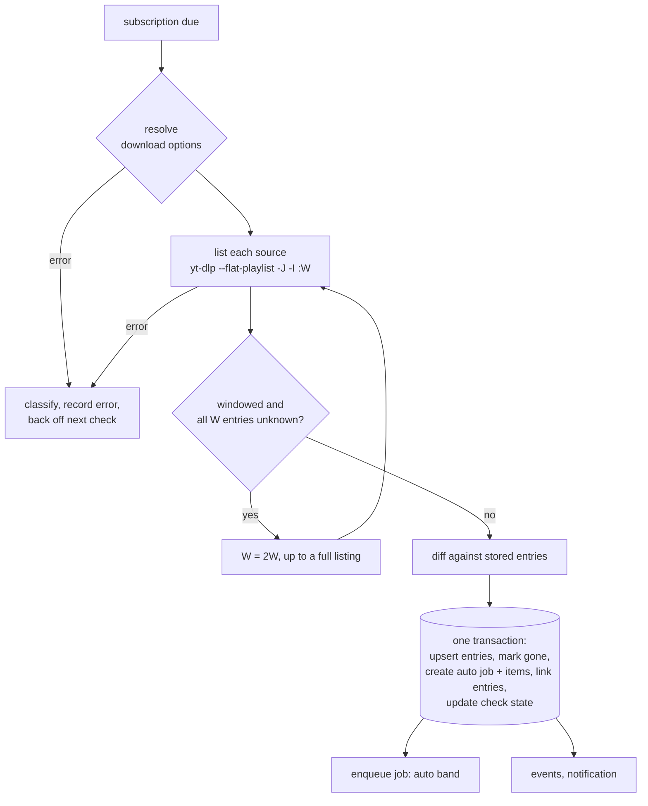

# Subscriptions Concept

> Status: **Implemented** (phases S-1 to S-3, [§13](#13-rollout)). All decisions are recorded in [§14](#14-decisions). The manual run against YouTube from the S-1 exit criteria was done on 2026-10-27; its results are in [Appendix A](#appendix-a-yt-dlp-calls). · 2026-10-14, revised 2026-10-27
> Scope: server, web UI, browser add-on
> Builds on [overhaul-concept.md](overhaul-concept.md), which lists subscriptions as "later" in §13.

## 1. Summary

A **subscription** watches one channel, playlist or other listing URL. A background loop checks it on a schedule and records every video it finds as an **entry**. Each subscription runs in one of two modes:

- **Auto** ("all new videos"): new videos are downloaded without asking.
- **Manual**: new videos land in an inbox, and the user clicks *Download* (or *Ignore*) per video, or for a selection.

A subscriptions page lists all subscriptions with their state, and a feed shows the newest videos across all of them.

Subscriptions never download anything themselves. They **create ordinary jobs with pre-planned items**, and from there the existing pipeline takes over. The archive, the integrity invariants, retries, site rules, cookies and naming all keep working unchanged.

**Core decisions**

| # | Decision |
|---|----------|
| S1 | **A subscription only creates jobs.** It never touches the library or the archive. Invariants 1–5 ([overhaul §4.5](overhaul-concept.md#45-file-integrity-design)) stay as they are. |
| S2 | **Entries are stored; their status is derived.** An entry records what the listing showed (key, title, URL, dates) plus the user's decision (*ignored*). Whether it is *in library*, *queued* or *failed* is computed from the archive and the linked item, so there is no second state machine to keep in sync. |
| S3 | **Auto mode queues only newly discovered entries.** An entry is considered for automatic download once, in the check that discovers it. Failed, deleted or cancelled downloads are never queued again automatically. This avoids retry loops for private or members-only videos ([overhaul D9](overhaul-concept.md#1-summary)). The one exception is premieres and upcoming streams ([§5.3](#53-auto-queue-rules)). |
| S4 | **Nothing from the past is downloaded unless asked.** When a subscription is created, or a source is added to it later, the videos that already exist in that source are the **backlog**. By default the backlog is not downloaded; when subscribing, the user chooses *none*, *latest N* or *all*. |
| S5 | **Checks list cheaply.** Channel tabs are newest-first, so a regular check lists only the newest 50 entries (`-I :50`), and lists more only if all 50 are unknown. A full listing runs on the first listing of each source, weekly, and on demand. |
| S6 | **Checks are separate from downloads.** They run in their own loop with low concurrency, run one at a time per site, and respect the scheduler's per-site cooldowns. A check never holds a download slot. |
| S7 | **Automatic downloads run in background bands.** Jobs created by auto mode queue behind interactive jobs, and backlog downloads queue behind both. Together they use at most `backgroundSlots` (default 1) slots. A background job gives up its slot between two items when a job of a higher band is waiting for it. A URL pasted by hand therefore waits for at most one subscription video, never for 40, and a new video never waits for a backlog of 2000 ([§4.3](#43-how-subscriptions-create-jobs)). |
| S8 | **Safety cap.** If one check finds more new entries than `autoQueueCap` (default 25), auto mode queues none of them and asks the user to review. This catches a changed channel URL or a broken listing before it turns into hundreds of downloads. |
| S9 | **One folder per subscription, in a library of its choice.** Items get the subscription's folder as `playlist_title`, so both naming presets put them in `<library>/<folder>/…`. The folder defaults to the subscription name and can be set separately, and the library can be chosen per subscription. Both can be edited later. That affects only new downloads: existing folders are never renamed or moved. |
| S10 | **Interval schedule, not cron syntax.** Each subscription is checked every N hours (global default 6 h, minimum 15 min) with ±10 % jitter. `POST /api/v1/subscriptions/check` lets an external cron trigger checks if someone wants exact times ([§14](#14-decisions)). |

## 2. Goals and non-goals

**Goals**

1. Subscribe to channels (with a choice of tabs) and playlists from any site yt-dlp can list.
2. Per subscription: download everything new automatically, or pick videos by hand.
3. One page that shows all subscriptions, their health, and what is new.
4. Gentle on sites: few requests per check, no request bursts, and rate limits are respected.
5. Crash-safe and idempotent like the rest of the server: no lost and no doubled automatic downloads.

**Non-goals**

- **Deleting old videos** (for example "keep only the last 10"). The server never deletes library content on its own ([§14](#14-decisions)).
- The TV-show NFO mode (`tvshow.nfo` per channel). It fits subscriptions well, but it is its own feature ([overhaul §13](overhaul-concept.md#13-additional-improvements)).
- Multi-user subscriptions or per-user feeds.
- Site-specific fast paths such as YouTube RSS feeds ([§13](#13-rollout)).

## 3. Terms

| Term | Meaning |
|---|---|
| **Subscription** | A named set of options with one or more **sources**, a mode, filters and a schedule. |
| **Source** | A listing URL: a channel tab (`…/@name/videos`), a playlist, or anything else yt-dlp returns entries for. A YouTube channel with *Videos* and *Live* selected has two sources. Each source has its own check state. |
| **Check** | One run of the listing for all sources of a subscription. It records entries and, in auto mode, creates a job. |
| **Entry** | One video seen in a source, identified by its archive key (`"youtube <id>"`). |
| **Inbox** | Entries discovered *after* the first listing of their source that are neither downloaded nor ignored. |
| **Backlog** | Entries found by the first listing of their source (they existed before it was subscribed) that are neither downloaded nor ignored. |

## 4. Model

### 4.1 Subscription

| Field | Notes |
|---|---|
| `name` | Display name. Defaults to the channel or playlist title from the preview; a listing without names is named after the last path segment of its URL that is not generic (`/users/<name>/videos` → `<name>`), else its id. |
| `folder` | Folder in the library (S9). Empty means the name, so the folder follows the name until it is set. It is a single folder level, sanitized like any `playlist_title` (`library/sanitize.go`). Folders don't have to be unique: subscriptions with the same folder in the same library share it, for example a *Videos* and a separate *Shorts* subscription of one channel. The UI shows when a folder is shared ([§14](#14-decisions)). |
| `sources` | One or more listing URLs in their own table (`subscription_sources`, [§9](#9-persistence)). Each source keeps the URL as entered and a **canonical URL**, which is unique across all subscriptions (a database constraint). For a YouTube channel tab, the canonical URL is built from the channel ID (`…/channel/<id>/<tab>`), so `…/@name/videos` and `…/channel/UC…/videos` count as the same source, and a renamed handle doesn't break the subscription. Other URLs are normalized like job URLs (`config.NormalizeURL`). Checks list the canonical URL. Each source has its own check state: first successful listing, last full listing, error. Sources can be added and removed later ([§5.2](#52-check-algorithm)). |
| `mode` | `auto` or `manual`. New subscriptions default to `manual`. It can be switched at any time. Switching to `auto` does **not** queue the current inbox; the UI offers *Download inbox* separately. Switching to `manual` does not cancel jobs that were already queued. |
| `enabled` | `false` = paused. A paused subscription is not checked and queues nothing. Its entries stay visible, and jobs that were already queued keep running. |
| `filters` | Minimum/maximum duration, title include/exclude (RE2 regex, max 200 chars, case-insensitive), *published after*. Filters use only what the listing reports. An entry whose duration or upload date is unknown passes the filter on that value ([§14](#14-decisions)). Entries that don't match are **ignored with a reason** (`filter: shorter than 2:00`). They stay visible under *Ignored* and can still be downloaded by hand. Filters apply in both modes, so they also keep the inbox clean. When the filters change, all *new* and *backlog* entries and all entries ignored by a filter are evaluated again: entries that now fail get the new reason, and entries that now pass go back to *new* or *backlog*. Auto mode does not queue them (S3). Entries ignored by the user are not touched ([§14](#14-decisions)). |
| `requested` | `config.OptionsRequest` for its jobs: preset, container, all audio, subtitles, impersonate, cookie profile, library, yt-dlp version. They are resolved per job with the usual precedence **subscription option > site rule > global default** ([overhaul §7.2](overhaul-concept.md#72-site-rules)), so "Default" follows later changes to the global settings. The library uses the existing libraries (*Settings → Libraries*, `LIBRARIES`) and the global default library. The add dialog shows it next to the folder, not under the download options ([§7.4](#74-add-dialog)). |
| `interval` | Check interval, 15 min to 7 days. `0` = the global default. |
| `listing` | `auto` (window for channel tabs, full listing otherwise), `window` or `full`. Set in *Edit → Advanced*. See [§5.2](#52-check-algorithm). |
| `notify` | Send a notification when a check finds new entries. This is mainly useful in manual mode. |
| `backlog` | The backlog choice from the add dialog (*none*, *latest N*, *all*). The first check applies it and then clears it. |
| `kind`, `uploader`, `thumbnail` | From the preview, updated by every successful listing of the first source. `kind` is `channel` if the listing's `id` equals its `channel_id` or `uploader_id`, else `playlist`. The thumbnail is the channel avatar (`avatar_uncropped`) if the listing has one, else its first thumbnail. |
| Check state | `last_check_at`, `last_ok_at`, `next_check_at`, `failures`, `error`, `error_class`, `hint`, `warning` (for example "cap exceeded"). `error` is the worst error of the sources, which keep their own. |

### 4.2 Entries and their status

An entry stores what the listing showed: key, URL, title, duration, upload date (approximate for YouTube listings, see [Appendix A](#appendix-a-yt-dlp-calls); an approximate date is kept from the first listing, because it drifts between checks), thumbnail URL, `live_status` and `availability` if reported, the source that listed it first and its position there, `first_seen_at`, `last_seen_at`, `gone_at`, whether the first listing of its source found it (`backlog`), and a `sort_date` that all lists sort by (the upload time if known, else `first_seen_at`). It also stores the user decision `ignored` (with `ignore_reason`) and a link `item_id` to the item that last downloaded it.

The status shown in the UI is **derived** at read time (S2), in this order. The first match wins:

| Status | Condition | Actions in the UI |
|---|---|---|
| **Queued / downloading** | The linked item is not terminal | *Show job*, *Cancel* |
| **In library** | The archive contains the entry's key | *Show in Downloads*, *Re-download (force)* |
| **Ignored** | `ignored = 1` | *Download*, *Unignore* |
| **Upcoming** | `live_status` is `is_upcoming`, `is_live` or `post_live`, or the linked item failed with "not available yet" and the entry was discovered less than `upcomingDays` ago | none (waits) |
| **Failed** | The linked item is `failed` or `cancelled` | *Retry*, *Ignore*, the failure hint from the classifier |
| **New** | `backlog = 0` | *Download*, *Ignore* |
| **Backlog** | everything else | *Download*, *Ignore* |

*Queued* comes before *In library* so that a forced re-download of an entry in the library shows as downloading. *Upcoming* comes before *Failed* because a premiere fails with "not available yet" until it starts.

- **Gone**: if an entry is missing from a full listing, it gets `gone_at` and a "removed from source" badge. Files in the library are not touched. If it reappears, `gone_at` is cleared.
- Deleting or clearing a job deletes its items, which sets `item_id` to `NULL`. The entry then falls back to *in library* (if it was finalized) or *new/backlog*. Auto mode does not queue it again (S3).
- **Key changes**: the pipeline can re-key an item after fetching its metadata (`pipeline/item.go`, `keyBefore`). `Store.FinalizeItem` updates the key of the entries with the old key in the same transaction that writes the archive record, so they still match the archive after the job is pruned. If a subscription already has an entry with the new key (for example, one source listed the video as `url …` and another one with its ID), the two are merged instead: the entry with the new key is kept and takes over `item_id`, and the other one is deleted. A plain `UPDATE` would violate `UNIQUE (subscription_id, key)` and fail the finalize transaction, and subscription bookkeeping must never block a finalize (invariant 4). The old key stays the entry's `listing_key`, and checks match listing entries by key or listing key: listings keep reporting the video under its old key, so without it the next check would record the video as new again (and queue it in auto mode), and the next full listing would mark the re-keyed entry gone.
- **No key**: if a listing gives no extractor key or ID, the entry uses `url <normalized url>` as its key. It is still listed and can be downloaded, and its status follows the linked item. Its download re-keys it to the archive key (see above). Whether such an entry is in the library can only be told once its metadata is fetched: an item that turns out to be in the archive already is skipped and re-keys its entries as well, so they show as *in library*.
- **Not a video**: a listing entry that is itself a listing (`_type: playlist`, or a URL entry whose extractor is a tab or playlist extractor such as `YoutubeTab`) is stored as ignored with the reason `not a video`. This only affects the display. The pipeline has the guard that matters ([§4.3](#43-how-subscriptions-create-jobs)).

### 4.3 How subscriptions create jobs

Every download of a subscription is an ordinary job with **pre-planned items**. `Pipeline.Run` already skips the probe when a job has items, so each video is extracted only once, just in time, in *fetch meta*.

| Trigger | Job | Band |
|---|---|---|
| Auto mode: a check finds N new entries | One job, N items, title `"<name>: 3 new videos"` (or `"<name>: <video title>"` for one) | auto |
| *Download all new*, *Download inbox* | One job with these entries | auto |
| Backlog choice at creation, *Download backlog…* | One job with the chosen entries | backlog |
| *Download* on one entry, or *Download selected* | One job with these entries | interactive |
| *Download* or *Retry* on a failed entry | A new one-item job. `Manager.Retry` works on whole jobs and would also reset the other failed items of the old job, which S3 forbids ([§14](#14-decisions)) | interactive |
| An upcoming entry becomes available ([§5.3](#53-auto-queue-rules)) | A new one-item job, never a retry of the old job, for the same reason | auto |

- Items get the subscription's folder (or its name, if no folder is set) as `playlist_title`, which puts them in that folder (S9). The library comes from the subscription's options and is resolved per job like any other option. Items whose key is already in the archive are created as `skipped`, as `newItems` does today.
- Job titles: `"<name>: <video title>"` for a single item, otherwise `"<name>: N new videos"` (auto band), `"<name>: N videos from the backlog"` (backlog band) or `"<name>: N videos"` (interactive).
- New job columns: `subscription_id` (`ON DELETE SET NULL`) and `band` (interactive, auto, backlog). The job `url` is the first source, for display and site-rule matching. `norm_url` stays empty, so subscription jobs are not part of the URL duplicate check. Duplicates are prevented per entry instead: an entry with an active item is not queued again, and the archive plus the key locks catch the rest.
- Items run sequentially within the job, as for playlists today, **oldest first**: by `sort_date`, and for equal dates by position, which runs newest-first in a channel tab and oldest-first in a playlist. A check that finds 5 videos therefore downloads them one after another, and they reach the library in the order they were published ([§14](#14-decisions)).
- **Subscription jobs never probe or expand.** The job `url` is the first source, so a probe would turn the job into a download of the whole channel. `Pipeline.Run` therefore fails a subscription job without items instead of probing it. A subscription item whose metadata turns out to be a playlist fails as `permanent` ("not a single video") instead of being expanded (`pipeline/item.go`, `expandItem`). Otherwise one item could turn into hundreds and bypass `autoQueueCap` (S8).

**Bands (S7)**

The scheduler gets three queue bands. **Interactive** holds everything a user starts by hand and all jobs outside subscriptions, **auto** holds new videos, and **backlog** holds backlog downloads. `scheduler.Job` gains `Band`. Dispatch starts jobs by band, then by queue position. An auto or backlog job (a *background job*) starts only when no **startable** job of a higher band is waiting and fewer than `backgroundSlots` background jobs are running. A job is startable if neither its `NotBefore`, a cooldown nor its site limit blocks it, so a job waiting hours for its retry backoff doesn't hold back a lower band. Background jobs count against `MAX_CONCURRENT` as usual, and per-site limits and cooldowns apply to all bands. *Start now* works for background jobs as well.

**Yielding ([§14](#14-decisions)).** The bands alone do not keep S7. A background job holds its slot until all its items are done. With a site rule that allows one download at a time, a pasted URL of the same site would wait for the whole job. With `backgroundSlots = 1`, new videos of every subscription would wait for a backlog of 2000. So between two items, the pipeline asks the scheduler whether this job is blocking a startable job of a higher band, through the global limit, `backgroundSlots` or the same site limit (`Scheduler.ShouldYield(id)`, answered by the loop goroutine). If so, the job returns `Requeue` and goes back to its band, and the other job gets the slot. Items are resumable (invariant 5), so yielding costs nothing. A job started with *Start now* never yields.

## 5. Checks

### 5.1 Schedule

- `next_check_at` is stored per subscription. After a check, `next_check_at = now + interval × (1 ± 0.1 jitter)`. A restart therefore never triggers a burst of checks: overdue subscriptions are simply processed in `next_check_at` order under the limits below.
- *Check now* (one subscription) and *Check all* set `next_check_at = now`. `POST /api/v1/subscriptions/check` does the same for all enabled subscriptions, or for those listed in the request body. It is meant for an external cron or a script.
- The global default interval is 6 h and the minimum is 15 min. *Pause all* in the settings stops all checks without changing any subscription.

### 5.2 Check algorithm



- **Options first.** A check resolves the subscription's download options (library, preset, cookie profile, yt-dlp version) before it lists anything. If that fails, for example because a library was removed, the check fails as `permanent` with an error such as *"unknown library 'Kinder'"* and records nothing. New videos are therefore not used up (S3): the first check after the fix finds and queues them. The next check is in 24 h, but restoring a library, site rule or cookie profile makes every subscription whose options now resolve due at once. Before a library, preset or cookie profile is removed, *Settings* lists the subscriptions that use it ([§14](#14-decisions)).
- **Window vs full listing.** `listing = auto` uses a window for sources that are known to list newest first. YouTube channel tabs are known up front: they are detected from the URL path (`/videos`, `/shorts` or `/streams`) and stored as `tab`, so this also works for imported sources without a preview. All other sources get a full listing until their order is confirmed, because new videos in a playlist can appear at the end. Full listings also run on the first listing of a source, every `fullRescanDays` (default 7, per source) and on *Full rescan*. The request is stored (`full_requested`), so it survives a restart, and only the commit of the check that listed everything clears it.
- **Order of a source.** Each source stores whether it lists newest first (`newest_first`) and whether that is confirmed (`order_known`). The order decides the `sort_date` of entries without a date (the listing order within one listing) and which entries *latest N* takes. A YouTube tab lists newest first. Otherwise a listing with dates tells the order from its first and last dated entries, and a listing without dates confirms it once a complete listing shows new entries as a block at the start (newest first) or at the end (oldest first). Until then the order is a guess: YouTube playlists and listings whose extractor names a playlist, album, set, collection, series, season or course keep playlist order, other channel and user pages list newest first. A guess only affects sorting, never the window, so a wrong guess can't hide new videos. If a confirmed order differs from the guess, the undated entries of the source are sorted again. The check log notes when an order is confirmed.
- **Gap detection.** If a windowed listing contains no known entry (an entry of the subscription with the same key, including ignored and gone ones), the channel published more than W videos since the last check (or its order changed). The window doubles until a known entry appears or the listing is complete.
- **Gone detection** happens only after full listings of *all* sources succeeded. A windowed or partly failed check never marks anything gone.
- **Merge.** Entries from several sources are merged by key. An entry belongs to the source that listed it first (`source_id`). Its URL and position come only from that source, and every listing of that source updates the position. The other fields are updated from the newest listing of any source.
- **First listing of a source.** Everything the first successful listing of a source finds is backlog (`backlog = 1`), unless the subscription already has an entry with that key. This holds for the first check of a new subscription and for a source added later, so adding the *Shorts* tab to an auto subscription never queues the whole tab. `first_ok_at` stays empty until that listing succeeds, and the next check tries again.
- **Backlog choice.** Once the first listings of all initial sources have succeeded, the backlog choice is applied: *none* (default), *latest N* or *all*. *Latest N* takes the N entries with the newest `sort_date` across all sources. For equal dates it uses the position within one source: the lowest positions in a source that lists newest first, the highest in a playlist. Positions from different sources are never compared. The choice is stored, applied once, and then cleared. A source added later has no backlog choice. Its backlog can be downloaded with *Download backlog…*.
- **Removing a source** keeps its entries with `source_id = NULL`. A later listing of another source that contains them takes them over. If no source does, the next full rescan marks them gone.
- **Check log.** Every check writes to `DATA_DIR/logs/subscriptions/<id>.log` (a second `joblog.Manager`, capped at 512 KB, tail kept): a header with the yt-dlp version, the sources and the window, the yt-dlp output on errors, and a summary line such as `Checked 2 sources: 50 listed, 2 new, 2 queued (job #123), 1 ignored by filter`. The log is deleted together with the subscription.

### 5.3 Auto-queue rules

In auto mode, a check queues an entry only if **all** of these hold:

1. It was discovered in this check and is not backlog (the first listing of a source only records the backlog).
2. It passes the filters. If not, it is ignored with the filter as its reason.
3. Its key is not in the archive.
4. It is not upcoming, live or post-live.
5. The number of entries that pass 1–4 is at most `autoQueueCap` (S8). Otherwise **nothing** is queued, the subscription gets the warning *"Found 312 new videos (limit 25). Review them before downloading."*, and the entries stay in the inbox. The warning stays until a later check stays within the cap or the user dismisses it. A notification is sent if `onFailed` is on ([§11](#11-notifications-and-integrations)).

**Upcoming videos and premieres.** If the listing reports `live_status` `is_upcoming`, `is_live` or `post_live`, the entry waits. `post_live` is a stream that just ended and is still being processed, and a download at that point is often incomplete. The first check whose listing no longer reports any of these queues it, however long it waited ([§14](#14-decisions)). In manual mode it shows as *new* instead. If the entry has fallen out of the window by then, the next full listing sees the change.

If the listing doesn't report `live_status` and the download fails with the classifier's "not available yet" reason (`classify.go`, class `permanent`), the entry becomes *upcoming*. The listing will never report a change for such an entry, so every later check queues it again, at most once per check, until a download succeeds or `upcomingDays` (default 7) have passed since the entry was discovered ([§14](#14-decisions)). With the default interval, that is at most 28 attempts.

Each of these queues is a new one-item job in the auto band ([§4.3](#43-how-subscriptions-create-jobs)). After `upcomingDays`, an entry on the classifier path stays *failed* and needs a manual retry. These are the only cases where auto mode queues an entry after the check that discovered it (S3).

**Members-only and similar.** If the listing reports an `availability` such as `subscriber_only`, `premium_only` or `needs_auth`, and the resolved options have no cookie profile (from the subscription, a site rule or the global default), auto mode ignores the entry with the reason "needs cookies" instead of queueing a download that will fail. Every check evaluates these entries again. Once the resolved options have a cookie profile, they go back to *new* or *backlog*, and auto mode does not queue them (S3).

### 5.4 Politeness, errors and rate limits

- At most `checkConcurrency` (default 2) checks run at the same time, and at most one per site (using the same site key as the scheduler). Between two checks of the same site, the loop waits `siteDelaySeconds` (default 10 s, ±20 % jitter).
- Checks for a site that is in a scheduler cooldown (after HTTP 429) are postponed until the cooldown ends.
- Checks use the yt-dlp version and the call options (impersonation, cookie profile, sleep between requests) from the subscription's resolved options and site rule, as a job does. The version is normally the active one.
- Failed listings are classified with `ytdlp.Classify`. A check has no retries of its own: the next scheduled check is the retry, with backoff `min(interval × 2^(failures−1), 24 h)`.

| Class | Effect |
|---|---|
| `rate_limited` | Sets the site cooldown in the scheduler for `rateLimitCooldownMinutes`, as a job does (it pauses that site's downloads too), and postpones the check until the cooldown ends |
| `blocked` | The next check uses impersonation (`any`) if a target is available. If that listing succeeds, the source keeps using impersonation (`impersonate = 1`) until the subscription's options change ([§14](#14-decisions)). Hint as in [overhaul §4.7](overhaul-concept.md#47-failure-handling-and-retries) |
| `auth_required` | Error "Needs cookies". Checks continue with backoff |
| `permanent` (channel removed, private playlist) | Error state, checks continue once a day. The subscription is never deleted automatically |
| `extractor_broken` | Error plus hint. If `nightlyRetryOnBroken` is on, the next check uses the latest nightly once, as a job does ([overhaul §4.7](overhaul-concept.md#47-failure-handling-and-retries)). Later checks go back to the resolved version, which may have been updated in the meantime |
| `crash` | Error plus hint, backoff |
| `transient`, `unknown` | Backoff |

- Errors are recorded per source. If some sources fail, the check still records and queues the entries of the others, but marks nothing gone ([§5.2](#52-check-algorithm)). The subscription shows the worst error.
- The UI shows the error, the hint and the time of the next check on the subscription, for example *"⚠ Access denied by the site, next check 18:30"*.

### 5.5 Crash safety

- The listing runs outside any transaction. Everything a check changes (entries, the gone markers, the auto job with its items, the entry links, the check state) is written in **one SQLite transaction**. A crash before the commit changes nothing, and the check runs again. A crash after the commit leaves a queued job, which `enqueueOpen` picks up at startup. Automatic downloads therefore can't get lost (S3 would never retry them) or happen twice.
- At startup, subscriptions left in state `checking` go back to `idle` with `next_check_at = now`.
- A subscription is never checked twice at the same time. *Check now* during a running check does nothing.
- A check can overlap with an edit or a delete, so its transaction reads the subscription and its sources again. Results of sources removed in the meantime are dropped, the mode and filters at commit time apply, and if the subscription was deleted, the check commits nothing.
- User actions (*Download*, *Ignore*) are conditional updates in one transaction: `item_id` is set only if the entry has no active item. A double click creates one job.
- Failpoints `subscription:listed` and `subscription:committed` let the integrity tests kill the process at both points ([§12](#12-testing)).

## 6. Adding a subscription

1. The user pastes a URL into *Add subscription* (or uses the add-on, [§11](#11-notifications-and-integrations)).
2. **Preview**: `POST /api/v1/subscriptions/preview` runs a listing with `-I :10` (timeout 60 s) and returns the title, uploader, kind (`channel` or `playlist`), thumbnail, the total count if the site reports it, the first entries, how many of them are already in the library, the canonical URL of each tab, and whether a subscription with one of these sources already exists (compared by canonical URL).
3. For a YouTube channel root URL (`/@name`, `/channel/…`, `/c/…`, `/user/…`), the preview lists the *Videos* tab, and the dialog offers the tabs **Videos** (preselected), **Shorts** and **Live**. Each selected tab becomes a source. If the URL is a single video, the preview switches to the video's channel (`channel_url` from its metadata) and says so, which makes *Subscribe* work on a video page. A single video without a channel returns `422` with the hint to subscribe to the channel or user page instead ([§14](#14-decisions)). A listing that fails because the URL does not exist says *"the channel or playlist does not exist or was removed"* (also in check errors), not the classifier's video wording.
4. The user sets the name, the library and folder ([§7.4](#74-add-dialog)), the mode (default **manual**, [§14](#14-decisions)), the backlog choice (default **none**, S4), the interval, and optionally filters and download options (the same option fields as *Retry with options…*).
5. *Subscribe* stores the subscription with `next_check_at = now`. The first check runs right away and fills the backlog.

## 7. Web UI

A new top-level entry **Subscriptions** sits next to *Downloads*. Its badge shows the total inbox count. It has two tabs, **Feed** and **Subscriptions**, and a detail page per subscription. Like the rest of the UI, it uses plain ES modules (`views/subscriptions.js`) and must work on a phone.

### 7.1 Subscriptions

```
┌───────────────────────────────────────────────────────────────────┐
│ ytdlp-nfo Server   Downloads  Subscriptions (7)  Archive   ⓘ  ⚙   │
├───────────────────────────────────────────────────────────────────┤
│  Feed (7) │ Subscriptions (12)        [+ Add subscription] [⟳ All] │
├───────────────────────────────────────────────────────────────────┤
│ ▣ Channel A        channel · Videos, Live   [Auto ▾]     ✓ 2 h ago │
│   412 listed · 37 in library · 0 new               next in 4 h  ⋮ │
│ ▣ Channel B        channel · Videos         [Manual ▾]   ✓ 2 h ago │
│   1 204 listed · 12 in library · 5 new ●           next in 4 h  ⋮ │
│ ▣ Some course      playlist                 [Auto ▾]     ⚠ 1 d ago │
│   Access denied by the site: try impersonation or cookies       ⋮ │
│ ▣ Channel C        channel · Videos         [Paused]      – never  │
└───────────────────────────────────────────────────────────────────┘
```

- One row per subscription: avatar, name, kind and sources, a mode switch (Auto / Manual / Paused) that works inline, counts, last check result, and next check.
- The ⋮ menu has *Check now*, *Full rescan*, *Edit*, *Show check log*, *Pause/Resume* and *Delete*.
- Sort by name, newest entry, or inbox count. A text filter is included.

### 7.2 Feed

```
├───────────────────────────────────────────────────────────────────┤
│ Show: [New ▾]  Subscription: [All ▾]  🔍 filter      ☐ select all │
├───────────────────────────────────────────────────────────────────┤
│ ☐ ▣ Video title …            Channel B · 2 h ago · 14:03  [⬇] [✕] │
│ ☐ ▣ Video title …            Channel B · 1 d ago · 42:10  [⬇] [✕] │
│ ☐ ▣ Video title …            Channel D · 3 d ago · 08:55  ⏳ queued │
├───────────────────────────────────────────────────────────────────┤
│ 2 selected:   [Download selected]   [Ignore selected]             │
```

- Entries of all subscriptions, newest first by `sort_date`. The default filter is **New** (the inbox); *All*, *Queued*, *Failed* and *Upcoming* are also available.
- ⬇ = *Download* (interactive band) and ✕ = *Ignore*. Rows update live through SSE. A queued row links to its job.

### 7.3 Subscription detail

```
┌───────────────────────────────────────────────────────────────────┐
│ ← Subscriptions                                                   │
│ ▣ Channel B                         [Check now]  [Edit]  [⋮]      │
│ Mode: ( ) All new videos   (•) Manual       ☐ Notify on new videos │
│ Sources: …/@channel-b/videos                                      │
│ Checked 2 h ago (50 listed, 2 new) · next in 4 h · every 6 h      │
│ Library: default · Folder: "Channel B" · Preset: Best · MKV       │
├───────────────────────────────────────────────────────────────────┤
│ New (5) │ Backlog (1 187) │ In library (12) │ Ignored (3) │ Failed (1) │
├───────────────────────────────────────────────────────────────────┤
│ ☐ ▣ Video title …                2026-10-13 · 14:03    [Download] │
│ ☐ ▣ Video title …                2026-10-12 · 42:10    [Download] │
│ ☐ ▣ Upcoming premiere …          in 3 h                ⏰ upcoming │
├───────────────────────────────────────────────────────────────────┤
│ [Download all new]   [Download backlog…]   [Ignore selected]      │
```

- Tabs follow the derived statuses from [§4.2](#42-entries-and-their-status). *Queued* and *Upcoming* entries have no tab of their own: they appear under *New* or *Backlog*, wherever they came from, with a badge. Tabs are paginated (50 per page) and searchable.
- *Download backlog…* asks for *latest N* or *all*, and shows the count and the total duration of the entries whose duration is known ([§14](#14-decisions)).
- *Delete* asks for confirmation and offers a checkbox *"Also cancel queued downloads of this subscription"*, which cancels its queued and running jobs as *Cancel* does. Library files, archive entries and finished jobs are kept.
- *Edit* warns when the folder or the library changes (or the name, if no folder is set): new videos go to the new place, and existing ones stay where they are (S9). It also shows when another subscription uses the same folder in the same library ([§14](#14-decisions)).
- Each source shows its own state, so an error in the *Live* tab is visible next to a working *Videos* tab.
- A cap warning (S8) shows above the tabs with *Download all new* and *Dismiss*.

### 7.4 Add dialog

```
┌ Add subscription ─────────────────────────────────────────────────┐
│ URL      [ https://…/@channel                     ] [Preview]     │
│ ▣ Channel B: channel, ~1 200 videos (12 already in library)       │
│   Latest: Video title … · Video title … · Video title …           │
│ Tabs     ☑ Videos   ☐ Shorts   ☐ Live                             │
│ Name     [ Channel B             ]                                │
│ Library  [ Kinder ▾ ]    Folder [ Channel B           ]           │
│          → /media/kinder/Channel B/                               │
│ Mode     (•) Manual   ( ) All new videos                          │
│ Existing (•) Don't download   ( ) Latest [10]   ( ) All           │
│ Check    [ Every 6 h (default) ▾ ]                                │
│ ▸ Filters (duration, title, date)                                 │
│ ▸ Download options (preset, container, cookies, …)                │
│                                          [Cancel]   [Subscribe]   │
└───────────────────────────────────────────────────────────────────┘
```

- **Library** sits next to the folder because together they decide where the videos end up. The field appears only when more than one library exists. *Default* follows the global default and shows which library that is, for example *Default (Kinder)*.
- **Folder** shows the name as a placeholder. Left empty, it follows the name.
- The **path preview** shows where new videos will go: the library path plus the sanitized folder. If the naming template has no `{playlist_title?}`, the preview says that the videos are not grouped in a folder. For this, `GET /api/v1/options` also returns the library paths and the effective naming template.

### 7.5 Elsewhere in the UI

- Job cards of subscription jobs show a link to the subscription. Background jobs carry a small "auto" or "backlog" badge in *Queued*.
- **Settings → Subscriptions** holds the global values from [§10](#10-settings).

## 8. API

All routes live under `/api/v1` and use the existing auth.

| Method | Path | Purpose |
|---|---|---|
| `POST` | `/subscriptions/preview` | `{url}` → title, kind, tabs, canonical URLs, count, sample entries, existing subscription. A video URL is resolved to its channel; `422` if it has none |
| `GET` | `/subscriptions?q=` | List with counts (inbox, backlog, in library, failed) and check state |
| `POST` | `/subscriptions` | Create `{name, folder, sources, mode, backlog, filters, options, intervalMinutes, notify}`. A YouTube channel root URL stands for its *Videos* tab, as in the add dialog and the import. Returns `409` if a source is already subscribed |
| `GET` | `/subscriptions/{id}` | Subscription with counts |
| `PATCH` | `/subscriptions/{id}` | Change mode, enabled, name, folder, filters, options, interval, listing, notify, sources. `{dismissWarning: true}` clears the cap warning. A new source starts with a first listing that records its backlog ([§5.2](#52-check-algorithm)). Returns `409` if a new source is already subscribed |
| `DELETE` | `/subscriptions/{id}?cancelQueued=` | Remove the subscription and its entries. The library, the archive and finished jobs stay |
| `POST` | `/subscriptions/{id}/check` | Check now, `{full: true}` for a full rescan |
| `POST` | `/subscriptions/check` | Check all, or `{ids}`. For external cron |
| `GET` | `/subscriptions/{id}/log` | Check log |
| `GET` | `/subscriptions/{id}/entries?status=&q=&offset=` | Entries with their derived status, newest first by `sort_date`, 50 per page |
| `GET` | `/feed?status=&subscription=&q=&offset=` | Entries across all subscriptions |
| `POST` | `/subscriptions/entries/download` | `{ids}` or `{subscription, status: "new" \| "backlog", latest?: N}` → created job. *Retry* on a failed entry uses it too |
| `POST` | `/subscriptions/entries/ignore` | `{ids, ignored: true \| false}` |
| `POST` | `/subscriptions/import` | `{format: "urls" \| "opml" \| "youtube-csv", data}` → created subscriptions and skipped sources ([§11](#11-notifications-and-integrations)) |
| `GET` | `/subscriptions/export?format=urls\|opml` | All sources as a URL list or OPML |

**Events** on the global SSE stream:

- `subscription`: state, counts and check result. Published when a check starts and finishes, and on every change.
- `subscription_removed`
- `entries`: `{subscription, changed}`, throttled to one per check and action. The UI reloads the visible page instead of receiving every row.
- The existing `counts` event gains `inbox`, the total for the navigation badge.

## 9. Persistence

Schema migration 2 (later migrations add the columns marked with their number):

```sql
CREATE TABLE subscriptions (
	id INTEGER PRIMARY KEY AUTOINCREMENT,
	name TEXT NOT NULL,
	folder TEXT NOT NULL DEFAULT '',       -- library folder; '' = name
	kind TEXT NOT NULL DEFAULT '',         -- channel | playlist
	uploader TEXT NOT NULL DEFAULT '',
	thumbnail TEXT NOT NULL DEFAULT '',
	mode TEXT NOT NULL,                    -- auto | manual
	enabled INTEGER NOT NULL DEFAULT 1,
	backlog TEXT NOT NULL DEFAULT '{}',    -- choice applied by the first check, then cleared
	filters TEXT NOT NULL DEFAULT '{}',
	requested TEXT NOT NULL DEFAULT '{}',  -- config.OptionsRequest for its jobs
	interval_minutes INTEGER NOT NULL DEFAULT 0,
	listing TEXT NOT NULL DEFAULT 'auto',  -- auto | window | full
	notify INTEGER NOT NULL DEFAULT 0,
	state TEXT NOT NULL DEFAULT 'idle',    -- idle | checking | error
	failures INTEGER NOT NULL DEFAULT 0,
	error TEXT NOT NULL DEFAULT '',
	error_class TEXT NOT NULL DEFAULT '',
	hint TEXT NOT NULL DEFAULT '',
	warning TEXT NOT NULL DEFAULT '',
	last_check_at INTEGER,
	last_ok_at INTEGER,
	next_check_at INTEGER,
	created_at INTEGER NOT NULL,
	updated_at INTEGER NOT NULL,
	full_requested INTEGER NOT NULL DEFAULT 0 -- migration 5: Full rescan requested (§5.2)
);
CREATE INDEX subscriptions_due ON subscriptions(enabled, next_check_at);
CREATE TABLE subscription_sources (
	id INTEGER PRIMARY KEY AUTOINCREMENT,
	subscription_id INTEGER NOT NULL REFERENCES subscriptions(id) ON DELETE CASCADE,
	url TEXT NOT NULL,                     -- as entered, for display
	canonical TEXT NOT NULL UNIQUE,        -- listed by checks; channel ID based for YouTube
	tab TEXT NOT NULL DEFAULT '',          -- YouTube tab: videos | shorts | streams, else ''
	added_at INTEGER NOT NULL,
	first_ok_at INTEGER,                   -- first successful listing; NULL = the next one records backlog
	last_ok_at INTEGER,
	last_full_at INTEGER,
	impersonate INTEGER NOT NULL DEFAULT 0, -- 1 after a blocked listing succeeded with impersonation
	error TEXT NOT NULL DEFAULT '',
	error_class TEXT NOT NULL DEFAULT '',
	newest_first INTEGER NOT NULL DEFAULT 0, -- migration 4: lists newest first (guessed until order_known)
	order_known INTEGER NOT NULL DEFAULT 0   -- migration 4: the order was confirmed (§5.2)
);
CREATE INDEX subscription_sources_sub ON subscription_sources(subscription_id);
CREATE TABLE subscription_entries (
	id INTEGER PRIMARY KEY AUTOINCREMENT,
	subscription_id INTEGER NOT NULL REFERENCES subscriptions(id) ON DELETE CASCADE,
	key TEXT NOT NULL,                     -- archive key, or "url <normalized url>"
	url TEXT NOT NULL,
	title TEXT NOT NULL DEFAULT '',
	duration REAL NOT NULL DEFAULT 0,
	upload_date TEXT NOT NULL DEFAULT '',  -- YYYYMMDD, may be approximate
	sort_date INTEGER NOT NULL,            -- upload time if known, else first_seen_at
	thumbnail TEXT NOT NULL DEFAULT '',
	live_status TEXT NOT NULL DEFAULT '',
	availability TEXT NOT NULL DEFAULT '',
	source_id INTEGER REFERENCES subscription_sources(id) ON DELETE SET NULL, -- source that listed it first
	position INTEGER NOT NULL DEFAULT 0,   -- in that source
	backlog INTEGER NOT NULL DEFAULT 0,    -- 1 = found by the first listing of its source
	first_seen_at INTEGER NOT NULL,
	last_seen_at INTEGER NOT NULL,
	gone_at INTEGER,
	ignored INTEGER NOT NULL DEFAULT 0,
	ignore_reason TEXT NOT NULL DEFAULT '', -- '' = by the user, else "filter: …" / "needs cookies"
	item_id INTEGER REFERENCES items(id) ON DELETE SET NULL,
	listing_key TEXT NOT NULL DEFAULT '',   -- migration 3: the key listings report, if it was re-keyed
	UNIQUE (subscription_id, key)
);
CREATE INDEX subscription_entries_key ON subscription_entries(key);
CREATE INDEX subscription_entries_item ON subscription_entries(item_id);
CREATE INDEX subscription_entries_source ON subscription_entries(source_id);
CREATE INDEX subscription_entries_sub_sort ON subscription_entries(subscription_id, sort_date);
CREATE INDEX subscription_entries_sort ON subscription_entries(sort_date);
ALTER TABLE jobs ADD COLUMN subscription_id INTEGER REFERENCES subscriptions(id) ON DELETE SET NULL;
ALTER TABLE jobs ADD COLUMN band INTEGER NOT NULL DEFAULT 0; -- 0 interactive, 1 auto, 2 backlog
```

- The derived status ([§4.2](#42-entries-and-their-status)) is one query with `LEFT JOIN archive` and `LEFT JOIN items`. Counts per subscription use the same expression with `GROUP BY`. No index can filter by a derived status, so the counts are cached in memory per subscription. They are recomputed (debounced) after a check, after a user action and when a linked item reaches a terminal state, not for every event. Lists walk the two `sort_date` indexes and check the derived status row by row, so a page stops after 50 matches instead of computing the status of every entry. The benchmark in [§12](#12-testing) keeps a page under 100 ms with 200 000 entries.
- Entries are only deleted together with their subscription. Removing a source keeps them ([§5.2](#52-check-algorithm)). Gone entries that were never downloaded are pruned after `pruneGoneDays` ([§10](#10-settings)). This is off by default, like the job auto-prune.
- **Packages**:
  - `internal/store/subscriptions.go`
  - `internal/subscriptions/`: the check loop, listing, diff and filters. It is a single goroutine like the scheduler.
  - `internal/manager/subscriptions.go`: the operations and the transaction that creates jobs
  - `internal/api/subscriptions.go`

## 10. Settings

`config.Settings` gains `subscriptions`:

| Setting | Default | Range | Notes |
|---|---|---|---|
| `paused` | `false` | – | Pause all checks |
| `intervalMinutes` | `360` | 15–10080 | Default interval |
| `checkConcurrency` | `2` | 1–10 | Parallel checks (always at most one per site) |
| `siteDelaySeconds` | `10` | 0–300 | Pause between checks of the same site |
| `window` | `50` | 10–500 | Window size for newest-first sources |
| `fullRescanDays` | `7` | 1–90 | Full listing interval, which detects gone entries and gaps |
| `autoQueueCap` | `25` | 1–1000 | Safety cap per check (S8) |
| `backgroundSlots` | `1` | 1–50 | Slots for auto and backlog jobs together (S7), still limited by `maxConcurrent` |
| `upcomingDays` | `7` | 1–30 | How long an entry that failed with "not available yet" is queued again ([§5.3](#53-auto-queue-rules)) |
| `pruneGoneDays` | `0` | 0–3650 | Delete gone entries that were never downloaded after this many days. `0` = never |

## 11. Notifications and integrations

- **Notifications** go through the existing channels (webhook, ntfy, Gotify, Discord). They contain no link, because the server has no public base URL ([§14](#14-decisions)).
  - New entries: one message per check that finds new entries, for example *"Channel B: 3 new videos"*, if the subscription has `notify` set.
  - Errors and cap warnings: one message when a subscription enters the error state or hits the cap, not on every check, if `onFailed` is on.
  - Auto jobs send the usual job notifications.
  - The webhook gets `{"event": "subscription.new" | "subscription.error" | "subscription.cap", "title", "message", "subscription": {"id", "name", "count"}}`, in the same shape as the job events (`"job.<state>"`).
- **Browser add-on**: a context menu entry and popup button *"Subscribe"*. It calls `/subscriptions/preview` and creates the subscription with the defaults: manual, no backlog, the *Videos* tab of a channel, and the channel of a video page. On `409` it shows "Already subscribed". The existing `POST /api/download` stays unchanged.
- **Import / export** ([§14](#14-decisions)):
  - Import formats: a list of URLs (one per line, `#` starts a comment), OPML (each `outline` with an `xmlUrl` or `htmlUrl`; a YouTube feed URL with `channel_id=` counts as that channel's *Videos* tab, unless `htmlUrl` names another tab of a channel, as the export does for *Shorts* and *Live* sources), and the CSV of a YouTube subscriptions export (a header row, then channel ID, URL, title).
  - Each imported channel becomes a subscription with its *Videos* tab. It is named after the title in the file, or after its first listing if the file has none. Imported subscriptions are manual with no backlog and use the default library and options. Their first checks are spread over one hour to avoid a burst.
  - The canonical URL comes from the file where possible, because the YouTube CSV and OPML contain channel IDs. For a handle URL in a plain list, the normalized URL serves until the first listing sets the canonical one. If the source then turns out to be subscribed already, it is removed again and the subscription gets a warning. Sources that are already subscribed at import time are skipped and reported.
  - Export writes the canonical URL of every source, either as a URL list or as OPML with one `outline` per source (`text` = subscription name, `htmlUrl` = canonical URL, and for YouTube channels `xmlUrl` = the channel's feed URL).
- **Jellyfin**: nothing new. Every finalized item already triggers the refresh.

## 12. Testing

The fake yt-dlp gets listing support. A playlist scenario can return **different entries per call** (`Playlist.Listings [][]string`, the n-th call uses the n-th listing) and honours `-I :N`.

| Scenario | Expected result |
|---|---|
| First check of a channel with 30 videos, backlog *none* | 30 backlog entries, no job |
| Second check finds 2 new videos, auto mode | One auto-band job with 2 items, oldest first, `playlist_title` = folder (the name by default), entries linked |
| A new video is already in the archive | Entry *in library*, no job |
| Manual mode, 2 new videos | Inbox = 2, no job. *Download* creates one interactive job |
| A check finds more new entries than `autoQueueCap` | No job, warning set, entries in the inbox |
| Window of 5, 7 new videos | The window doubles, all 7 are found |
| Item fails as `permanent`, next check | Not queued again (S3) |
| Item fails with "not available yet" | Each later check queues it again as a new one-item job, until it is downloaded or `upcomingDays` have passed |
| Listing reports `post_live` | Not queued until a later listing reports it as finished |
| A video disappears from a full listing | `gone_at` set. A windowed check never sets it |
| Listing returns HTTP 429 | Site cooldown set, check postponed, downloads of that site paused |
| Double *Download* click | Exactly one job |
| Delete a subscription during a running auto job | The job finishes, `subscription_id` becomes `NULL`, library unchanged |
| Subscription with folder "X" in a second library | Files land in `<second library>/X/…`. After the folder is changed, only new videos go to the new folder |
| Bands | An interactive job queued after 3 background jobs starts first. At most `backgroundSlots` background jobs run. An interactive job in retry backoff does not hold back the lower bands |
| Background job with 5 items, site rule with one slot, an interactive job of the same site queued during item 1 | The background job yields after item 1, the interactive job runs, then the background job continues with item 2 |
| A backlog job with 200 items runs, a check queues an auto job, `backgroundSlots` = 1 | The backlog job yields after its current item, the auto job runs, then the backlog continues |
| Subscribe to `…/@name/videos` while `…/channel/<id>/videos` is subscribed | `409` with the existing subscription |
| A library used by a subscription is removed | The check fails with "unknown library" and records nothing. After the library is back, the next check finds the new videos and queues them |
| Members-only entry without cookies, then a cookie profile is set | Ignored as "needs cookies", back to *new* at the next check, no job |
| The listing reports a premiere as `is_upcoming` for 10 days, then as a normal video | Queued by the first check after the change |
| Entry without a duration, filter "longer than 2:00" | Passes the filter |
| Preview of a single video URL | Preview of its channel. `422` for a video without a channel |
| A blocked listing succeeds with impersonation | Later checks of that source use impersonation |
| A subscription is edited or deleted during a check | Removed sources and a deleted subscription leave nothing behind. The new mode applies |
| Feed query with 200 000 entries (benchmark) | One page of 50 in under 100 ms |
| A source is added later (Shorts tab with 40 videos), auto mode | 40 backlog entries, no job |
| A channel outside YouTube without dates lists newest first | *Latest N* takes its newest entries. Checks list it completely until a new entry at the top confirms the order, then with a window |
| A source guessed newest first shows new entries at the end | Confirmed oldest first, undated entries sorted again, no window |
| A finalized item is re-keyed to a key that another entry of the subscription already has | Finalize succeeds, the entries are merged, the entry is *in library* |
| A listing without video IDs, an entry is downloaded, then a full listing | The entry is found by its listing key: no new entry, no job, not gone. An entry already in the archive shows as *in library* after *Download* |
| A listing entry is a playlist, or an item's metadata turns out to be a playlist | The entry is ignored as "not a video". The item fails, and nothing is expanded |
| *Retry* on one failed entry of a job with two failed items | A new one-item job. The other item stays failed |
| Forced re-download of an entry in the library | Status *downloading* until it finishes |
| Filters change | Filter-ignored entries that now pass go back to *new*, no job |

**Integrity**: `server/integrity_test.go` gets SIGKILL runs at `subscription:listed` and `subscription:committed`. After a restart, each new video is queued exactly once and invariants 1–5 hold.

## 13. Rollout

| Phase | Content | Exit criteria |
|---|---|---|
| **S-1 Engine** | Migration 2, store, check loop, listing args, diff, filters, auto-queue, bands in the scheduler, API without UI, fake yt-dlp listings | Tests from [§12](#12-testing) pass. `go test -race ./...` passes, including the integrity tests. A manual run against YouTube confirms the listing behavior from [Appendix A](#appendix-a-yt-dlp-calls) |
| **S-2 UI** | Subscriptions list, detail page, add dialog with preview, settings section, links from job cards | A channel can be added, switched between auto and manual, and downloaded entry by entry on desktop and phone |
| **S-3 Feed and integrations** | Feed tab, navigation badge, notifications, add-on *Subscribe*, import/export | The add-on can subscribe. An import of 200 channels doesn't cause a request burst |
| Not part of this concept | YouTube RSS fast path (one request instead of a yt-dlp call when nothing is new), TV-show NFO mode for subscription folders ([§2](#2-goals-and-non-goals)) | – |

## 14. Decisions

Decisions 1–6 were made on 2026-10-14, and 7–24 on 2026-10-27 after a review. They are reflected in the sections referenced.

| # | Topic | Decision | Where |
|---|---|---|---|
| 1 | Schedule | **Interval per subscription**, not cron syntax: global default 6 h, minimum 15 min, ±10 % jitter. Exact times are possible through `POST /api/v1/subscriptions/check` from an external cron. A per-subscription cron field can be added later as one extra column. | S10, [§5.1](#51-schedule) |
| 2 | Default mode | New subscriptions start in **manual** mode. Auto plus a wrong URL is the expensive mistake, and switching to auto takes one click. | [§4.1](#41-subscription), [§6](#6-adding-a-subscription) |
| 3 | Existing videos | The backlog is **not downloaded** by default. *Latest N* and *all* are opt-in when subscribing or later via *Download backlog…*. | S4, [§5.2](#52-check-algorithm) |
| 4 | Library folder | **One folder per subscription** (`playlist_title`), not `{channel}` from each video's metadata. It defaults to the subscription name and can be set separately, so several subscriptions can share a folder on purpose. It stays stable when the channel is renamed, and playlists get their own folder. Users who prefer `{channel}` can use a custom naming template. | S9, [§4.3](#43-how-subscriptions-create-jobs) |
| 5 | Retention | **No automatic deletion** ("keep only the last N videos", "delete after watching"). It conflicts with "the server never deletes library content". If it is wanted later: opt-in per subscription, moved to a trash folder, and a separate concept. | [§2](#2-goals-and-non-goals) |
| 6 | A video in two subscriptions | Downloaded **once**. The archive is global: the video lands in the folder of whichever subscription queued it first, and the other one shows it as *in library*. | [§4.2](#42-entries-and-their-status) |
| 7 | Background band | Background jobs **yield between two items** when a startable interactive job waits for their slot. One job per video was rejected because it means 25 job cards per check and no grouping. Accepting the wait was rejected because it breaks S7 for any site rule that allows one download at a time. | S7, [§4.3](#43-how-subscriptions-create-jobs) |
| 8 | Filter changes | Changed filters **re-evaluate** *new*, *backlog* and filter-ignored entries. Entries that now pass are not queued automatically (S3), and entries ignored by the user stay ignored. | [§4.1](#41-subscription) |
| 9 | Upcoming without `live_status` | **Every check queues it again** until `upcomingDays` have passed, which is at most 28 attempts at 6 h. Reading the start time from the error ("Premieres in 3 hours") was rejected because it depends on yt-dlp's message format. | [§5.3](#53-auto-queue-rules) |
| 10 | Shared folders | **Allowed.** Subscriptions with the same folder in the same library share it, and the UI shows that. Names don't have to be unique either. | [§4.1](#41-subscription), [§7.3](#73-subscription-detail) |
| 11 | *Retry* on one entry | **A new one-item job.** The old job keeps its failed item. An item-level retry in the job API would keep the history in one place, but subscriptions don't need it. It can come later on its own. | [§4.3](#43-how-subscriptions-create-jobs) |
| 12 | Library per subscription | Uses the **existing libraries** and the global default library; nothing new is needed for multiple libraries. The add dialog shows the library **next to the folder, with a path preview**, because the two decide where videos end up. *Default* follows the global default. | S9, [§4.1](#41-subscription), [§7.4](#74-add-dialog) |
| 13 | Backlog priority | **Three bands: interactive > auto > backlog.** Backlog jobs yield to auto jobs between two items, as background jobs yield to interactive ones (decision 7). Splitting a backlog into chunks was rejected because it only shortens the wait. | S7, [§4.3](#43-how-subscriptions-create-jobs) |
| 14 | Same channel, different URLs | Sources are unique by a **canonical URL**, built from the channel ID for YouTube. A warning alone was rejected because it still allows duplicate checks. | [§4.1](#41-subscription), [§6](#6-adding-a-subscription) |
| 15 | Removed library, preset or cookie profile | **The check resolves the options first** and fails without recording anything, so new videos are not used up. *Settings* lists the subscriptions that use the item. Blocking the removal was rejected because it makes cleaning up the settings awkward. | [§5.2](#52-check-algorithm) |
| 16 | Item order | **Oldest first**, so videos reach the library in the order they were published. | [§4.3](#43-how-subscriptions-create-jobs) |
| 17 | Listing arguments | Windowed listings pass **`--lazy-playlist -I :W`**, so yt-dlp stops paging once it has W entries. Full listings pass neither. The arguments in Appendix A are binding. Timeouts: 5 min for a windowed listing, 2 h for a full one (the first listing of a source with many thousand entries on a site with small pages takes long). | [§5.2](#52-check-algorithm), [Appendix A](#appendix-a-yt-dlp-calls) |
| 18 | Upcoming from the listing | Queued by the **first check that no longer reports it** as upcoming, live or post-live, however long it waited. `upcomingDays` only limits the classifier path (decision 9). | [§5.3](#53-auto-queue-rules) |
| 19 | Filters and missing data | Filters use **listing data only**. An unknown duration or upload date **passes**, and title patterns are case-insensitive. Rejecting unknown values would ignore everything on sites whose listings have no durations. | [§4.1](#41-subscription) |
| 20 | Video URL as a subscription | The preview **switches to the video's channel**, so *Subscribe* works on a video page. A video without a channel returns `422`. | [§6](#6-adding-a-subscription), [§11](#11-notifications-and-integrations) |
| 21 | Notifications | **No link**, because the server has no public base URL. New entries follow `notify` per subscription. Errors and cap warnings follow the global `onFailed`. A base URL setting can come later on its own. | [§11](#11-notifications-and-integrations) |
| 22 | Backlog estimate | The backlog dialog shows the **count and the total duration**, no size estimate. A size would need bitrates that the listing doesn't have. | [§7.3](#73-subscription-detail) |
| 23 | Import and export | Formats: URL list, OPML, YouTube CSV. Imported channels get **only the Videos tab**, manual mode, no backlog and the default library. | [§11](#11-notifications-and-integrations) |
| 24 | Blocked listings | A source that only lists with impersonation **keeps using it** until the subscription's options change, so it doesn't fail once per check. | [§5.4](#54-politeness-errors-and-rate-limits) |

## Appendix A: yt-dlp calls

These are the arguments the implementation uses (decision 17 in [§14](#14-decisions)). The common part is the same as for a probe (`ytdlp.ProbeArgs`).

```bash
# Windowed check (per source). <common> is CallOptions.common():
# --ignore-config --color no_color [--cache-dir …] [--impersonate …] [--cookies "$TMP/.cookies.txt"] [--sleep-requests …]
yt-dlp <common> --flat-playlist -J --lazy-playlist -I :50 \
  [--extractor-args youtubetab:approximate_date] \
  -- "$CANONICAL_URL"

# Full listing: the same without --lazy-playlist and -I.
# Preview: the same as a windowed check, with -I :10.
```

- `--extractor-args youtubetab:approximate_date` makes YouTube tab listings include an approximate `upload_date`/`timestamp`, which is needed for sorting, the *published after* filter and display. It is a **fixed, server-controlled** argument added only for YouTube tab sources. It is not user input, so it is consistent with "no free-form yt-dlp arguments" ([overhaul §11](overhaul-concept.md#11-security)).
- `--lazy-playlist` makes yt-dlp process entries as they arrive, so `-I :50` stops after the pages that hold 50 entries. Correctness doesn't depend on it: if a yt-dlp version pages further, a check only costs more requests. In the manual run, a channel tab needed 2 page requests for `-I :50` and 4 for `-I :100`, with or without `--lazy-playlist`.
- Timeouts: 60 s for a preview, 5 min for a windowed listing and 2 h for a full one. A timeout is classified as `transient`.
- Fields used from flat listings, what happens when one is missing, and what the manual run found (no decision depends on it):
  - `live_status` per entry. Without it, the classifier path in [§5.3](#53-auto-queue-rules) handles premieres. Not in the samples of the manual run.
  - `availability` per entry. Without it, members-only videos fail as `auth_required` and stay *failed* (S3). Not in the samples of the manual run.
  - `channel_id` at the top level. Without it, the canonical URL uses the top-level `id` if it is a YouTube channel ID, and the normalized URL otherwise. Always present for YouTube tabs.
  - `timestamp` / `upload_date` per entry. Without them, `sort_date` is `first_seen_at`. The *Videos* tab reports an approximate `timestamp` (day precision) and `duration`, but no `upload_date`. The *Shorts* tab reports neither a date nor a duration. Playlists report `duration` and `playlist_count`, but no dates.
- Many listings in a row from one address got HTTP 429 and then *"Sign in to confirm you're not a bot"*. After a 429, that check is classified as `rate_limited`, so it waits for the cooldown instead of failing as `auth_required`.
- Cookie profiles are copied per check, as they are per job ([overhaul §7.3](overhaul-concept.md#73-cookies)), because yt-dlp writes the cookie jar back to the file.
- Downloads use the existing calls unchanged: fetch meta, download, subtitles ([overhaul Appendix A](overhaul-concept.md#appendix-a-yt-dlp-invocation-sketch)).
